# TUF Tools 项目文档

> 本文档基于 `main` 分支 commit **`969546d`**（提交信息：`更新 PP 计算并整理本地数据管理`）的源码编写，描述的是该提交时仓库中的实际行为。文中标注的 `path:line` 均为该提交下的位置；代码继续演进后，请以源码为准。
>
> 覆盖范围：`src/` 下全部 C++ 源码、`CMakeLists.txt`、`build.sh` / `build.ps1`、GitHub Actions 发布流程、运行时数据文件与 TUF API 调用链。`third_party/` 只说明集成方式，不展开第三方库内部实现。
>
> 相关专题：[XACC 反推判定：算法与实现思路](xacc_reverse.md)（目标窗口、整数损失模型、精确 DP、分支定界、legacy 与等效组合的算法详解）。

## 目录

1. [项目概览](#1-项目概览)
2. [快速开始](#2-快速开始)
3. [仓库结构](#3-仓库结构)
4. [构建、版本与发布](#4-构建版本与发布)
5. [运行时架构](#5-运行时架构)
6. [模块详解](#6-模块详解)
7. [功能与调用链](#7-功能与调用链)
8. [数据与持久化](#8-数据与持久化)
9. [HTTP API 清单](#9-http-api-清单)
10. [算法与公式](#10-算法与公式)
11. [错误处理、并发与平台差异](#11-错误处理并发与平台差异)
12. [调试与可观测性](#12-调试与可观测性)
13. [扩展指南](#13-扩展指南)
14. [已知限制与风险](#14-已知限制与风险)
15. [源码索引](#15-源码索引)
16. [术语表](#16-术语表)

---

## 1. 项目概览

### 1.1 这是什么

**TUF Tools**（可执行文件 `tuftools`）是一个面向 [TUF](https://tuforums.com/) 的交互式命令行查询与计算工具。它是原 Python 工具集的 C++17 重写版本，最终产物是一个不依赖 Python 运行时的单文件可执行程序。

主要能力：

- **玩家数据查询**：按名称、Discord 用户名或玩家 ID 搜索；展示全球/地区排名、各类分数、平均 XACC、通关数、最高难度等。
- **通关记录浏览**：按玩家名分页拉取 `/v2/database/passes`，本地按 `playerId` 过滤后以自适应表格展示，支持分页与按难度筛选。
- **谱面查询**：按名称关键词或谱面 ID 搜索/读取谱面；展示谱面元数据；支持下载原始 ZIP、转换 ZIP、V2 `.adofai`。
- **PP 计算器**：按难度等级、API 谱面或手填 BaseScore 三种方式构造谱面数据；输入 XACC、空敲数、速度、NoHoldTap 等，计算 PP；可进一步估算排位分/全球排名/地区排名变化。
- **XACC 计算器**：按判定分布正算 XACC；按目标 XACC 反推判定分布；列出与最优解等效的判定组合；编辑难度系数与求解器预算；切换求解器。
- **HTTP 响应缓存**：按完整 URL 缓存响应体到 `cache.json`，支持 `--no-cache` 与主菜单清空缓存。
- **跨平台**：Windows 使用 WinHTTP，macOS/Linux 使用 libcurl；数据目录可在可执行文件旁或用户数据目录之间自动选择。

### 1.2 关键事实

| 项目 | 值 |
| --- | --- |
| 语言标准 | C++17（`CMAKE_CXX_STANDARD 17`） |
| 构建系统 | CMake ≥ 3.15；另有 `build.sh` / `build.ps1` 封装 |
| 第三方依赖 | `nlohmann/ordered_json` v3.11.3、`p-ranav/argparse` v3.1（均已 vendored） |
| 平台 HTTP | Windows：WinHTTP；macOS/Linux：libcurl |
| 默认 API | `https://api.tuforums.com`，可被 `TUFTOOLS_API_BASE` 覆盖 |
| 数据目录 | 可用 `TUFTOOLS_DATA_DIR` 覆盖；否则 exe 同目录 → 用户数据目录 |
| 数据文件 | `settings.json`（配置/难度库/预设/XACC 模型）、`cache.json`（HTTP 缓存） |
| 版本字符串 | 构建时写入 `build/generated/version.hpp` |
| 许可证 | MIT（见 `LICENSE`） |
| 源码规模 | `src/` 约 6,500 行 C++（不含 vendored 头文件） |
| 自动化测试 | 仓库中目前没有测试目录、测试目标或 CI 测试步骤 |

### 1.3 设计取向

从代码与注释可以归纳出几个明确的设计目标：

1. **控制台优先、零运行时依赖**：所有交互都是 `std::cin` / `std::cout` 的线性问答；Windows 静态链接 MinGW 运行时，macOS/Linux 只依赖系统 libcurl。
2. **尽量复刻原 Python 工具语义**：`pyjson.hpp`、`numfmt.hpp`、`console.hpp` 专门实现 Python 的 `dict.get`、浮点 `repr`、`round`、`input()`、`float()`/`int()` 等行为。
3. **XACC 精确整数化**：`xacc_model.hpp` / `xacc_solver.hpp` 把权重、成本、目标全部转成整数单元，避免浮点数导致正算与反推给出不同答案；求解器有明确的最优性标志与预算。
4. **网络故障可降级**：排名请求失败只显示 `?`，通关记录拉取失败返回已取到的部分，配置损坏通常回退默认值；只有无法继续的操作才抛异常。
5. **缓存透明**：所有 JSON API GET 统一经过 `api::fetchapi_sync`，命中缓存不增加请求计数，缓存文件损坏时自动退化为无缓存；文件下载直接使用 `http_get`，不进入缓存。

### 1.4 阅读代码的入口顺序

建议按以下顺序阅读：

1. [`src/main.cpp`](../src/main.cpp) —— CLI 与主菜单。
2. [`src/menus.cpp`](../src/menus.cpp) —— 四个业务菜单与下载/转换流程。
3. [`src/info.cpp`](../src/info.cpp) —— 玩家、排名、通关记录、表格排版。
4. [`src/tools.cpp`](../src/tools.cpp) + [`src/weights.cpp`](../src/weights.cpp) —— PP 计算与固定判定权重。
5. [`src/xacc_model.cpp`](../src/xacc_model.cpp) + [`src/xacc_solver.cpp`](../src/xacc_solver.cpp) —— XACC 精确模型与逆推。
6. [`src/api.cpp`](../src/api.cpp) + [`src/http.cpp`](../src/http.cpp) + [`src/apppaths.cpp`](../src/apppaths.cpp) —— 网络、缓存、数据目录。

---

## 2. 快速开始

### 2.1 命令行

```text
tuftools [--proxy VAR] [-v|--verbose] [--dump-json] [--no-cache]
```

| 参数 | 作用 |
| --- | --- |
| `--proxy <url>` | 设置 HTTP(S) 代理；Windows 传给 `WinHttpOpen`，其他平台传给 `CURLOPT_PROXY`。只支持一个代理 URL，不读取代理认证参数。 |
| `-v`, `--verbose` | 打印每个请求的 URL、代理、状态码、耗时、响应大小；并输出 XACC 求解器的详细 trace。 |
| `--dump-json` | 与 `-v` 联用时，额外打印响应体（JSON 会格式化，其他内容原样）；单个响应最多打印 256 KiB。单独使用无效。 |
| `--no-cache` | 本次运行不读也不写 `cache.json`。主菜单“清空缓存”会提示该限制。 |

`--help` 由 argparse 自动生成；程序**没有**暴露 `--version`，版本信息在启动横幅中打印（`TUF_VERSION` / `TUF_BUILD_TIME`）。

退出码：

| 退出码 | 场景 |
| --- | --- |
| `0` | 正常 `q` 退出；或 stdin 在交互中被关闭（`InputClosed`，按正常退出处理） |
| `1` | 主流程未捕获的 `std::exception` |
| `2` | 命令行参数解析失败（argparse 抛异常，`main` 打印帮助并返回 2） |

### 2.2 环境变量

| 变量 | 读取位置 | 作用 |
| --- | --- | --- |
| `TUFTOOLS_API_BASE` | `api.cpp` 静态初始化 | 覆盖 API 根地址，可指向镜像、桩服务或本地测试服务器；空值等于不覆盖。 |
| `TUFTOOLS_DATA_DIR` | `apppaths.cpp::compute_data_dir` | 强制指定数据目录；目录不存在时会尝试创建；不再检查可写性。 |
| `TUFTOOLS_*` 之外 | 无 | 程序不读取其他业务环境变量。 |

`build.sh` 额外使用 `CXX`、`JOBS`、`CPPFLAGS`、`LDFLAGS`；`build.ps1` 不接受这些环境变量（见第 4 节）。

### 2.3 最短使用流程

```bash
./build.sh                 # CMake Release，产物 build/tuftools
./build/tuftools --verbose # 启动交互式主菜单
```

主菜单：

```text
选择功能系统
1. 玩家数据查询
2. 谱面查询
3. PP计算器
4. XACC计算器
5. 清空缓存
q. 退出
```

> 输入 EOF（例如 `printf 'q\n' | ./build/tuftools`）会触发 `InputClosed`，程序按正常退出处理并刷新缓存，不会陷入死循环。

---

## 3. 仓库结构

```text
tuftools/
├── CMakeLists.txt              # CMake 构建、版本注入、平台链接
├── build.sh                    # Linux/macOS 构建封装（cmake / direct）
├── build.ps1                   # Windows PowerShell 构建封装（cmake / mingw）
├── README.md                   # 用户向简要说明
├── LICENSE                     # MIT
├── .gitattributes              # third_party 保持原样
├── .gitignore                  # 忽略 build/、*.json、venv 等
├── .github/workflows/build.yml # 手动触发的 Windows 发布构建
├── docs/doc.md                 # 本文档
├── src/
│   ├── main.cpp                # CLI + 主菜单
│   ├── menus.cpp/.hpp          # PP / XACC / 谱面查询与下载菜单
│   ├── info.cpp/.hpp           # 玩家、排名、通关记录、表格排版
│   ├── tools.cpp/.hpp          # CostsMan / DiffMan / TUFScoreCalculator / XACC 兼容层
│   ├── weights.cpp             # 固定判定权重（编译进程序）
│   ├── xacc_model.cpp/.hpp     # XACC 整数模型、配置加载/迁移、目标窗口
│   ├── xacc_solver.cpp/.hpp    # 精确 DP / 分支定界 / 旧版 map DP / 等效集
│   ├── api.cpp/.hpp            # 请求计数、verbose 日志、响应缓存、批量请求
│   ├── http.cpp/.hpp           # WinHTTP / libcurl 同步 GET
│   ├── apppaths.cpp/.hpp       # 数据目录、settings.json 读写、旧文件迁移
│   ├── pyjson.hpp             # Python 语义 JSON 适配层
│   ├── numfmt.hpp             # Python 风格数字格式化
│   ├── console.hpp            # UTF-8 控制台、input/float/int 封装、终端宽度
│   └── version.hpp.in         # CMake 生成 version.hpp 的模板
├── third_party/
│   ├── nlohmann/json.hpp      # ordered_json 单头
│   ├── argparse/argparse.hpp  # CLI 解析单头
│   └── README.md              # 版本/来源/许可证
└── build/                      # 本地构建产物（.gitignore）
    ├── tuftools
    ├── generated/version.hpp
    ├── CMakeFiles/...
    └── *.json                  # 历史遗留数据（若存在）
```

### 3.1 文件职责与规模

| 文件 | 行数（约） | 职责 | 主要调用者 |
| --- | ---: | --- | --- |
| [`src/main.cpp`](../src/main.cpp) | 115 | 参数解析、全局配置、主循环、顶层异常处理 | 操作系统 |
| [`src/menus.cpp`](../src/menus.cpp) / [`.hpp`](../src/menus.hpp) | 1444 / 20 | 谱面搜索下载、PP 计算、排名变化、XACC 菜单 | `main` |
| [`src/info.cpp`](../src/info.cpp) / [`.hpp`](../src/info.hpp) | 735 / 87 | 玩家搜索/详情/排名/通关记录/表格/分页 | `main`、`menus` |
| [`src/tools.cpp`](../src/tools.cpp) / [`.hpp`](../src/tools.hpp) | 441 / 89 | 难度库、PP 计算、XACC 兼容 API | `menus`、`xacc_model`、`weights` |
| [`src/weights.cpp`](../src/weights.cpp) | 46 | 正常/XPerfect 判定键顺序与固定权重 | `tools`、`menus`、`xacc_model`、`xacc_solver` |
| [`src/xacc_model.cpp`](../src/xacc_model.cpp) / [`.hpp`](../src/xacc_model.hpp) | 643 / 125 | 整数模型、settings 读写、目标解析/窗口/格式化 | `menus`、`tools`、`xacc_solver` |
| [`src/xacc_solver.cpp`](../src/xacc_solver.cpp) / [`.hpp`](../src/xacc_solver.hpp) | 1479 / 94 | 反推求解器、等效组合枚举 | `menus`、`tools` |
| [`src/api.cpp`](../src/api.cpp) / [`.hpp`](../src/api.hpp) | 329 / 49 | 缓存、请求计数、批量并发、统计 | 所有业务模块 |
| [`src/http.cpp`](../src/http.cpp) / [`.hpp`](../src/http.hpp) | 302 / 40 | 同步 HTTPS GET、进度回调、错误模型 | `api`、`menus` |
| [`src/apppaths.cpp`](../src/apppaths.cpp) / [`.hpp`](../src/apppaths.hpp) | 255 / 28 | 数据目录探测、settings 读写、legacy 迁移 | `api`、`tools`、`xacc_model`、`menus` |
| [`src/pyjson.hpp`](../src/pyjson.hpp) | 294 | Python 风格 JSON 访问/格式化/URL quote | 全项目 |
| [`src/numfmt.hpp`](../src/numfmt.hpp) | 58 | `format_fixed` / `trim_fixed` / `format_g` / 小数位统计 | 全项目 |
| [`src/console.hpp`](../src/console.hpp) | 134 | UTF-8、终端宽度、输入、数字解析 | 全项目 |
| [`src/version.hpp.in`](../src/version.hpp.in) | 8 | 版本宏模板 | CMake |

### 3.2 仓库中不存在的东西

- **没有测试**：无 `tests/`、无 CTest、无单元/集成测试目标；CI 只做构建与发布。
- **没有设计文档 `tgb.md`**：`xacc_model.hpp` / `xacc_solver.hpp` / `xacc_model.cpp` 多处引用 `tgb.md` 的第 4–6 节，但该文件不在仓库中。本文档按代码实际行为重建了这些约束。
- **没有 Python 源码**：README 的“原 Python 文件”列只用于说明移植来源。
- **没有运行时数据文件**：`settings.json`、`cache.json` 由程序生成；`.gitignore` 忽略 `*.json`。

---

## 4. 构建、版本与发布

### 4.1 CMake 构建

`CMakeLists.txt` 的关键行为：

1. `project(tuftools CXX)`，强制 C++17。
2. `file(GLOB TUFFTOOLS_SOURCES "src/*.cpp")`：**配置时**收集源文件。新增 `.cpp` 后必须重新运行 CMake 配置（`build.sh` 每次都会 configure，因此通常无感；直接 `cmake --build` 可能漏文件）。
3. 可执行目标名 `tuftools`，输出目录被强制设为 `build/`（含多配置生成器的 Debug/Release 等变体）。
4. 包含路径：`src/`、`third_party/`、`build/generated/`。
5. 平台链接：
   - Windows：`winhttp`。
   - 其他：`find_package(CURL REQUIRED)` + `CURL::libcurl`。
   - MinGW：`-static`，避免依赖 `libwinpthread-1.dll` / `libstdc++-6.dll`。
   - GCC < 9：额外链接 `stdc++fs`（`std::filesystem`）。
6. MSVC 加 `/utf-8`（源码含 UTF-8 中文字面量）；非 MSVC 加 `-Wall`。
7. 版本注入：
   - 缓存变量 `TUF_VERSION`、`TUF_BUILD_TIME` 可由命令行传入（CI 使用）。
   - 未传 `TUF_VERSION` 时：优先 `git describe --exact-match --tags HEAD`；否则 `dev-<short sha>`；工作区有改动追加 `-dirty`。
   - 未传 `TUF_BUILD_TIME` 时使用本机当前时间。
   - 用 `version.hpp.in` 生成 `${CMAKE_BINARY_DIR}/generated/version.hpp`。

版本解析逻辑（简化）：

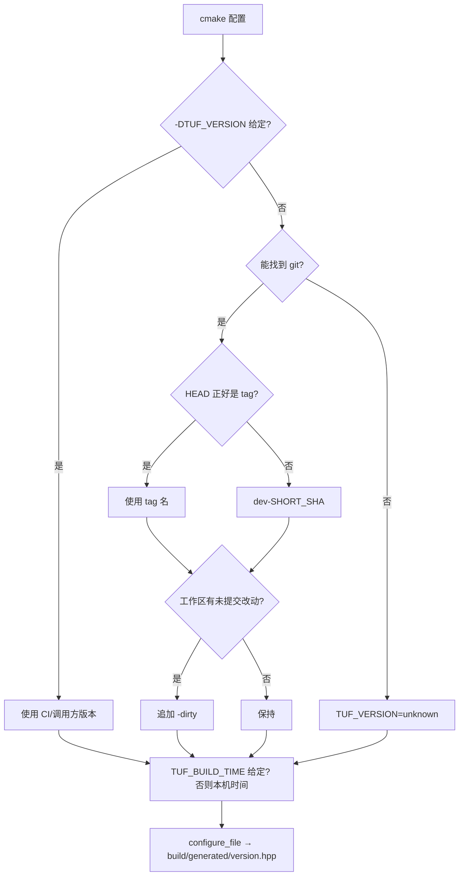

> 注意：`main.cpp` 的横幅使用 `TUF_VERSION` / `TUF_BUILD_TIME`，而 argparse 的构造函数里写的 `"1.0"` 只是内部值，没有 `--version` 输出，二者不是一回事。

### 4.2 `build.sh`（Linux/macOS）

```bash
./build.sh                 # CMake Release（默认）
./build.sh cmake --debug   # CMake Debug
./build.sh direct          # 不经过 CMake，直接调用 g++/clang++
./build.sh --clean         # 先清空 build/
```

实现要点：

- 参数解析：`cmake|direct` 选择后端；`-Debug/--debug/-d`；`-Clean/--clean/-c`；`-h/--help`。
- `--clean` 时会尝试保留 `build/costs.json`、`build/difficulties.json`，其余 `build/` 全部删除。
- CMake 后端：检查 `build/CMakeCache.txt` 中记录的编译器是否与本次选择的编译器一致；不一致时提示 `--clean`。
- `direct` 后端：`g++/clang++ -std=c++17 -Wall -I third_party -O2（或 -O0 -g） src/*.cpp -o build/tuftools`，libcurl 优先用 `pkg-config --cflags --libs libcurl`，否则 `-lcurl`。
- 支持 `CXX`、`JOBS`、`CPPFLAGS`、`LDFLAGS`。
- 编译完成后检查 `build/tuftools` 是否存在且可执行。

> **重要已知问题**：`direct` 后端的命令行只加了 `-Ithird_party`，没有生成/包含 `build/generated/version.hpp`。`main.cpp` 会 `#include "version.hpp"`，因此从干净树直接运行 `./build.sh direct` 会以 `fatal error: version.hpp: No such file or directory` 失败（已在本仓库实测）。需要先走一次 CMake 配置，并手动加上 `-Ibuild/generated`，或直接使用 CMake 后端。详见[第 14 节](#14-已知限制与风险)。

### 4.3 `build.ps1`（Windows PowerShell）

```powershell
powershell -NoProfile -ExecutionPolicy Bypass -File ./build.ps1               # CMake Release
powershell -NoProfile -ExecutionPolicy Bypass -File ./build.ps1 mingw         # 直接 g++，不走 CMake
powershell -NoProfile -ExecutionPolicy Bypass -File ./build.ps1 cmake -Debug  # Debug
powershell -NoProfile -ExecutionPolicy Bypass -File ./build.ps1 -Clean
```

实现要点：

- `-Backend cmake|mingw`；`-Debug`；`-Clean`。
- `-Clean` 同样只保留 `costs.json`、`difficulties.json`。
- `mingw` 后端：`g++ -std=c++17 -Wall -I third_party -O2/-O0 -g ... -lwinhttp -static`。
- `cmake` 后端：自动查找 `cmake.exe`（PATH、Program Files、LOCALAPPDATA、各盘符），自动选择 `Ninja` → `MinGW Makefiles` → 默认生成器；检查 `CMakeCache.txt` 中记录的生成器是否一致；MinGW Makefiles 时显式传入 `mingw32-make.exe`。
- 同样存在 `mingw` 后端缺少 `version.hpp` 的问题（只在 CMake 配置后才会生成）。

### 4.4 GitHub Actions 发布流程

[`.github/workflows/build.yml`](../.github/workflows/build.yml) 是**手动触发**的 `workflow_dispatch`：

1. 输入要构建的分支（默认 `main`），`actions/checkout` 拉取该分支（`fetch-depth: 0` 以便 git 元信息）。
2. `msys2/setup-msys2` 安装 MinGW-w64 GCC、CMake、Ninja。
3. 生成版本：
   - `TAG_NAME = YYYYMMDD-<short sha>`；
   - `BUILD_STAMP = YYYY-MM-DD HHMMSS`；
   - 写入 `$GITHUB_ENV` / `$GITHUB_OUTPUT`。
4. CMake 配置：`-G Ninja -DCMAKE_BUILD_TYPE=Release -DTUF_VERSION=... -DTUF_BUILD_TIME="... UTC"`。
5. 构建 `build/tuftools.exe`。
6. 用 `softprops/action-gh-release@v2` 创建 release，标题 `ci-<tag>`，上传 `build/tuftools.exe`。

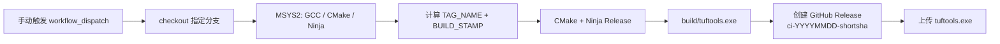

### 4.5 依赖要求

| 平台 | 编译依赖 | 运行依赖 |
| --- | --- | --- |
| Windows（MSVC / MinGW） | CMake（可选）、MSVC 或 MinGW-w64 | 系统 `winhttp.dll` |
| Debian/Ubuntu | `cmake g++ libcurl4-openssl-dev` | `libcurl.so.4` 及系统 TLS 库 |
| Fedora | `cmake gcc-c++ libcurl-devel` | 同上 |
| macOS | Xcode Command Line Tools（含 libcurl SDK） | 系统 libcurl |

---

## 5. 运行时架构

### 5.1 分层视图

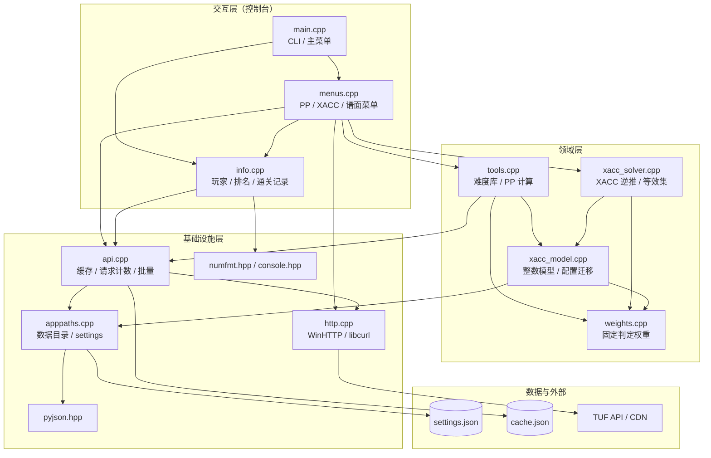

### 5.2 编译期依赖关系

| 源文件 | 直接包含的内部头文件 |
| --- | --- |
| `main.cpp` | `api.hpp`、`console.hpp`、`info.hpp`、`menus.hpp`、`version.hpp` |
| `menus.cpp` | `menus.hpp`、`api.hpp`、`apppaths.hpp`、`console.hpp`、`http.hpp`、`info.hpp`、`pyjson.hpp`、`numfmt.hpp`、`tools.hpp`、`xacc_solver.hpp` |
| `info.cpp` | `info.hpp`、`api.hpp`、`console.hpp`、`numfmt.hpp` |
| `tools.cpp` | `tools.hpp`、`api.hpp`、`apppaths.hpp`、`console.hpp`、`numfmt.hpp`、`xacc_model.hpp`、`xacc_solver.hpp` |
| `weights.cpp` | `tools.hpp` |
| `xacc_model.cpp` | `xacc_model.hpp`、`apppaths.hpp`、`console.hpp`、`numfmt.hpp`、`pyjson.hpp`、`tools.hpp` |
| `xacc_solver.cpp` | `xacc_solver.hpp`、`api.hpp`、`numfmt.hpp`、`tools.hpp` |
| `api.cpp` | `api.hpp`、`apppaths.hpp`、`console.hpp`、`http.hpp`、`numfmt.hpp` |
| `http.cpp` | `http.hpp` |
| `apppaths.cpp` | `apppaths.hpp` |

### 5.3 启动与主循环

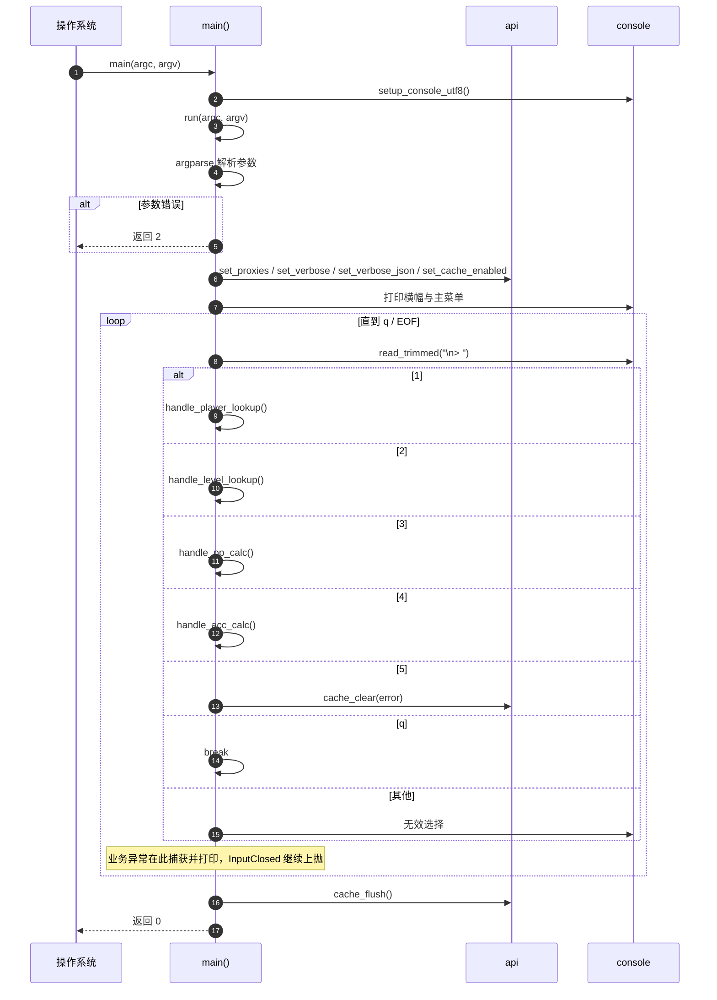

关键点：

- `setup_console_utf8()` 在参数解析之前调用；Windows 上设置控制台输入/输出代码页为 UTF-8，并关闭 `iostream` 与 stdio 的同步。
- 业务处理的异常在**每轮菜单选择内部**被捕获（`main.cpp:92`），打印 `错误: ...` 后继续主菜单；`InputClosed` 被单独 `throw` 给 `main()`，最终按正常退出处理并刷新缓存。
- 程序没有后台线程常驻；所有网络请求都在当前调用栈内同步完成，唯一例外是 `fetchall_sync` 内部临时启动的线程（见 6.7）。

### 5.4 全局状态

| 状态 | 位置 | 生命周期/说明 |
| --- | --- | --- |
| `BASE_URL` | `api.cpp` 静态常量 | 进程启动时读一次 `TUFTOOLS_API_BASE` |
| 代理、verbose、verbose_json | `api.cpp` 文件级变量 | 由 `main` 启动时设置；之后只读为主 |
| 请求计数、请求累计耗时、首/末请求时间 | `api.cpp` | `std::atomic`；`stats()` 打印并清零 |
| HTTP 缓存 map / 命中计数 / dirty 标志 | `api.cpp` | 懒加载；`cache_flush()` 在退出时落盘 |
| 当前求解器 `g_acc_solver` | `menus.cpp` 匿名命名空间 | 会话级，启动为 `automatic`，不持久化 |
| 难度名称缓存 `difficulty_tables()` | `info.cpp` 函数内 static | 首次需要时懒加载 `/v2/database/difficulties`，进程内复用 |
| 数据目录 `data_dir()` | `apppaths.cpp` 函数内 static | 首次调用计算并缓存；之后不再变化 |

> 因为几乎所有状态都是进程级单例，这个项目**不适合**作为库被多实例、多线程并发调用；但作为单用户 CLI 足够。

---

## 6. 模块详解

### 6.1 `main.cpp` —— CLI 与主菜单

**职责**：解析参数、把参数写进 API 层全局配置、打印横幅、驱动主菜单循环、兜底异常与缓存刷新。

**关键函数**：

| 函数 | 位置 | 说明 |
| --- | --- | --- |
| `run(int, char**)` | [`main.cpp:15`](../src/main.cpp#L15) | 参数解析 → 配置 → 主循环 → `cache_flush()` |
| `main(int, char**)` | [`main.cpp:103`](../src/main.cpp#L103) | `setup_console_utf8()` + 顶层异常处理 |

**参数解析**：使用 vendored argparse v3.1，`argparse::default_arguments::help` 只自动添加 `-h/--help`。`--proxy` 没有默认值，用 `present<std::string>` 判断是否提供；其余布尔参数使用 `.default_value(false).implicit_value(true)`。

**主菜单分发**：

| 输入 | 调用 | 说明 |
| --- | --- | --- |
| `1` | `tuf::handle_player_lookup()` | 玩家查询 |
| `2` | `tuf::handle_level_lookup()` | 谱面查询/下载 |
| `3` | `tuf::handle_pp_calc()` | PP 计算 |
| `4` | `tuf::handle_acc_calc()` | XACC 计算 |
| `5` | `tuf::cache_clear(error)` | 清空缓存；`--no-cache` 时只提示不操作 |
| `q` | 打印 `exit` 并跳出 | 大小写敏感，只有小写 `q` |
| 其他 | 打印“无效选择” | 不退出 |

**错误策略**：

```cpp
try {
    // 四个业务入口 / cache_clear
} catch (const tuf::InputClosed&) {
    throw;                      // EOF 交给 main
} catch (const std::exception& e) {
    std::cout << "错误: " << e.what() << std::endl;  // 单次操作失败，不退出程序
}
```

**注意**：

- `q` 是唯一退出方式；`Q` 会被当成无效输入。
- 只有主菜单退出路径与顶层 `InputClosed` 路径会调用 `cache_flush()`；进程被强杀时缓存不会落盘（但网络响应已经在内存中，丢失的只是缓存持久化）。
- `stats()` 不是主菜单统一调用，而是由玩家查询和 PP 计算流程在结束时自行调用（见 6.8、6.13）。

---

### 6.2 `console.hpp` —— 控制台与输入封装

**职责**：把 Windows 控制台切到 UTF-8，提供终端宽度、字符串 trim/大小写、Python 风格 `input()`、`float()`/`int()` 解析。

| 接口 | 位置 | 行为 |
| --- | --- | --- |
| `setup_console_utf8()` | [`console.hpp:23`](../src/console.hpp#L23) | Windows：`SetConsoleOutputCP(CP_UTF8)` + `SetConsoleCP(CP_UTF8)`；所有平台：`sync_with_stdio(false)`、`cin.tie(nullptr)` |
| `terminal_width(fallback=120)` | [`console.hpp:34`](../src/console.hpp#L34) | Windows 用 `GetConsoleScreenBufferInfo`；POSIX 用 `ioctl(TIOCGWINSZ)`；失败返回 `fallback` |
| `trim(s)` | [`console.hpp:49`](../src/console.hpp#L49) | 去除 ASCII 空白（空格、`\t\n\r\f\v`） |
| `lower_ascii` / `upper_ascii` | [`console.hpp:60`](../src/console.hpp#L60) | 仅 ASCII 大小写，不处理非 ASCII 字母 |
| `InputClosed` | [`console.hpp:73`](../src/console.hpp#L73) | stdin 结束异常；对应 Python `input()` 的 `EOFError` |
| `read_line(prompt)` | [`console.hpp:79`](../src/console.hpp#L79) | 打印 prompt 并 flush，`getline` 一行；EOF 抛 `InputClosed` |
| `read_trimmed(prompt)` | [`console.hpp:87`](../src/console.hpp#L87) | `trim(read_line())` |
| `parse_double_or_throw` | [`console.hpp:90`](../src/console.hpp#L90) | 空串/非法/尾随字符都抛 `runtime_error`；消息模仿 Python `float()` |
| `parse_int_or_throw` | [`console.hpp:104`](../src/console.hpp#L104) | `std::stoll`，要求整串被消费；消息模仿 Python `int()` |
| `try_parse_double` / `try_parse_int` | [`console.hpp:118`](../src/console.hpp#L118) | 解析失败返回 `std::nullopt` |

**行为细节**：

- `parse_*` 不接受空格之外的多余字符；`1.0` 不能作为整数，`1abc` 也不能。
- 没有对 `NaN`/`inf` 的过滤：`std::stod` 会接受 `nan`/`inf`，后续计算可能出现非有限值；依赖调用方校验（例如 XACC 目标用独立的精确解析器）。
- `terminal_width` 的 fallback 是 120，管道/重定向输出时会用 120 列排版。

---

### 6.3 `numfmt.hpp` —— 数字格式化

**职责**：复刻 Python f-string 的几种常用格式，供表格、日志、提示使用。

| 接口 | Python 等价 | 说明 |
| --- | --- | --- |
| `format_fixed(value, digits)` | `f"{value:.{digits}f}"` | `snprintf("%.*f")` |
| `trim_fixed(value, digits)` | `f"{value:.{digits}f}".rstrip("0").rstrip(".")` | 先定长，再删除尾部 0 和小数点 |
| `format_g(value)` | `f"{value:g}"` | `snprintf("%g")`，用于速度标签 |
| `decimal_places_of(text)` | 自定义 | 统计数字字面量小数点后的位数；忽略指数部分；遇到 E/e 停止 |

**边界**：

- `trim_fixed` 对 `0` 输出 `"0"`；对 `1.2300` 输出 `"1.23"`。
- `decimal_places_of("-9.9e1") == 1`（只看尾数）；`"99" == 0`；空串/不可解析返回 0。
- 这里没有实现 Python 的 `round` 银行家舍入；`py_round` 在 `pyjson.hpp` 中使用 `snprintf("%.*f")`，对 `.5` 的舍入行为可能与 Python 不一致（见 14 节）。

---

### 6.4 `pyjson.hpp` —— Python 语义 JSON 适配层

**职责**：在 `nlohmann::ordered_json` 上包一层 `tuf::Json`，模拟原 Python 工具中 `dict` / `json` / `urllib.parse` 的使用习惯。

#### 6.4.1 `Json` 类

- 内部持有 `OrderedJson`（对象键顺序保留，对应 Python 3.7+ `dict` 顺序）。
- 值类型：null、bool、int、unsigned、double、string、array、object。
- 构造/工厂：`Json()`, `array()`, `array(items)`, `object()`, `object(items)`, `parse(text)`。
- 访问：
  - `get(key)`：非对象或键不存在返回 **null**，不抛异常（对应 `dict.get`）。
  - `has(key)`：仅对象且包含键时为 true。
  - `set(key, value)`：非对象会先变成空对象。
  - `items()`：按顺序返回 `vector<pair<string, Json>>`；非对象返回空。
  - `elements()`：数组返回 `vector<Json>`；非数组返回空。
  - `operator[](size_t)`：越界返回 null。
  - `size()`：数组/对象/字符串返回元素数/字节数；其他返回 0。
- 类型判断：`is_null` / `is_bool` / `is_int` / `is_double` / `is_number` / `is_string` / `is_array` / `is_object`。
- 强制转换：
  - `as_bool()`：非 bool 走 `truthy()`。
  - `truthy()`：Python 真值语义（null/0/空串/空容器为假）。
  - `as_double()`：数字直接转；bool 转 0/1；字符串尝试 `stod`，失败 0；其他 0。
  - `as_int()`：整数/无符号/浮点/字符串尝试 `stoll`，失败 0。
  - `as_string()`：字符串原样；其他走 `key_text()`（**注意 null 会得到字面量 `"null"`**）。
  - `key_text()`：`str(value)` 风格；null 是 `"null"`，bool 是 `"true"/"false"`，整数十进制，浮点走 `py_float_str`，容器走 `dump()`。
  - `number_or(fallback)`：仅数字返回值，否则 fallback。
- 序列化：`dump(indent=-1)`；`indent>=0` 时缩进，键顺序保留。

#### 6.4.2 Python 风格辅助函数

| 函数 | 作用 | 备注 |
| --- | --- | --- |
| `py_float_str(double)` | 模拟 Python `repr(float)` | 用 `std::to_chars` 最短表示；没有 `.`/`e`/`E` 时补 `.0`；`nan`/`inf` 特殊处理 |
| `py_round(double, digits)` | 模拟 `round(value, digits)` | 实际是 `snprintf("%.*f")` + `strtod`，不是 Python 的十进制/银行家舍入 |
| `py_repr(Json)` | 模拟 `repr(obj)` | `None`/`True`/`False`/字符串引号/数字/数组/对象 |
| `py_repr_string(string)` | 字符串 repr | 优先单引号；字符串含单引号且不含双引号时改用双引号；转义 `\`、引号、`\n\r\t` |
| `py_repr_q(Json)` | null → `"?"`，否则 `py_repr` | 排行榜显示辅助 |
| `py_text(Json)` | 字符串去掉引号，其他 `py_repr` | 名称/国家等展示用 |
| `url_quote(string)` | 模拟 `urllib.parse.quote` 默认 safe | 保留字母数字和 `_-.~/`，其余字节按 UTF-8 字节 `%XX` 编码 |

**注意**：

- `url_quote` 把 `/` 视为安全字符（与 Python `quote` 默认 `safe='/'` 一致）；它不会做 URL 的 `+` 空格转换。
- `as_string()` / `key_text()` 的 `"null"` 行为是本项目多个“可选字段判空”逻辑的隐患（见 14 节）。
- `py_round` 使用 C 的舍入模式（通常为 round-half-even，但取决于浮点表示和 `printf` 实现），不能保证与 Python 完全一致。

---

### 6.5 `apppaths.*` —— 数据目录与 `settings.json`

**职责**：定位数据目录，读写 `settings.json`，把旧版分散的 JSON 文件迁移进 settings。

#### 6.5.1 数据目录解析

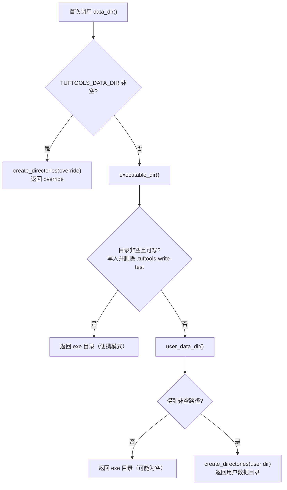

`executable_dir()` 的实现：

| 平台 | 方法 |
| --- | --- |
| Windows | `GetModuleFileNameW(nullptr, ...)`，必要时扩容，转 UTF-8 后取目录 |
| macOS | `_NSGetExecutablePath` + `realpath` |
| Linux | `readlink("/proc/self/exe")` |

`user_data_dir()` 的候选：

| 平台 | 路径 |
| --- | --- |
| Windows | `%LOCALAPPDATA%\tuftools`；若空则 `%APPDATA%\tuftools` |
| macOS | `$HOME/Library/Application Support/tuftools` |
| Linux/其他 | `$XDG_DATA_HOME/tuftools`；未设置则 `$HOME/.local/share/tuftools` |

`data_file(name)` 只在目录非空时拼接路径；目录为空则返回相对文件名（相当于当前工作目录）。

#### 6.5.2 `settings.json` 读写

| 接口 | 说明 |
| --- | --- |
| `settings_read(section, Json& value, string& error)` | 读取并返回指定 section；section 不存在时 `value` 为 null，返回 true。解析失败返回 false。 |
| `settings_write(section, const Json& value, string& error)` | 重新读取整个 settings 根对象，设置 section，再以 2 空格缩进写回。 |

实现细节：

- `load_settings_root()` 每次都重新读文件，没有进程内缓存，因此**每次 settings 读写都会做一次 legacy 迁移扫描**。
- settings 文件不存在时视为 `{}` 空对象。
- 顶层必须是 JSON 对象，否则返回错误。
- 写入使用 `std::ofstream` 截断模式；如果文件不可写，返回 `"无法写入 settings.json"`。
- 因为使用 `ordered_json`，已有键保持原位置，新键追加到末尾；不会保留原文件的空白/缩进风格。

#### 6.5.3 Legacy 迁移

`load_settings_root()` 会扫描数据目录里的旧文件：

| 旧文件 | 导入到 settings 的 section | 说明 |
| --- | --- | --- |
| `xacc.json` | `xacc` | 旧 XACC 配置 |
| `difficulties.json` | `difficulties` | 难度库 |
| `transform_presets.json` | `transformPresets` | 转换预设 |
| `costs.json` | `legacyCosts` | 旧判定难度系数 |
| `weights.json` | —（`section=nullptr`） | **不导入**，直接退休；判定权重已是编译期固定规则 |

流程：

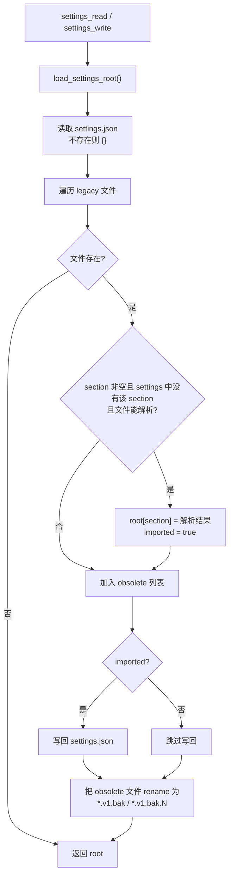

**注意**：

- 如果 settings 中**没有**同名 section 且旧文件解析失败，它不会被退休，方便人工恢复；但也不会阻塞启动。
- 如果 settings 中已经有同名 section，旧文件会被直接退休（不覆盖新数据），即使它本身无法解析；`weights.json`（section 为空）同样直接退休。
- 重命名失败被静默忽略（`retire_legacy_file` 不检查 `error_code`）。
- 由于 `settings_read` / `settings_write` 都会触发迁移，**程序运行期间第一次访问 settings 时可能改变数据目录内容**；这是设计上的自动迁移，不是显式升级命令。
- `build.sh --clean` / `build.ps1 -Clean` 只备份 `costs.json`、`difficulties.json` 这两个 legacy 文件，**不会备份当前的 `settings.json` 和 `cache.json`**（见 14 节）。
- **`xacc.json` 的 schema 风险**：它会被原样导入 `settings.xacc`，但随后 `xacc_model_load` 走 `parse_v2`，要求 `schemaVersion == 2`。如果旧 `xacc.json` 不是 v2 格式，导入会成功、旧文件会被退休，但 XACC 菜单会报“schemaVersion 不是 2”。此时需要手工修正 `settings.json` 的 `xacc` 段（或删除该段后让程序重新迁移）。

---

### 6.6 `http.*` —— 同步 HTTPS GET

**职责**：提供一个最小、同步、带进度回调的 HTTP GET；Windows 用 WinHTTP，其他平台用 libcurl。

#### 6.6.1 公共接口

```cpp
struct HttpResponse { int status; std::string reason; std::string body; };

class HttpError : public std::runtime_error {
    int status() const;
    const std::string& body() const;
};

using HttpProgressCallback = std::function<void(uint64_t downloaded, uint64_t total)>;

HttpResponse http_get(const std::string& url,
                      const std::string& proxy = "",
                      int timeout_sec = 30,
                      const HttpProgressCallback& progress = {});
std::string http_reason_from_status(int status);
```

错误约定：

- 传输层失败（连不上、超时、TLS 失败、读取失败）→ `std::runtime_error`。
- HTTP 状态码 `>= 400` → `HttpError`，同时携带 `status` 和响应体（便于 verbose 打印错误 JSON/HTML）。
- 成功 → `HttpResponse`，`body` 完整读入内存。

#### 6.6.2 Windows（WinHTTP）实现

| 步骤 | API |
| --- | --- |
| URL 转宽字符 | `MultiByteToWideChar(CP_UTF8)` |
| 拆分 URL | `WinHttpCrackUrl`（scheme/host/port/path/extra） |
| 打开会话 | `WinHttpOpen("tuftools/1.0 (cpp)", proxy ? NAMED_PROXY : NO_PROXY, ...)` |
| 超时 | `WinHttpSetTimeouts` 四个阶段都设为 `timeout_sec * 1000` |
| 连接 | `WinHttpConnect(host, port)` |
| 创建请求 | `WinHttpOpenRequest(GET, path, secure ? WINHTTP_FLAG_SECURE : 0)` |
| 解压 | 若 `WINHTTP_OPTION_DECOMPRESSION` 可用，请求 gzip/deflate 自动解压 |
| 发送/接收 | `WinHttpSendRequest` → `WinHttpReceiveResponse` |
| 状态/原因 | `WinHttpQueryHeaders(STATUS_CODE / STATUS_TEXT)`；原因缺失时用 `http_reason_from_status` 补齐 |
| 内容长度 | `WINHTTP_QUERY_CONTENT_LENGTH`，用于进度 |
| 读取 | 8 KiB 缓冲循环 `WinHttpReadData`；每次回调 `progress(downloaded, total)` |
| 错误 | 状态 `>=400` 抛 `HttpError` |

Windows 版的状态原因表比较完整（200/201/204/301/302/304/400/401/403/404/405/409/422/429/500/502/503/504）。

> WinHTTP 代码没有显式设置重定向策略；不同 Windows 版本的默认行为可能不同。libcurl 版显式 `FOLLOWLOCATION=1, MAXREDIRS=10`。

#### 6.6.3 POSIX（libcurl）实现

| 选项 | 值 |
| --- | --- |
| `CURLOPT_URL` | 请求 URL |
| `CURLOPT_FOLLOWLOCATION` / `MAXREDIRS` | 跟随重定向，最多 10 次 |
| `CURLOPT_USERAGENT` | `tuftools/1.0 (cpp)` |
| `CURLOPT_ACCEPT_ENCODING` | `""`：请求并自动解压 gzip 等 |
| `CURLOPT_WRITEFUNCTION` / `WRITEDATA` | 追加到 `std::string body` |
| `CURLOPT_XFERINFOFUNCTION` | 仅在传入 progress 时启用 |
| `CURLOPT_TIMEOUT` | `timeout_sec` 秒（整体超时） |
| `CURLOPT_PROXY` | 非空时设置 |
| `CURLOPT_PROTOCOLS_STR` / `REDIR_PROTOCOLS_STR` | libcurl ≥ 7.85 时限制为 `http,https` |
| `CURLOPT_ERRORBUFFER` | 捕获详细错误文本 |

- `curl_global_init` 用 `std::call_once` 保证只执行一次；失败抛 `runtime_error`。
- 响应状态用 `CURLINFO_RESPONSE_CODE` 获取；原因短语是简化表（200/404/429/5xx/4xx），不像 Windows 那样完整。
- 进度回调异常被 `try/catch(...)` 吞掉，不允许异常穿过 libcurl 的 C 回调边界。
- POSIX 版不把 body 流式写文件；调用方（下载）拿到完整 `std::string` 后再写盘。

#### 6.6.4 超时与重试

- API 请求默认 30 秒；文件下载在 `save_download()` 中显式传 60 秒。
- **没有自动重试**；失败由上层决定是否提示/继续。
- 没有连接池复用：每次 `http_get` 都新建 WinHTTP 会话或 curl easy handle。批量排名请求靠线程并发而不是连接复用。

---

### 6.7 `api.*` —— 请求层、缓存与统计

**职责**：所有 JSON API 请求的统一入口；负责 URL 级响应缓存、请求计数、耗时统计、verbose 日志、批量并发请求。

#### 6.7.1 公共接口

```cpp
extern const std::string BASE_URL;  // https://api.tuforums.com 或 TUFTOOLS_API_BASE

void set_proxies(const std::string&);
void set_verbose(bool);
bool verbose_enabled();
void set_verbose_json(bool);
std::string active_proxy();

void set_cache_enabled(bool);
bool cache_enabled();
long long cache_hits();
bool cache_clear(std::string& error);
void cache_flush();

void log(const std::string& msg);

struct FetchResult { bool ok; Json data; std::string error; };

Json fetchapi_sync(const std::string& url);
std::vector<FetchResult> fetchall_sync(const std::vector<std::string>& urls);
void stats();
```

#### 6.7.2 请求路径

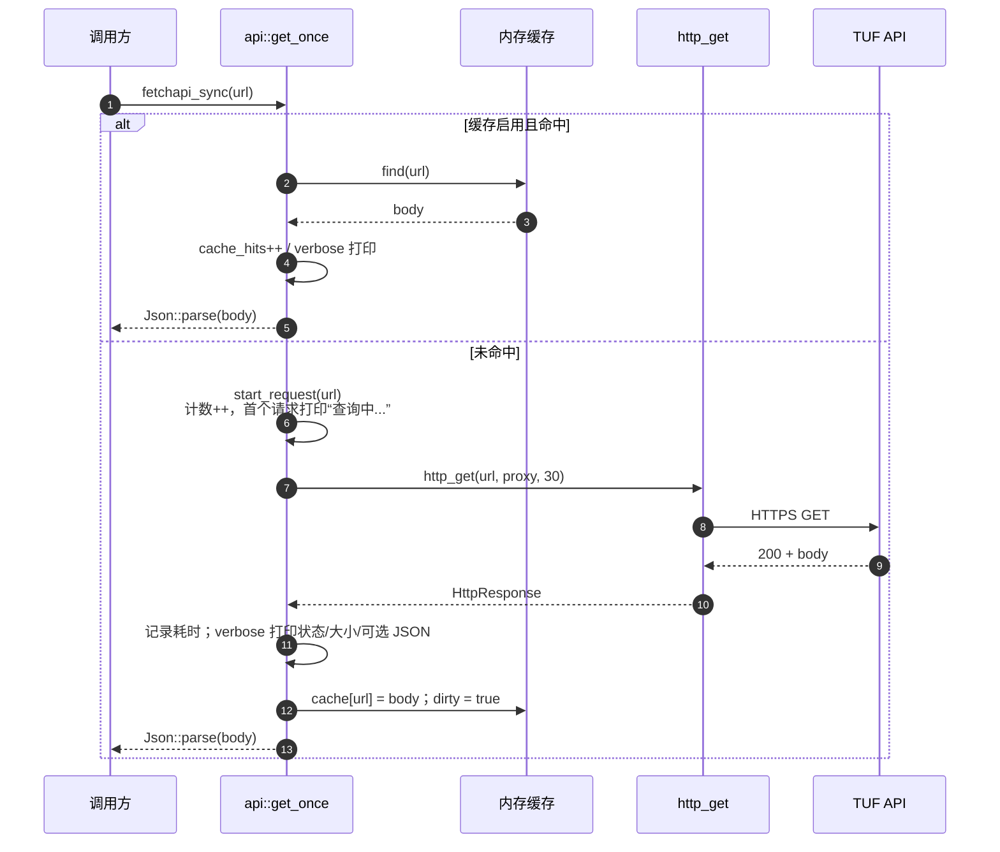

- 缓存键是**完整 URL**（包含 query）。
- 缓存值是**原始响应体字符串**，不是解析后的 Json；命中时会重新解析，保证与网络返回一致，也让缓存不依赖解析器版本。
- 空响应体不入缓存，返回 null Json。
- 缓存命中不会调用 `start_request`，因此不计入请求数、不打印“查询中...”，但会打印 verbose 的 `#cached` 行。
- `Json::parse` 失败会向调用方抛出；网络响应在解析前就已写入缓存（因此一个内容非 JSON 的错误页可能被缓存，直到手动清空或缓存失效；见 14 节）。

#### 6.7.3 缓存文件

| 项 | 说明 |
| --- | --- |
| 文件名 | `cache.json`（数据目录） |
| 结构 | 顶层对象：`{ "<完整URL>": "<原始响应体字符串>" }` |
| 载入时机 | 第一次访问缓存时懒加载 |
| 损坏处理 | 解析失败：清空内存缓存、标记 dirty；下次写回时覆盖 |
| 写入时机 | 每次成功网络响应后标记 dirty；进程正常退出时 `cache_flush()` 写盘；主菜单“清空缓存”立即写 `{}` |
| 过期策略 | **无 TTL、无 ETag/Last-Modified 校验**；只有手动清空或删除文件 |
| 禁用 | `--no-cache` 同时禁止读和写 |
| 统计 | 命中次数单独计数，不计入 `used N requests` |

`cache_clear(error)` 会先 `cache_load_locked()` 再清空并立即写盘。这样即使此前从未加载过磁盘缓存，清空操作也会真正覆盖磁盘文件；写失败返回 false，主菜单打印错误。

`cache_flush()` 只在 `cache_enabled && dirty` 时写；失败通过 `log()` 输出（仅 verbose 可见）。

#### 6.7.4 请求计数与 `stats()`

- `g_count`：真实网络请求数（缓存命中不算）。
- `g_api_us`：所有请求耗时之和（微秒精度累加）。
- `g_span_start` / `g_span_end`：第一个网络请求开始、最近一次请求结束；用于“span”。
- `g_cache_hits`：缓存命中数。
- `stats()` 输出：
  - 若 `count` 或 `hits` 非零：
    - verbose：`used N requests, span X ms (请求累计 Y ms)，命中缓存 Z 次`
    - 非 verbose：`总耗时: X ms`（有缓存命中时追加 `，命中缓存 Z 次`）
  - 总是打印一行 70 个 `=` 的分隔线。
  - 清零全部计数器和 span。

> `span` 是“首个请求开始到末个请求结束”的墙钟时间，不是进程总运行时间；如果全部命中缓存，`count=0`，不会打印耗时行（只打印分隔线）。

#### 6.7.5 批量请求 `fetchall_sync`

- 为每个 URL 启动一个 `std::thread`，在 `get_once` 中独立执行；结果按输入顺序写入 `results[i]`。
- 单个 URL 失败不会影响其他 URL：`ok=false`、`error=e.what()`。
- 没有并发上限；当前用于一次最多约 14 个排名 URL（7 个指标 × 全球/地区，部分全球排名直接来自玩家对象）。未来如果批量很大，需要加线程池/limit。
- `std::cout` 输出由 `api.cpp` 的 `g_print_mutex` 串行化，避免 verbose 行交错，但行的先后顺序不保证。

#### 6.7.6 verbose 日志格式

| 场景 | 示例 |
| --- | --- |
| 请求开始 | `#1 GET https://api.tuforums.com/...  (proxy: http://...)` |
| 成功 | `    <- #1 200 OK  123.45 ms  4567 B` |
| 失败（HttpError） | `    <- #1 HTTP 404 ... 请求失败 ...  12.34 ms` + 可选 body 块 |
| 缓存命中 | `    <- #cached https://...  (4567 B)` |
| 首次请求（非 verbose） | `查询中...` |
| 普通日志 | `log()` 只在 verbose 输出 |

`--dump-json` 的 body 块：

- 若 body 能解析为 JSON，按 2 空格缩进打印；
- 否则原样打印；
- 超过 256 KiB 截断，并打印 `... 已截断 (响应 N 字节)`；
- 每行前缀 `    | `，去掉行尾 `\r`。

---

### 6.8 `info.*` —— 玩家、排名、通关记录与表格

**职责**：`info.py` 的移植。封装玩家搜索/详情/排名查询，拉取通关记录，解析难度名称，按终端宽度渲染表格，提供交互式分页器。

#### 6.8.1 数据结构

| 类型 | 字段 | 说明 |
| --- | --- | --- |
| `RankVal` | `numeric`、`num`、`text` | 排名可能是数字，也可能是未知 `"?"` 或非数字文本 |
| `PassList` | `rows`、`total` | 通关记录行 + 过滤后的总数 |

`RankVal` 的辅助：

- `unknown()` → 非数字，`text="?"`。
- `from_number(double)` → 数字。
- `from_json(Json)`：数字 → 数字；null → 未知；其他 → `py_text` 文本。
- `str()`：数字为整数时输出整数，否则 `py_float_str`；非数字输出 `text`。
- `is_zero()`：数字且为 0。

#### 6.8.2 玩家接口

| 函数 | API | 说明 |
| --- | --- | --- |
| `player_search(query)` | `GET /v3/players/search?query=<query>` | 返回 `results` 数组；缺失/非数组返回空数组。**query 未做 URL 编码**。 |
| `get_player(pid)` | `GET /v3/players/<pid>` | 返回玩家对象。**pid 未编码**。 |
| `rank_url(player, sort_by, scope)` | 构造 leaderboard URL | 见下 |
| `rank_count(response)` | — | 从响应取 `count`；非对象/非数字返回未知 |
| `fetch_ranks(jobs)` | 批量 leaderboard | 并发请求，失败项为未知 |
| `fetch_single_rank` | 单个 leaderboard | 目前未被使用 |
| `get_all_ranks(player)` | 组合 | 7 个指标 × 全球/地区 |
| `choose_player(results)` | — | 单个直接返回；多个让用户选序号 |

**排名 URL 构造**（[`info.cpp:136`](../src/info.cpp#L136)）：

```text
BASE_URL + "/v3/players/leaderboard?query=&sortBy=<sort_by>"
         + "&order=desc&offset=0&limit=1&showBanned=hide"
         + "&filters=" + url_quote({"<sort_by>": [score, 999999999], "country": <country>?}.dump())
```

- 如果 `player[sort_by]` 为 null 或数字 0，直接返回空串（该排名未知）。
- `scope == "country"` 时附加 `country` 过滤；否则全球。
- `filters` 是 JSON 对象，`dump()` 后整体 `url_quote`。
- 服务端返回的 `count` 被当作“排名”。

**7 个指标**（`get_all_ranks`）：

| 分数键 | 排名键 | 中文显示 |
| --- | --- | --- |
| `rankedScore` | `rankedScoreRank` | 排位分 |
| `totalScoreV2` | `totalScoreV2Rank` | 总分 |
| `ppScore` | `ppScoreRank` | 无暇分 |
| `wfScore` | `wfScoreRank` | 首通分 |
| `wfPPScore` | `wfPPScoreRank` | 首杀分 |
| `score12K` | `score12KRank` | 12K分 |
| `generalScore` | `generalScoreRank` | 全局分 |

全球排名优先使用玩家对象里现成的 `*Rank` 字段；缺失时才发 leaderboard 请求。地区排名总是尝试构造请求（因为玩家对象里没有国家排名字段）；若该指标分数为 0 或缺失，`rank_url` 返回空，直接记为未知。

#### 6.8.3 玩家详情与流程

| 函数 | 位置 | 说明 |
| --- | --- | --- |
| `details(player, ranks, passes)` | [`info.cpp:240`](../src/info.cpp#L240) | 打印分隔线、名称/ID/Discord/地区、14 行排名、7 项分数、平均 XACC、U 级/总通关/世界首通/首杀、最高难度；若 `passes=nullptr` 则自行拉取前 16 条并打印 |
| `run_player(player)` | [`info.cpp:296`](../src/info.cpp#L296) | 必要时按 ID 重新拉取完整玩家；拉取全部排名与尽可能多的通关记录（上限 4096）；展示前 16 条；询问是否进入分页器；最后 `stats()` |
| `handle_player_lookup()` | [`info.cpp:327`](../src/info.cpp#L327) | 子菜单：1 名称 / 2 Discord / 3 ID / b 返回 |

**`run_player` 的重取条件**：玩家对象缺少 `rankedScoreRank` 或 `totalScoreV2` 时，用 `player.id` 调 `get_player` 获取完整数据。搜索接口返回的简要对象通常缺少字段，因此这一步很常见。

**`details` 的字段**：

- `name`、`id`、`discord.username`、`country`
- 全球排名：`rankedScore_global`、`totalScoreV2_global`、`ppScore_global`、`wfScore_global`、`wfPPScore_global`、`score12K_global`、`generalScore_global`
- 地区排名：对应 `*_country`
- 分数：`rankedScore`、`generalScore`、`totalScoreV2`、`ppScore`、`wfScore`、`wfPPScore`、`score12K`
- `averageXacc` 是 0–1 小数，显示时乘 100 加 `%`
- `universalPassCount`、`totalPasses`、`worldsFirstCount`、`worldsFirstPPCount`
- `topDiff.name` / `topDiff.sortOrder`

#### 6.8.4 难度名称解析

通关记录里的 `level.difficulty` 通常内嵌完整对象，因此优先直接读 `difficulty.name`。缺失时才懒加载 `/v2/database/difficulties`，建立两张表：

| 表 | 键 | 值 |
| --- | --- | --- |
| `by_id` | `id` | `name` |
| `by_sort_order` | `sortOrder` | `name` |

> 两张表必须分开：某个难度的 `id` 可能等于另一个难度的 `sortOrder`，合并会导致错名（代码注释提到 U1 曾渲染成 U1J）。

`difficulty_name_of(level)` 的解析顺序：

1. `level.difficulty.name` 是非空字符串 → 直接用。
2. `by_id[level.difficulty.id]`。
3. `by_id[level.diffId]`。
4. `by_sort_order[level.difficulty.sortOrder]`。
5. 若 `level.diffId` 为 null → `"-"`；否则返回 `diffId` 的字符串。

难度表加载失败时保留空表（异常被吞掉），后续按 fallback 处理。

#### 6.8.5 通关记录拉取

`fetch_all_player_passes(name, player_id, fetch_cap=64)`：

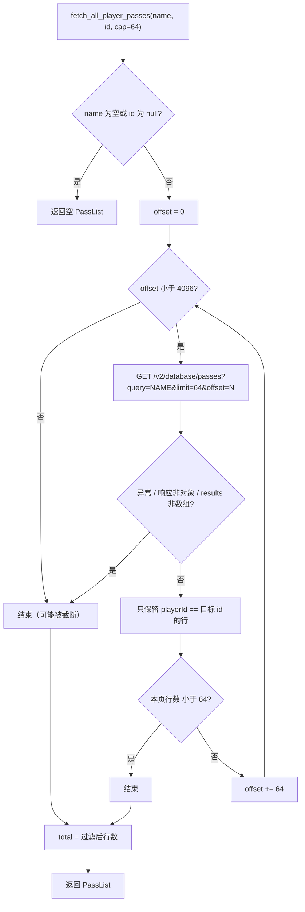

关键设计：

- 该接口按**玩家名**查询，返回所有同名玩家的通关；因此必须按 `playerId` 过滤。
- `count` 字段是“名字匹配的条数”，不是当前玩家的通关数，所以代码不使用它作为总数，而是用过滤后的 `rows.size()`。
- 分页不信任 `count`：只要本页满 64 条就继续翻页，直到短页或达到 `kMaxPassScan=4096`。
- 每页 64 条，最多 64 页；这意味着单个玩家最多收集 4096 条通关记录。
- 任何一页请求异常都会 `break`，返回已收集的部分（静默降级）。

`fetch_player_passes(name, id, limit=16, fetch_cap=64)` 在 `fetch_all_player_passes` 基础上截断到 `limit` 条，但 `total` 仍保留完整过滤数。

#### 6.8.6 表格渲染

`print_passes_to(out, passes, total, width)`：

- 7 列：序号、分数、ACC、ID、难度、谱面、标签。
- 分数来自 `scoreV2`，`trim_fixed(2)`；缺失显示 `-`。
- ACC 来自 `accuracy * 100`，固定 4 位小数 + `%`；缺失 `-`。
- ID 来自 `id`，缺失 `-`。
- 谱面标题 `level_heading`：`levelId - 歌名 - 艺术家 - 谱师`，缺失片段被省略；歌名缺失显示 `谱面`；艺术家如果已经包含在歌名中则不重复。
- 谱师 `level_charter`：优先 `levelCredits[]` 中 `role == "charter"` 的 `creator.name`，去重后用 `, ` 连接；没有 charter 时取第一个 credit；再退回旧字段 `level.creator.name`。
- 标签：`世界首通`、`世界首杀`、`NoHoldTap`、非 1.0 速度 `Nx`、`重复`、`隐藏`、`XPerfect`、`判定异常`、`12K`/`16K`。
- 列宽：
  - 窄列（序号/分数/ACC/ID/难度/标签）取表头与内容的最大显示宽度；
  - 剩余宽度给“谱面”列，限制在 `[24, 60]`；
  - 固定 6 个单空格分隔符；
  - 谱面超宽用 `cut_width` 截断并加 `…`。
- 标题行：`通关谱面 (按分数降序，本页 N 条，共 M 条):`；只有当 `total > 当前行数` 时才显示“共 M 条”。

**显示宽度**：`display_width` 按 UTF-8 码点解码，东亚宽字符（CJK、假名、韩文、全角、部分 emoji 等）计 2，其余计 1。这是 `unicodedata.east_asian_width in "WF"` 的近似，不处理组合字符/零宽字符。

#### 6.8.7 分页器 `browse_passes`

- 每页 16 条（`kPagerPageSize=16`）。
- 命令：`n` 下一页、`p` 上一页、`a` 全部（打印后等回车）、`d` 难度筛选、`q` 或空回车返回。
- 难度筛选会先收集当前视图里出现过的难度名，排序后让用户按序号选择；`0` 表示全部。
- 筛选后从第 1 页开始。
- **已知问题**：`page_count` 在进入循环前按原始 `view` 计算，筛选后没有重新计算；页码显示和“下一页”判断可能沿用筛选前页数（见 14 节）。

---

### 6.9 `tools.*` —— 难度库、PP 计算与 XACC 兼容层

**职责**：移植 `tools/CostsMan.py`、`tools/DiffMan.py`、`tools/TUFScoreCalculator.py`、`tools/XACCTools.py` 的公共部分。

#### 6.9.1 CostsMan：判定难度系数（legacy）

| 接口 | 说明 |
| --- | --- |
| `jd_cost_keys()` | 返回 10 个成本键，顺序固定：`perfect, failMiss, tooEarly, early, late, ePerfect, lPerfect, +perfect, xperfect, -perfect` |
| `default_jd_costs()` | 默认成本表（见下表） |
| `costs_load()` | 从 settings 的 `legacyCosts` 读取；缺文件/缺键用默认值；异常打印并返回默认 |
| `costs_save(costs)` | 写回 `legacyCosts`；目前没有调用方（兼容 API） |

默认成本（`cost_scale = 1000` 时对应 0、1000、1500、50000、10000…）：

| 键 | 默认成本 |
| --- | ---: |
| `perfect` | 0.0 |
| `failMiss` | 1.0 |
| `tooEarly` | 1.5 |
| `early` | 50.0 |
| `late` | 50.0 |
| `ePerfect` | 50.0 |
| `lPerfect` | 50.0 |
| `+perfect` | 10.0 |
| `xperfect` | 0.0 |
| `-perfect` | 10.0 |

这些成本**不参与正算 XACC**，只用于逆推时在多个同等 XACC 的组合之间挑选“更便宜/更可能”的判定分布。成本越低，求解器越倾向于使用该判定。

#### 6.9.2 DiffMan：难度库

| 接口 | 说明 |
| --- | --- |
| `DifficultyManager()` | 构造即 `load()` |
| `file_exists()` | settings 中 `difficulties` 是数组则 true |
| `load()` | 有数据则读入；没有则打印“下载难度数据...”并 `update()` |
| `update()` | `GET /v2/database/difficulties`，只保留 `name` / `baseScore`，写入 settings 的 `difficulties`；设置 `downloaded_=true` |
| `get_base_score(name)` | 大小写不敏感匹配 `name`，返回 `baseScore`；未知抛 `runtime_error("未知难度: ...")` |

存储格式：

```json
{
  "difficulties": [
    { "name": "Unranked", "baseScore": 0 },
    { "name": "P1", "baseScore": 0.1 }
  ]
}
```

`DifficultyManager` 不缓存 API 的完整难度对象，只存名称和 baseScore；其他字段（id/sortOrder）由 `info.cpp` 的另一张懒加载表负责。

#### 6.9.3 TUFScoreCalculator：PP 计算

**构造**：`diffman_()` 先 `load()`（可能下载），然后 `difficulties_(diffman_.load())` 再加载一次。首次缺数据时可能产生一次下载 + 一次读取；这是可优化的重复加载。

**`build_level_data(difficulty_name, marathon, tilecount, base_score)`**：

- `base_score` 有值（手动输入模式）：
  - `difficulty.baseScore = base_score`
  - `level.baseScore = base_score`
- `base_score` 无值（按难度模式）：
  - `difficulty.baseScore = diffman.get_base_score(name)`
  - `level.baseScore = 0`
- `level` 固定字段：`song=""`、`artist=""`、`tilecount`、`ppBaseScore=0`、`xaccCurve=null`、`xaccCurveMeta=null`
- `difficulty.name = marathon ? "Marathon" : (name.empty() ? "Custom" : name)`
- 顶层 `{ "level": level }`

**`get_base_score(level_data, accuracy)`** 的优先级：

1. `accuracy == 1.0` 且 `level.ppBaseScore != 0` → `ppBaseScore`（标记 `ppBaseScore`）
2. `level.baseScore != 0` → `baseScore`
3. `difficulty.baseScore != 0` → `difficulty.baseScore`
4. 兜底 `1000.0`（标记 `default`）

注意：判定“非零”用的是 `number_or(0.0) != 0.0`；负数/NaN 也会被视为非零。

**`calculate_score_multiplier(accuracy, base_score, xacc_curve)`**：

- 曲线配置默认 `cutoff=0.95`、`topMultiplier=5.51289781`、`poleOffset=0.0054017154`。
- `accuracy < cutoff || accuracy > 1.0` → `1.0`。
- `accuracy == 1.0` → `base_score != 0 ? -2100.0 / (base_score + 262.5) + 14.0 : 1.0`。
- 否则按双曲线公式（见 10.1）。

**`calculate_speed_modifier(speed, is_marathon)`**：

- Marathon：`speed == 0 || speed == 1` → 1；`speed < 1` → 0；否则 `max(0, 2 - speed)`。
- 普通：`speed == 0 || speed == 1` → 1；`speed < 1` → 0；`[1,1.1)` → `-3.5*s + 4.5`；`[1.1,1.5)` → `0.65`；`[1.5,2)` → `0.7*s - 0.4`；`>= 2` → 1。

**`calculate_empty_tap_modifier(empty_taps, tilecount)`**：

- `adjusted = max(0, empty_taps - tilecount / 315)`
- `empty_taps == 0` → `1.1`
- `adjusted == 0` → `1.0`
- `adjusted == 1` → `0.9`
- `adjusted <= 25.5` → `0.9 - 0.2 * ((adjusted - 1) / 24.5)^0.7`
- `adjusted <= 50` → `0.5 + 0.2 * ((50 - adjusted) / 24.5)^0.7`
- 否则 `0.5`

**`calculate_score(level_data, accuracy_pct, misses, speed, is_no_hold_tap)`**：

- 取 `level` 和 `difficulty`；`accuracy = accuracy_pct / 100`。
- 取 base、曲线、速度修正、空敲修正（`misses` 传入）、`no_hold ? 0.95 : 1.0`。
- `raw = base * multiplier * speed_mod * empty_tap_mod * setting_mod`。
- 返回 Json 字段：`accuracy`、`accuracy_pct`（4 位 round）、`score`/`raw_score`、`base_score`、`base_source`、`xacc_curve_custom`、曲线三参数、`multiplier`/`speed_mod`/`empty_tap_mod`（4 位 round）、`default_setting_mod`、`tilecount`。

**曲线来源**：

- 优先 `level.xaccCurve` 对象。
- 否则使用 `level.xaccCurveMeta`：如果是字符串则先解析；如果是对象则使用；然后补 `topMultiplier` / `poleOffset`（来自 `level.xaccTopMultiplier` / `level.xaccPoleOffset`）。
- 都没有时构造空对象，最终走默认配置。
- `xacc_curve_config` 支持对象内的 `xaccCurveMeta` 子对象（优先）或直接在对象上读三参数；参数越界/非有限值则整体回退默认。
- `xacc_curve_is_custom` 只要三参数中任意一个是数字就标记为自定义（即使值非法、实际用的是默认曲线）。

#### 6.9.4 XACC 兼容层

`xacc_calc`（两个重载）和 `xacc_reverse` 是为旧调用方保留的便捷封装：

- 无 model 版本会自行 `xacc_model_load`，失败返回 0 / `nullopt`。
- `xacc_calc(model, judgements, xperfect)`：按 `jd_keys(xperfect)` 的键顺序，把 `count * weight` 累加为整数分数单位，再除以 `total * score_scale` 得到 0–1 比率。
- `xacc_reverse`：把 double 目标先 `format_fixed(decimals)` 转回字符串，再用精确解析器构造窗口，最后调用 `xacc_reverse_search`；失败 `log()` 并返回 `nullopt`。
- **当前菜单不调用这些包装函数**；菜单直接使用 `XaccModel` + `xacc_reverse_search`，以避免每次操作重复加载配置。

`score_judgement_keys()` / `score_judgement_weights()` 是另一组 6 键判定权重（`miss/early/ePerfect/perfect/lPerfect/late`），当前没有业务调用方，属于兼容/遗留 API。

---

### 6.10 `weights.cpp` —— 固定判定权重

**职责**：定义 XACC 的判定键顺序和固定权重。这些权重是**游戏规则**，不是配置：代码明确说明它们编译进程序，不读取也不写 `weights.json`/settings。

**`jd_keys(xperfect)`**：

| 模式 | 键顺序 | 数量 |
| --- | --- | --- |
| 普通 | `failMiss, tooEarly, early, ePerfect, perfect, lPerfect, late` | 7 |
| XPerfect | `failMiss, tooEarly, early, ePerfect, +perfect, xperfect, -perfect, lPerfect, late` | 9 |

**`fixed_jd_weights()`**：

| 键 | 权重 |
| --- | ---: |
| `perfect` | 1.0 |
| `failMiss` | 0.0 |
| `tooEarly` | 0.2 |
| `early` | 0.4 |
| `late` | 0.4 |
| `ePerfect` | 0.75 |
| `lPerfect` | 0.75 |
| `+perfect` | 1.0 |
| `xperfect` | 1.0 |
| `-perfect` | 1.0 |

XPerfect 的三种 perfect 子判定权重都等于 `perfect`，所以同一局在普通/XPerfect 模式下的 XACC 相同；区别只在逆推时把它们当成不同判定并分别计入难度系数。

> 成本键顺序（`jd_cost_keys`）与判定键顺序（`jd_keys`）不同：前者用于编辑/配置文件，后者用于正算判定输入。写扩展代码时不要混用。

---

### 6.11 `xacc_model.*` —— 精确整数 XACC 模型

**职责**：把 XACC 的权重、成本、目标精度、求解器预算统一成整数契约；加载/迁移/保存配置；解析目标 XACC；计算接受窗口与格式化。

#### 6.11.1 类型与常量

```cpp
using XaccCount     = std::int64_t;  // 判定数量/物量
using XaccScoreUnit = std::int64_t;  // 分数单位
using XaccCostUnit  = std::int64_t;  // 成本单位
```

| 常量 | 默认值 | 含义 |
| --- | ---: | --- |
| `kDefaultMaxNodes` | 20,000,000 | 分支定界节点预算 |
| `kDefaultMaxDpCells` | 8,000,000 | 精确 DP 状态/格数预算 |
| `kDefaultMaxSeconds` | 5.0 | 求解时间预算（秒） |

`XaccModel` 字段：

| 字段 | 含义 |
| --- | --- |
| `score_scale` | 分数权重分母；默认 1000 |
| `cost_scale` | 成本分母；默认 1000 |
| `max_dp_cells` / `max_nodes` / `max_seconds` | 求解器预算 |
| `order` | 所有成本键的顺序（加载时设为 `jd_cost_keys()`） |
| `weight_units` | 键 → 分数单位 |
| `cost_units` | 键 → 成本单位 |

关系：`weight = weight_units / score_scale`，`cost = cost_units / cost_scale`。一次 XACC 运行的分数单位为 `Σ count_i * weight_units_i`，百分比为 `100 * score_units / (total * score_scale)`。

#### 6.11.2 状态与求解器枚举

`XaccStatus`：

| 值 | 文本 | 含义 |
| --- | --- | --- |
| `ok` | 成功 | 有结果 |
| `invalid_input` | 输入无效 | 物量/固定数量/目标/溢出等 |
| `invalid_config` | 配置无效 | 目前求解器未主动使用（保留） |
| `out_of_range` | 目标在物理范围外 | 该物量下可达分数范围与目标窗口无交集 |
| `unreachable` | 目标不可达 | 搜索完成但无解 |
| `budget_exhausted` | 预算耗尽 | 节点/时间/状态预算用完 |

`XaccSolver`：

| 值 | 文本 | 说明 |
| --- | --- | --- |
| `automatic` | 自动 | 按 DP 估算格数选择 exact_dp 或 branch_and_bound |
| `exact_dp` | 精确DP(小规模) | 稠密数组 DP，可证明最优 |
| `branch_and_bound` | 分支定界(大规模) | DFS + 剪枝 + 预算 |
| `legacy_map_dp` | 旧版map DP | 保留用于对比/回退，不保证全局最优 |

`xacc_solver_from_text` 支持数字（1..4，`0` 等价 automatic）和别名：

- automatic：`auto` / `automatic` / `自动`
- exact_dp：`dp` / `exact` / `exact_dp` / `精确dp` / `精确`
- branch_and_bound：`bb` / `bandb` / `branch_and_bound` / `分支定界`
- legacy_map_dp：`legacy` / `map` / `legacymapdp` / `legacy_map_dp` / `旧版` / `旧版mapdp`

#### 6.11.3 整数辅助函数

| 函数 | 说明 |
| --- | --- |
| `mul_checked(a,b,out)` | 溢出返回 false；GCC/Clang 用 `__builtin_mul_overflow`，否则手动检查 |
| `add_checked(a,b,out)` | 同上，加法 |
| `gcd_i64(a,b)` | 欧几里得；对 `INT64_MIN` 特殊处理 |
| `ceil_div_i64(a,b)` | `b>0`，向正无穷取整 |
| `round_div_i64(a,b)` | `b>0`，四舍五入（距离相等时向远离 0 的方向） |

#### 6.11.4 配置加载：`xacc_model_load`

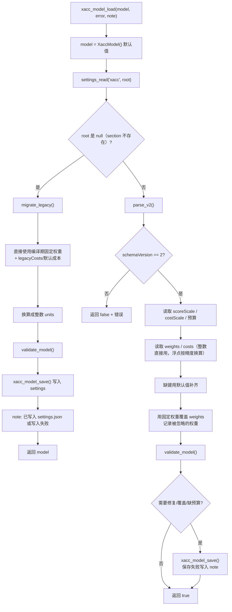

`parse_v2` 的细节：

- 顶层必须对象；`schemaVersion` 必须数字且等于 2；`scoreScale` / `costScale` 必须数字且 > 0。
- 预算三项可缺省（null）→ 使用默认值并标记 `budgets_missing`；存在但不是数字 → 错误；存在但非正 → 错误。
- `weights` / `costs` 若不是对象则忽略（后续补默认）；每个条目必须是数字；整数直接作为 units，浮点用 `units_from_value(value, scale)` 换算，并记录是否非精确。换算使用 `llround(value * scale)`，与整数网格的误差不超过 `1e-6` 视为精确；迁移路径拒绝非精确成本，交互编辑则取整并提示。
- 缺失键用 `default_jd_costs()` / `fixed_jd_weights()` 补齐，标记 `repaired`。
- 文件中的权重一律被编译期固定权重覆盖；若与文件值不同，标记 `weights_ignored`。
- `validate_model`：scale > 0；每个成本键的权重在 `[0, score_scale]`；成本 >= 0；`order = jd_cost_keys()`。
- 只要发生过补键、覆盖权重或缺预算，就回写 settings，避免文件里保留一份“看似生效但其实无效”的自定义权重。
- `note` 会汇总提示：缺少判定已补、缺少预算已补、存在按精度取整的数值、权重被忽略等。

`migrate_legacy`：

- 强制 `score_scale = cost_scale = 1000`。
- 权重来自 `fixed_jd_weights()`，成本来自 `costs_load()`（settings 的 `legacyCosts`，再由 `costs.json` 迁移而来）或默认值。
- 权重/成本都必须能精确落在 1/1000 网格上；不精确的成本会报错并提示先修正 `costs.json`。
- 成功则写 settings，`note` 为“已写入 settings.json”或保存失败信息。

`xacc_model_save`：把整个模型写入 settings 的 `xacc` section，包含 `schemaVersion`、两个 scale、三个预算、`weights`、`costs`；使用整数 units。

#### 6.11.5 目标解析与窗口

`XaccTarget { int decimals; int64_t numerator; }`：目标以有理数保存，`value = numerator / 10^decimals`（百分数）。

`xacc_parse_target(text, out, error)`：

- 允许结尾一个 `%`；trim。
- 只接受数字和最多一个小数点；小数位最多 6 位。
- 前导 0 会被去掉；逐位累加 numerator，带溢出检查。
- 上限 `100 * 10^decimals`；超过报“必须在 0..100 之间”。
- 不直接经过 `double`。

`xacc_target_window(target, model, total, slo, shi, error)`：

- 百分数定义：`percent = score_units * 100 / (total * score_scale)`。
- 用户输入 `n / 10^d`，接受范围 `[n - 0.5, n + 0.5) / 10^d`。
- 代码把窗口换算成整数分数单位：

```text
denominator = 200 * 10^d
base        = total * score_scale
slo = ceil((2n - 1) * base / denominator)
shi = ceil((2n + 1) * base / denominator) - 1
```

- `slo` 下限截到 0；若 `shi < slo` 报“该精度下不存在可达的分数区间”。
- 所有乘法使用 checked helper。

`xacc_target_units`：取离目标最近的分数单位：

```text
units = round(n * total * score_scale / (100 * 10^d))
```

格式化：

- `xacc_acc_percent(units, total, model)` = `100 * units / (total * scale)`；total <= 0 返回 0。
- `xacc_format_acc(..., decimals)`：decimals 限制在 0..6，`format_fixed`。
- `xacc_format_weight` / `xacc_format_cost`：units / scale，`py_float_str`。

#### 6.11.6 `settings.json` 的 `xacc` 段示例

```json
{
  "xacc": {
    "schemaVersion": 2,
    "scoreScale": 1000,
    "costScale": 1000,
    "maxDpCells": 8000000,
    "maxNodes": 20000000,
    "maxSeconds": 5.0,
    "weights": {
      "perfect": 1000,
      "failMiss": 0,
      "tooEarly": 200,
      "early": 400,
      "late": 400,
      "ePerfect": 750,
      "lPerfect": 750,
      "+perfect": 1000,
      "xperfect": 1000,
      "-perfect": 1000
    },
    "costs": {
      "perfect": 0,
      "failMiss": 1000,
      "tooEarly": 1500,
      "early": 50000,
      "late": 50000,
      "ePerfect": 50000,
      "lPerfect": 50000,
      "+perfect": 10000,
      "xperfect": 0,
      "-perfect": 10000
    }
  }
}
```

---

### 6.12 `xacc_solver.*` —— XACC 逆推求解器

> 本节的算法详解（公式推导、DP/B&B/legacy 伪代码与算例）见 [XACC 反推判定：算法与实现思路](xacc_reverse.md)。

**职责**：给定目标 XACC、物量、固定判定数量，搜索一组判定分布，使分数尽可能接近目标；在同等距离下最小化难度系数总和，再最小化“非基准判定”数量。支持三种求解器和等效组合枚举。

#### 6.12.1 输入/输出结构

```cpp
struct XaccReverseOptions {
    XaccSolver solver = automatic;
    long long max_nodes = kDefaultMaxNodes;
    long long max_dp_cells = kDefaultMaxDpCells;
    double max_seconds = kDefaultMaxSeconds;
};

struct XaccReverseResult {
    XaccStatus status;
    std::string message;
    std::map<std::string, long long> counts;  // 包含固定 + 自由
    XaccScoreUnit score_units;
    double actual_acc;
    bool exact;     // 分数是否落在用户输入精度对应的窗口内
    bool optimal;   // 是否被预算截断
    XaccScoreUnit distance_units;
    XaccCostUnit cost_units;
    XaccSolver solver;
    long long nodes, pruned, incumbent_updates, states, cells;
    double elapsed_ms;
    std::string note;
    bool ok() const;
};

struct XaccEquivalentSet {
    XaccStatus status;
    std::string message;
    bool ok() const;
    XaccScoreUnit score_units;
    XaccCostUnit cost_units;
    XaccScoreUnit distance_units;
    std::vector<std::map<std::string, long long>> solutions;
    bool truncated;
};
```

入口：

```cpp
XaccReverseResult xacc_reverse_search(
    const XaccModel&, const XaccTarget&, XaccCount total,
    const std::map<std::string, long long>& fixed_counts,
    bool xperfect, const XaccReverseOptions& = {});

XaccEquivalentSet xacc_equivalents(
    const XaccModel&, const XaccTarget&, XaccCount total,
    const std::map<std::string, long long>& fixed_counts,
    bool xperfect, long long max_solutions = 64,
    const XaccReverseOptions& = {});
```

#### 6.12.2 `Search` 类

`Search` 是逆推的核心，构造时保存 model/target/total/fixed/options/keys。主要成员：

| 成员 | 作用 |
| --- | --- |
| `prepare()` | 校验并构造自由判定 items、固定部分、窗口、目标单位 |
| `run()` | 选择求解器并分发 |
| `run_dense_dp()` | 精确 DP |
| `run_branch_and_bound()` | 分支定界 |
| `run_legacy()` | 旧版 map DP |
| `dfs()` / `evaluate_leaf()` | B&B 主递归与叶子评估 |
| `seed_incumbent()` | B&B 初始上界（单类型/双类型闭式解） |
| `branch_distance()` | 区间+同余的最短距离下界 |
| `lp_cost_bound()` | 线性规划成本下界 |

`Candidate` 保存：`valid`、`score`、`cost`、`non_base`、`distance`、`counts`。全局排序 `candidate_better`：

1. `distance` 小者优先；
2. `cost` 小者优先；
3. `non_base` 小者优先；
4. `counts_prefer_earlier`：按 `jd_keys` 顺序，较早键的数量多者优先（集中到列表前面的判定）。

#### 6.12.3 `prepare()` 的数学准备

- 校验 total >= 0、固定数量 >= 0、固定键属于当前模式、固定数量总和 <= total。
- 固定部分贡献 `fixed_score_`、`fixed_cost_`、`fixed_counts_`。
- 自由判定列表 `items_`：只包含没有固定（未出现在 `fixed_in_`）的键；每个 item 有 `weight`、`cost`、`u = weight - min_weight`、`ur = u / gcd`。
- `min_weight` / `max_weight` 是所有自由 item 的最小/最大权重。
- 可达分数范围 `[fixed_score + free*min_weight, fixed_score + free*max_weight]`；若与目标窗口无交集 → `out_of_range`。
- `gcd` 是所有 `u` 的最大公约数；`ur` 是归一化损失步长。
- `base_index`：`u` 最小者；`u` 相同取成本更低者。
- `base_score_all_ = fixed_score + free*min_weight`：所有自由音符都放在最低权重判定时的分数（最低可达分）。
- `target_loss_ = target_units - base_score_all_`：自由部分还需要补的分数单位。
- 若 `gcd == 0`（所有自由判定权重相同）：分数固定，只需选成本最低的判定放满自由音符，直接返回。
- 若 `free_notes == 0`：固定部分唯一确定分数，直接返回（`exact` 看是否落在窗口）。

#### 6.12.4 精确 DP（`run_dense_dp`）

**状态**：`DP[t][k]` 表示用了 `t` 个自由音符、归一化损失为 `k` 时，最小的 `(cost, non_base)` 字典序。`k` 的范围是 `0..t*max_ur`。

**转移**：

```text
DP[0][0] = (0, 0)
DP[t][k + ur_i] = min_lex( DP[t][k] + (cost_i, i == base ? 0 : 1) )
```

对每个 `t=1..free`、每个 item、每个可达 `k` 更新。

**内存**：`offsets[t]` 指向第 t 层起点，第 t 层宽度 `t*max_ur + 1`；总格数为 `Σ(t*max_ur+1)`，超过 `max_dp_cells` 时报 `budget_exhausted`。`choice` 数组记录每个格子的最后一个 item（`uint16_t`），用于回溯。

**选解**：扫描最后一层，按 `(distance, cost, non_base)` 选最优；收集最多 64 个完全并列的 `k`（`kMaxLexTies`）。对每个并列 `k` 回溯出 counts，重新计算分数/成本，再用 `candidate_better` 做最终字典序决胜。回溯失败/没有可达状态返回 `unreachable`。

**复杂度**：时间约 `O(free * n * max_ur * free)` 级别的格点访问，空间 `O(free^2 * max_ur)`；适合小规模（自动模式下估算格数 ≤ 8,000,000）。

#### 6.12.5 分支定界（`run_branch_and_bound`）

**分支顺序**：按 `ur` 降序、成本升序、键序升序排序；DFS 依次决定每个 item 的数量。

**初始上界**：`seed_incumbent()`：

- 单类型：所有自由音符都给某一 item；
- 双类型：对每对 item，用闭式解估算在目标损失附近的数量分配（`guess ± 2`）。

**剪枝**：

1. **节点/时间预算**：`nodes > max_nodes` 或每 1024 个节点检查一次 `elapsed > max_seconds` → `budget_hit`。
2. **支配记忆化**：键 `(position, remaining, accumulated_ur)`；如果之前以更低成本且 non_base 不更差访问过，剪枝。表上限 `2,000,000` 项。
3. **区间/同余距离下界**：剩余 item 的 `ur` 属于 `[suffix_min, suffix_max]`，且总损失必须与当前累计值同余（模 `suffix_gcd`）。`branch_distance` 计算该区间内与目标最接近的可达距离；若大于当前最优距离，剪枝。
4. **LP 成本下界**：仅当 `best_guess == 0` 且当前最优距离为 0 时，用单类型/双类型线性组合估算剩余音符的最低成本；若累计成本 + 下界 > 当前最优成本，剪枝。
5. **数量线性约束**：对当前 item 取 `n` 个时，`accumulated + n*ur + (remaining-n)*next_min/max` 必须能到达目标窗口（用当前最优距离放宽）；解出 `n` 的上下界，缩小分支范围。
6. **分支中心**：优先尝试闭式估算 `needed_ur / ur_i` 对应的数量，向两侧扩展，尽早得到好上界。

**结果**：预算耗尽时返回当前最优 `optimal=false`，`note="预算耗尽,结果未证明最优"`；完整搜索则 `optimal=true`。

#### 6.12.6 旧版 map DP（`run_legacy`）

- 选**最高权重**的 item 作为 base（同权重取成本低者）。
- 其他 item 的“损失” `loss = base_weight - weight_i`；同一 loss 只保留成本最低者，形成 `loss_items`。
- `base_total = fixed_score + free*base_weight`；`ideal = base_total - target_units`。
- 损失窗口：

```text
half_exact = ceil(total * score_scale / (200 * 10^d))
slack      = 0.4 * score_scale
cap        = 4096 * score_scale / 20
half       = min(max(half_exact, slack), cap)
loss_min   = max(0, base_total - (target_units + half))
loss_max   = base_total - (target_units - half)
```

- 用 `std::map<loss, State>` 逐层扩展，每层只保留同一 loss 下 `delta_cost` 最小的状态及布局；状态数超过 `2,000,000` 时停止。
- 对每层落在 `loss_min..loss_max` 的状态评估候选；剩余未分配音符全部放到 base。
- 最终重新计算分数/成本，标记 `solver=legacy_map_dp`，并附加 note：`旧版 map DP：同损失只保留最低成本判定，不保证全局最优`。
- 这是**近似算法**；保留它主要用于对比和极端情况下的回退。

#### 6.12.7 等效组合枚举（`xacc_equivalents`）

目标：列出所有在 `(distance, cost, non_base)` 上与最优解并列的组合。

- 校验 total > 0、固定数量、固定键、固定总数 <= total、free > 0。
- 构造 items（包含所有判定键，**不像 `Search::prepare` 那样排除固定键**）；若所有 item 权重相同（gcd=0）→ 报“所有判定权重相同，不存在等效组合”。
- 计算目标单位；若目标低于最低可达分 → `unreachable`。
- 用与精确 DP 相同的稠密 DP（但不需要 `choice` 数组）计算每层最小 `(cost, non_base)`；预算同样受 `max_dp_cells` 限制。
- 扫描最后一层，找出所有 `(distance, cost, non_base)` 并列的 `k`。
- 对每个并列 `k`，用 `collect_combinations` 回溯枚举所有顺序组合；按成本升序尝试 item，并用 `best_cost` 作为总成本预算剪枝；最多收集 `max_solutions`（默认 64）个。
- 去重（`std::set<vector<long long>>`），只保留 `combo_notes == free`、`combo_cost == best_cost`、`combo_non_base == best_non_base` 的组合。
- 输出 `solutions` 中每项是 `{key: 固定+自由总数}`（只保留非零键），`truncated` 表示是否因上限截断。

注意：等效集使用“距离目标单位”作为目标，不要求分数落在用户输入精度的窗口内；因此可能返回“最接近但不 exact”的并列组合。UI 会打印 `distance_units` 供用户判断。

> **固定数量语义差异**：与 `Search::prepare` 不同，`xacc_equivalents` 构造 items 时**没有排除固定键**，自由音符可以继续分配到固定键上。因此结果中的某个“固定”判定数量可能大于用户输入值。例如物量 100、目标 100%、固定 `perfect=99` 时，等效集会输出 `perfect=100`。这是当前实现的实际行为，使用等效集时应把它理解为“下界”而不是“锁定值”。

> 另外，`out.score_units` 取的是 `best_ks.front()` 对应的分数；如果多个并列 `k` 分别落在目标两侧、但距离相同，`solutions` 中可能包含实际 XACC 不同的组合，UI 的“均达成 XACC”只对应第一个 `k`。

---

### 6.13 `menus.cpp` —— 业务菜单

**职责**：所有交互式业务逻辑：谱面搜索/下载/转换、PP 计算与排名变化、XACC 菜单。

#### 6.13.1 谱面查询与下载

| 函数 | 位置 | 说明 |
| --- | --- | --- |
| `search_level(allow_sort_selection)` | [`menus.cpp:62`](../src/menus.cpp#L62) | 谱面搜索主循环 |
| `fetch_level_by_id(id)` | [`menus.cpp:54`](../src/menus.cpp#L54) | `GET /v2/database/levels/byId/<id>`；兼容直接返回 level 的情况 |
| `print_level_details(level)` | [`menus.cpp:626`](../src/menus.cpp#L626) | 打印谱面详情 |
| `download_level_chart(level)` | [`menus.cpp:528`](../src/menus.cpp#L528) | 下载方式选择 + 转换预设 |
| `save_download(url, filename, expect_zip)` | [`menus.cpp:390`](../src/menus.cpp#L390) | 路径选择、重名处理、进度显示、写盘 |
| `transform_zip_url(file_id, params)` | [`menus.cpp:374`](../src/menus.cpp#L374) | 构造转换下载 URL |
| `safe_level_filename(level, suffix)` | [`menus.cpp:380`](../src/menus.cpp#L380) | 生成安全文件名 `TUF_Level_<id><suffix>` |
| `load_transform_presets` / `save_transform_presets` | [`menus.cpp:219`](../src/menus.cpp#L219)、[`242`](../src/menus.cpp#L242) | 读写 settings 的 `transformPresets` |
| `build_custom_transform_params` | [`menus.cpp:260`](../src/menus.cpp#L260) | 交互式构造自定义转换参数 |
| `manage_transform_presets` | [`menus.cpp:326`](../src/menus.cpp#L326) | 预设增删改查（最多 5 条） |
| `handle_level_lookup()` | [`menus.cpp:1006`](../src/menus.cpp#L1006) | 搜索 → 详情 → 可选下载 |

**搜索排序**（当 `allow_sort_selection=true`，即主菜单 2）：

用户先选择排序字段：通关数、下载数、点赞数、收藏数、BPM、砖块数、时长、BaseScore、谱面 ID；再选降序/升序。实际 `sort` 参数是 `字段_DESC` 或 `字段_ASC`（默认 `CLEARS_DESC`）。

**搜索循环**：

- 输入空 → 取消。
- 纯数字 → 当作谱面 ID，走 `byId`。
- 否则关键词搜索 `/v2/database/levels?query=&sort=&limit=10&offset=`。
- 每页打印 10 条，含 `passes/ID/歌名-艺术家/难度/tiles/baseScore/diffBase/ppBase`。
- 输入序号选择；`n` 下一页（`hasMore`）；`p` 上一页；`0` 重新搜索。
- 请求异常打印并回到输入关键词。

**谱面详情**包含：ID、歌曲、艺术家、后缀、难度、谱师/团队、BaseScore/PP BaseScore/难度 BaseScore、BPM、砖块数、时长 ms、通关数/独立通关玩家/下载数/收藏数、视频/创意工坊链接、标签、简介、备注。

**下载流程**：

1. 要求 `dlLink` 非空；否则提示无下载链接。
2. 请求 `/v2/database/levels/<id>/cdnData`；失败时提示“仍可下载原始 ZIP”。
3. `can_transform = metadata 对象 && transformOptions 对象 && !metadata.transformUnavailable`。
4. `can_download_v2 = can_transform && transformOptions.version >= 18`。
5. 展示选项：1 原始 ZIP；2 转换 ZIP（若 `can_transform`）；3 V2 `.adofai`（若 `can_download_v2`）。
6. 原始 ZIP：`safe_level_filename(level, ".zip")`，`expect_zip=true`。
7. V2：`/cdn/levels/<fileId>/level-v2.adofai`，`expect_zip=false`。
8. 转换：
   - 预设 1–5 是内置 `keepEvents`/`dropEvents` 组合；
   - 6 自定义；
   - 7+ 是已保存的自定义预设；
   - `m` 进入预设管理。
9. 构造 `/cdn/levels/<fileId>/transform?format=zip&<params>`，文件名 `_converted.zip`，`expect_zip=true`。

**自定义转换参数**：

| 参数 | 交互 | 值 |
| --- | --- | --- |
| `keepEvents` / `dropEvents` | d 删除指定事件 / k 只保留指定事件 / 回车跳过 | 逗号分隔事件名 |
| `baseCameraZoom` | 0.1–10 | 数字（`py_float_str`） |
| `constantBackgroundColor` | RGB `#RRGGBB` + 不透明度 0–100 | 8 位十六进制（RGB + alpha） |
| `removeForegroundFlash` | y/N | `"true"` |
| `dropFilters` | 选择滤镜 | 逗号分隔滤镜名 |

**下载保存**：

- 默认路径：当前工作目录 / 文件名；用户可输入自定义路径（UTF-8）。
- 自动创建父目录；目标已存在时自动加 `_1`、`_2`… 后缀。
- `http_get(url, active_proxy(), 60, progress)`；进度显示百分比、MiB、平滑速度、ETA；总大小未知时每 512 KiB 更新一次。
- 下载完成后再整块写盘；写入失败会删除目标；空文件/非 ZIP（`PK` 头）会报错。
- 整个响应体在内存中，**不是流式写入**；大文件会占用相应内存。
- 下载直接调用 `http_get`，不经过 `api`：不写 `cache.json`、不计入请求计数/耗时统计，也没有 `--dump-json` 的请求/响应日志；进度显示由下载回调自行负责。

#### 6.13.2 PP 计算与排名变化

| 函数 | 位置 | 说明 |
| --- | --- | --- |
| `calculate_rank_changes(score, selected_level_id)` | [`menus.cpp:746`](../src/menus.cpp#L746) | 计算排位分与排名变化 |
| `ranked_score_after_candidate(...)` | [`menus.cpp:670`](../src/menus.cpp#L670) | 用本地通关记录重算 top-20 加权排位分 |
| `handle_pp_calc()` | [`menus.cpp:851`](../src/menus.cpp#L851) | PP 计算主流程 |

**`handle_pp_calc` 流程**：

1. 立即构造 `TUFScoreCalculator` 和 `DifficultyManager`（**会加载/可能下载难度库**，即使后续选择谱面搜索或手填 BaseScore）。
2. 选择 BaseScore 来源：
   - 1 按难度等级：可选更新难度库；输入难度名（转大写）；读取 Marathon、砖块数；`build_level_data`。
   - 2 按谱面搜索：`search_level()`；可选 Marathon（把 `selected_level.difficulty.name` 改为 Marathon）；要求 API 返回有效 `tilecount`；`level_data = {"level": selected_level}`。
   - 3 直接输入 BaseScore：解析失败打印 `could not convert string to float`；之后输入砖块数；`build_level_data("", marathon, tilecount, base_score)`。
3. 输入 XACC 百分比、空敲数（默认 0）、速度倍率（默认 1.0）、是否禁用 Hold+Tap。
4. `calculate_score()`，打印：
   - `XACC`、`基础分`、`分数倍率`、`速度修正`、`空敲修正`；
   - verbose 下额外打印 XACC 曲线是自定义还是标准；
   - `PP分`。
5. 询问是否计算排名变化；若是，调用 `calculate_rank_changes(result.score, selected_level_id)`。
6. `stats()`。

**`ranked_score_after_candidate`**：

- 尽可能拉取玩家通关记录（受 4096 条上限约束）；如果没拿到任何行但 `totalPasses > 0` → 错误“没有获取到玩家通关记录”。
- 过滤 `isHidden` / `isDuplicate`；只处理 `scoreV2` 为数字的行。
- 每个谱面只保留最高分：level id 优先 `pass.levelId` → `pass.level.id` → `pass.id`。
- 构造旧分数列表和新分数列表（用候选成绩替换同谱面更高分，或直接加入）。
- 排序后取前 20，权重 `0.9^i`（i 从 0 开始）求和。
- 用本地重算的旧加权分与玩家当前 `rankedScore` 比较，差值 > 0.05 则报错“通关记录重算值与玩家当前 rankedScore 不一致”；否则返回 `current + (new - old)`。

**`calculate_rank_changes`**：

1. 选择按名称或按 ID 查玩家；名称搜索后 `choose_player`。
2. 若未指定 `selected_level_id`，询问“本次成绩是否对应已有谱面？”；是则输入关卡 ID（空则取消）。
3. 必要时重新拉取玩家完整对象。
4. `ranked_score_after_candidate` 得到新排位分；失败打印原因。
5. 构造 `future_player = {country, rankedScore: new_score}`，构造 4 个排名查询：
   - `old_country`：旧分数 + 国家；
   - `new_global`：新分数 + 全球；
   - `new_country`：新分数 + 国家；
   - `old_global`：仅当玩家对象没有 `rankedScoreRank` 时。
6. 并发请求；旧全球排名优先用玩家对象里的字段；0 名被当作 1 名（`as_one_if_zero`）。
7. 打印玩家、加权排位分变化、全球/国家排名变化；`rank_delta = old - new`，正数表示排名上升（显示 `+N`）。

#### 6.13.3 XACC 菜单

| 函数 | 位置 | 说明 |
| --- | --- | --- |
| `handle_acc_calc()` | [`menus.cpp:1410`](../src/menus.cpp#L1410) | 6 项子菜单循环 |
| `acc_run1()` | [`menus.cpp:1093`](../src/menus.cpp#L1093) | 按判定正算 XACC |
| `acc_run2()` | [`menus.cpp:1194`](../src/menus.cpp#L1194) | 按 XACC 反推判定 |
| `acc_run_equivalents()` | [`menus.cpp:1249`](../src/menus.cpp#L1249) | 列出等效组合 |
| `acc_run3()` | [`menus.cpp:1298`](../src/menus.cpp#L1298) | 编辑难度系数 |
| `acc_choose_solver()` | [`menus.cpp:1075`](../src/menus.cpp#L1075) | 选择会话级求解器 |
| `acc_edit_solver_params()` | [`menus.cpp:1322`](../src/menus.cpp#L1322) | 编辑预算与 costScale |
| `acc_load_model()` | [`menus.cpp:1032`](../src/menus.cpp#L1032) | 加载模型并打印 note |
| `ask_reverse_query()` | [`menus.cpp:1154`](../src/menus.cpp#L1154) | 收集物量/目标/固定数量 |

**子菜单**：

```text
1. 根据判定计算 XACC
2. 根据 XACC 推算判定
3. 列出等效判定组合
4. 自定义难度系数
5. 选择求解器 (当前: ...)
6. 编辑求解器参数
b. 返回主菜单
```

**正算**（`acc_run1`）：

- 先问是否 XPerfect，决定 7/9 个键。
- 加载一次模型；提示输入格式；读取一行按空格拆分的整数（数量必须正好是键数，且非负）。
- 用整数 units 累加 `weighted` 和 `total`；`total==0` 报“物量为 0”。
- 打印 `XACC: <py_float_str(percent)>%`。

**反推**（`acc_run2`）：

- 问 XPerfect。
- 输入物量、目标 XACC（精确解析，最多 6 位小数）、每个判定的固定数量（回车表示不固定）。
- 加载模型；用 `g_acc_solver` 和模型预算构造 `XaccReverseOptions`。
- 调用 `xacc_reverse_search`。
- 打印每个键的数量（固定项标 `(Locked)`）、XACC（6 位小数；若有效小数位少于用户输入精度，则补到用户精度）、是否 exact、求解器、距离（分数单位）、成本合计、节点/剪枝/状态、message/note、耗时。

**等效组合**（`acc_run_equivalents`）：

- 同样收集物量/目标/固定数量，加载模型。
- 调用 `xacc_equivalents(..., 64, options)`。
- 打印组合数、共同 XACC、距离、成本合计、是否截断；逐条打印每个键的数量。

**编辑难度系数**（`acc_run3`）：

- 加载模型，打印当前 10 个成本键的值。
- 逐个提示新值；空回车保留；非数字/无法精确表示/负数会提示并保留原值。
- 只有至少修改了一项才 `xacc_model_save`；否则打印 `Not modified`。
- **权重不在这里编辑**，因为权重是固定规则。

**编辑求解器参数**（`acc_edit_solver_params`）：

- 可编辑 `max_dp_cells`、`max_nodes`、`max_seconds`、`cost_scale`。
- `max_seconds` 必须 >0 且 <=86400。
- 修改 `cost_scale` 时，按比例把所有成本 units 换算到新精度，并四舍五入；超出 `9e15` 的截断；打印“部分系数按新精度取整”提示。
- 保存到 settings 的 `xacc` 段。

**求解器选择**（`acc_choose_solver`）：

- 显示当前求解器与四个选项；输入数字/别名；空回车保持不变。
- `g_acc_solver` 是**会话级**的，不写入 settings，重启回到 `automatic`。

---

### 6.14 `version.hpp.in` —— 版本头模板

```cpp
#define TUF_VERSION "@TUF_VERSION@"
#define TUF_BUILD_TIME "@TUF_BUILD_TIME@"
```

`configure_file(... @ONLY)` 会把两个占位符替换为 CMake 变量。该头文件生成在 `build/generated/`，源码树里只有 `.in` 模板。任何绕过 CMake 的构建方式都必须自己提供 `version.hpp`，否则 `main.cpp` 无法编译。

---

## 7. 功能与调用链

本节从用户操作出发，串起跨模块的实际调用链。所有网络调用最终都落到 `api::fetchapi_sync` → `http::http_get`。

### 7.1 主菜单与入口对照

| 用户操作 | 入口函数 | 主要下游 | 是否调用 `stats()` |
| --- | --- | --- | --- |
| 主菜单 1 玩家数据查询 | `main` → `handle_player_lookup` | `info.cpp`、`api.cpp`、`http.cpp` | 是（每次查询结束） |
| 主菜单 2 谱面查询 | `main` → `handle_level_lookup` | `menus.cpp`、`api.cpp`、`http.cpp` | 否 |
| 主菜单 3 PP 计算器 | `main` → `handle_pp_calc` | `tools.cpp`、`menus.cpp`、`api.cpp` | 是（每次计算结束） |
| 主菜单 4 XACC 计算器 | `main` → `handle_acc_calc` | `xacc_model.cpp`、`xacc_solver.cpp` | 否 |
| 主菜单 5 清空缓存 | `main` → `api::cache_clear` | `apppaths.cpp` | 否 |
| `q` | `main` 跳出循环 | `api::cache_flush` | 否 |

### 7.2 玩家查询完整链路

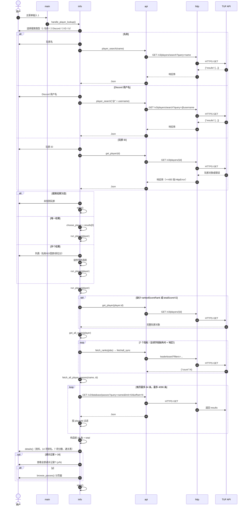

**关键边界**：

- 名称/Discord 搜索没有对 query 做 URL 编码（`player_search` 直接拼接），包含空格、`&`、中文、`#` 等字符时可能请求失败或语义改变。
- 名称搜索返回 0 条时只打印“未找到玩家”，仍会 `stats()`；异常（网络/HTTP/JSON）会冒泡到主菜单的 `catch`，打印“错误: ...”，不会调用 `stats()`。
- ID 模式会捕获 `get_player` 的所有异常并显示“未找到玩家”，把网络错误也当作“未找到”。
- `choose_player` 假设 `results` 非空且是数组；单个结果直接返回，不打印。
- 通关记录按名称查询，结果必须按 `playerId` 精确过滤；同名玩家不会混入。

### 7.3 通关记录分页与展示

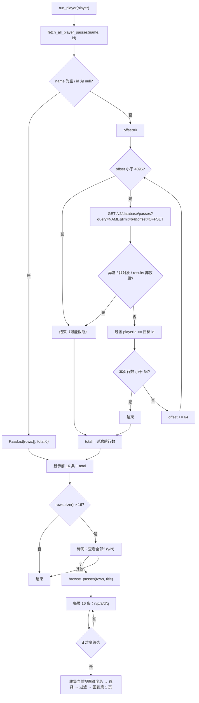

**展示细节**：

- `details` 只拿前 16 条（如果调用方传入 `passes`），表头会显示 `本页 16 条，共 N 条`。
- 如果不传入 `passes`（`details` 被单独调用），它会自己调用 `fetch_player_passes` 取 16 条。
- 分页器 `browse_passes` 接收已经拉全的记录，不再发网络请求；筛选/翻页都是本地操作。
- 记录行内的 `difficulty_name_of` 可能触发一次 `/v2/database/difficulties` 懒加载（只在首次且内嵌难度名缺失时）。

### 7.4 谱面查询与下载

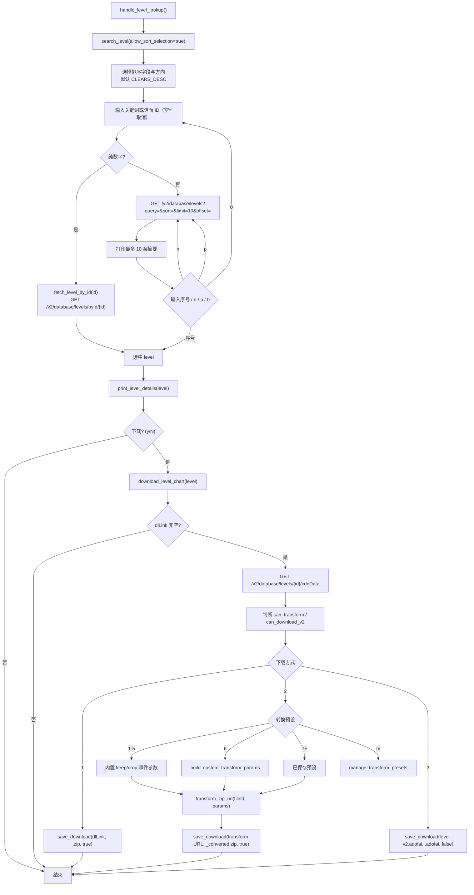

**网络与文件失败处理**：

- `cdnData` 请求失败不会中止整个下载，只提示“仍可下载原始 ZIP”；此时 `metadata`/`transformOptions` 为空，只能选原始 ZIP。
- `save_download` 捕获自身全部异常并打印“下载失败: ...”，不向上抛。
- 转换下载可能需要服务端先生成文件，代码提示“转换下载可能需要等待服务器生成文件...”，但超时仍是 60 秒。
- 原始 ZIP/转换 ZIP 会校验前两个字节为 `PK`；V2 `.adofai` 不校验内容。

### 7.5 PP 计算完整链路

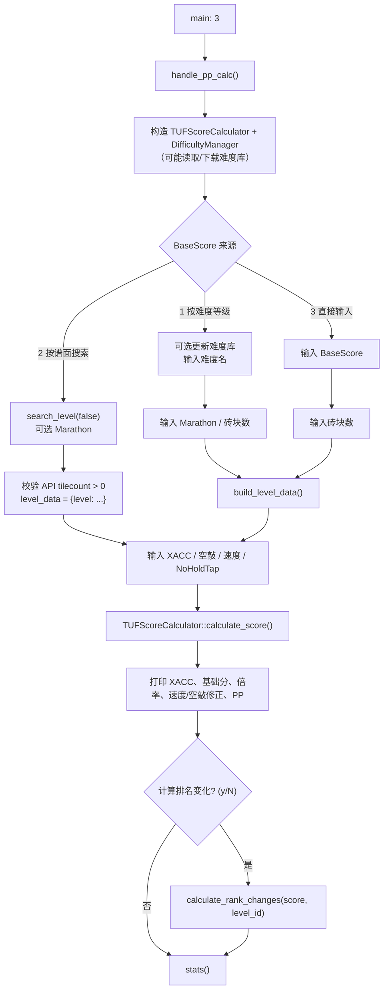

**PP 计算内部数据流**：

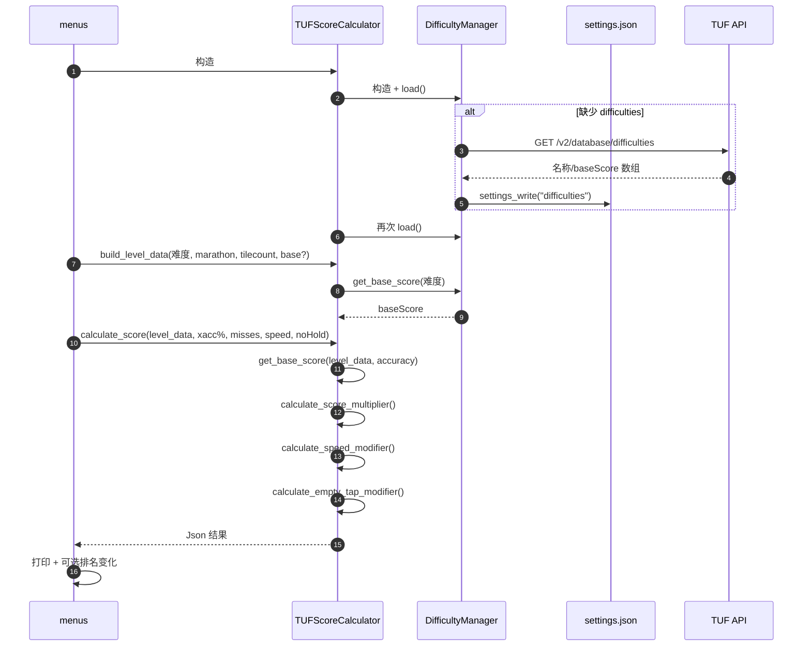

**注意**：

- 构造 `TUFScoreCalculator` / `DifficultyManager` 时就会 `load()`，缺数据会**立即下载**；即使最终选择“按谱面搜索”或“直接输入 BaseScore”，也可能发生这次网络请求。
- 来源 2 直接使用 API 返回的 level 对象；`calculate_score` 会优先读取 `xaccCurve`/`xaccCurveMeta`，因此谱面自定义曲线会影响 PP。
- 来源 1/3 使用 `build_level_data`，`xaccCurve` 为 null，走标准曲线。
- 空敲数的变量名在 `calculate_score` 中叫 `misses`，实际传给 `calculate_empty_tap_modifier`；它表示“空敲/漏按”而不是普通 miss 判定。
- `NoHoldTap` 的 0.95 修正只通过 `default_setting_mod` 参与，不改变 `baseScore`。

### 7.6 排名变化计算链路

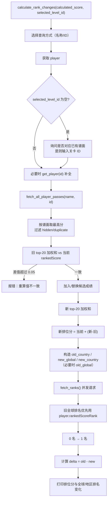

**排位分公式**：

```text
weighted = Σ_{i=0}^{min(20, n)-1} score_i * 0.9^i   （score 降序，每个谱面只取最高分）
```

**排名查询语义**：`leaderboard` 用 `[score, 999999999]` 过滤、`limit=1`、`order=desc`，取响应 `count` 作为“达到/超过该分数的人数”，代码把它当作排名。`rank_url` 对分数 0/缺失直接返回空，因此 0 分不会查询。

**误差容忍**：本地重算的旧加权分与玩家当前 `rankedScore` 必须相差不超过 0.05，否则拒绝估算。这能避免通关记录不完整/被隐藏导致错误结果，但也意味着部分玩家无法使用该功能。

### 7.7 XACC 正算、反推与等效组合

#### 7.7.1 正算

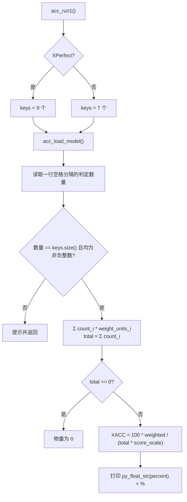

#### 7.7.2 反推

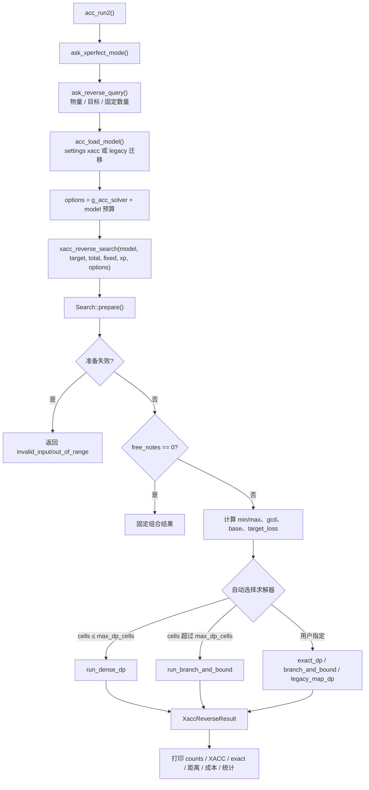

**反推输入细节**：

- 物量必须是正整数；固定数量**空回车表示不固定**，输入 `0` 表示“固定为 0”（该判定会被锁定为 0），输入负数/非整数会跳过该项并提示。
- 目标 XACC 使用 `xacc_parse_target`，最多 6 位小数；输入 `99.28%` 或 `99.28` 均可。
- 固定数量键按当前模式的 `jd_keys` 顺序逐个询问。
- `ask_reverse_query` 不检查固定数量总和是否超过物量；这个检查在 solver 的 `prepare` 中完成，错误会以 `invalid_input` 返回。
- 反推结果中固定键的值原样保留并标 `(Locked)`；自由键如果为 0 也会打印。

#### 7.7.3 等效组合

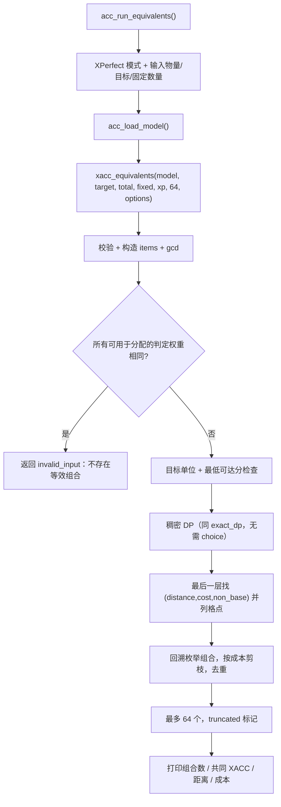

### 7.8 缓存生命周期

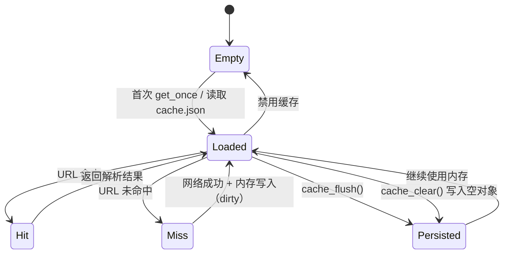

**清空缓存调用链**：

```text
main 菜单 5
  → 若 --no-cache：打印提示，不操作
  → 否则 cache_clear(error)
      → 加锁
      → cache_load_locked() 确保已读磁盘
      → g_cache.clear()
      → cache_write_locked() 写 {}
      → 成功："缓存已清空"
      → 失败："缓存清空失败: <error>"
```

---

## 8. 数据与持久化

### 8.1 数据目录

| 优先级 | 条件 | 结果 |
| ---: | --- | --- |
| 1 | `TUFTOOLS_DATA_DIR` 非空 | 使用该目录（尝试创建；不检查可写性） |
| 2 | exe 所在目录非空且可写 | 使用 exe 目录（便携模式） |
| 3 | 用户数据目录可确定 | 使用用户数据目录（尝试创建） |
| 4 | 以上都失败 | 返回 exe 目录（可能为空，文件名退化为相对路径） |

**可写性探测**：在目标目录创建 `.tuftools-write-test`，成功则关闭并删除；Windows 额外检查 `FILE_ATTRIBUTE_DIRECTORY`。

**数据目录只计算一次**（函数内 static）。如果运行期间环境变量或目录权限变化，不会重新计算。

### 8.2 `settings.json`

`settings.json` 保存除 HTTP 缓存外的全部持久数据。顶层是对象，目前使用的 section：

| section | 类型 | 写入者 | 读取者 | 说明 |
| --- | --- | --- | --- | --- |
| `xacc` | object | `xacc_model_save` | `xacc_model_load` | schemaVersion 2 的整数模型 |
| `difficulties` | array | `DifficultyManager::update` | `DifficultyManager::load` / `file_exists` | `{name, baseScore}` |
| `transformPresets` | array | `save_transform_presets` | `load_transform_presets` | 最多 5 条 `{name, params}` |
| `legacyCosts` | object | `costs_save`（目前无调用）/ legacy 迁移 | `costs_load` | 旧判定成本；XACC 迁移会读取 |
| 其他 | 任意 | 第三方/手工 | — | 保留不认识的 section |

**完整示例**（经过实际迁移后的典型文件）：

```json
{
  "legacyCosts": {
    "perfect": 0.0,
    "failMiss": 1.0,
    "tooEarly": 1.5,
    "early": 50.0,
    "late": 50.0,
    "ePerfect": 50.0,
    "lPerfect": 50.0
  },
  "difficulties": [
    { "name": "Unranked", "baseScore": 0 },
    { "name": "P1", "baseScore": 0.1 }
  ],
  "transformPresets": [
    {
      "name": "低特效",
      "params": {
        "keepEvents": "PositionTrack,RecolorTrack,ColorTrack,MoveTrack"
      }
    }
  ],
  "xacc": {
    "schemaVersion": 2,
    "scoreScale": 1000,
    "costScale": 1000,
    "maxDpCells": 8000000,
    "maxNodes": 20000000,
    "maxSeconds": 5.0,
    "weights": { "perfect": 1000, "failMiss": 0, "tooEarly": 200, "early": 400, "late": 400, "ePerfect": 750, "lPerfect": 750, "+perfect": 1000, "xperfect": 1000, "-perfect": 1000 },
    "costs": { "perfect": 0, "failMiss": 1000, "tooEarly": 1500, "early": 50000, "late": 50000, "ePerfect": 50000, "lPerfect": 50000, "+perfect": 10000, "xperfect": 0, "-perfect": 10000 }
  }
}
```

**写入语义**：

- `settings_write` 每次都会先读取当前根对象，再修改一个 section，最后整体覆盖写回。正常写入时不会丢失其他 section。
- 写入不是原子操作（没有临时文件 + rename）；进程崩溃/磁盘满可能留下截断文件，下一次读取会报解析错误并阻止依赖该 section 的操作（但不会自动恢复）。
- 文件编码为 UTF-8；缩进 2 空格；键顺序按内存中的 `ordered_json`（已有键保留位置）。
- `settings_read` 对缺失 section 返回 null + 成功；对文件不存在也返回 null + 成功；只有“文件存在但损坏/顶层非对象”才返回 false。

### 8.3 `cache.json`

| 项 | 说明 |
| --- | --- |
| 位置 | `data_dir()/cache.json` |
| 结构 | `{ "<完整URL>": "<响应体字符串>" }` |
| 编码 | JSON，2 空格缩进；响应体作为字符串转义 |
| 内容 | 只缓存非错误响应（`status < 400`）且 body 非空；空 body 不缓存 |
| 生命周期 | 懒加载 → 内存 map → 退出/清空时写回 |
| 失效 | 无自动失效；只能手动删除/清空 |
| 损坏 | 读取失败时清空内存并标记 dirty，下次写入覆盖 |
| 禁用 | `--no-cache` 时不读不写 |

> 缓存写入发生在 JSON 解析**之前**：如果服务器返回 200 但 body 不是合法 JSON（例如错误页），该 body 也可能被缓存；下一次命中会在 `Json::parse` 处抛异常。需要手动清空缓存。

### 8.4 Legacy 迁移矩阵

| 旧文件 | 迁移目标 | 迁移后旧文件 | 备注 |
| --- | --- | --- | --- |
| `xacc.json` | `settings.xacc` | `xacc.json.v1.bak` | 若 settings 已有 xacc 则不导入，直接退休 |
| `difficulties.json` | `settings.difficulties` | `difficulties.json.v1.bak` | 同上 |
| `transform_presets.json` | `settings.transformPresets` | `transform_presets.json.v1.bak` | 同上 |
| `costs.json` | `settings.legacyCosts` | `costs.json.v1.bak` | 供 XACC 迁移读取 |
| `weights.json` | 不导入 | `weights.json.v1.bak` | 权重是固定规则，文件被忽略并退休 |

重名备份规则：`<file>.v1.bak` 已存在时依次尝试 `.v1.bak.1`、`.v1.bak.2`……

### 8.5 数据一致性策略

- **配置**：XACC 模型在每次操作前加载一次；`settings.json` 由单线程 UI 读写，没有文件锁。
- **难度库**：更新时整体覆盖 `difficulties` section；API 返回空/异常时 `update()` 会写入空数组（因为 `raw` 非数组时 `result` 为空），可能清空本地难度库。使用时注意。
- **缓存**：缓存键是 URL，不包含代理、请求头、时间；切换 `--proxy` 或 API 版本后仍可能命中旧响应。
- **转换预设**：最多 5 条；读取时只取前 5 条；保存时写入当前列表。
- **没有 schema 迁移框架**：除了 legacy 文件迁移和 XACC 的 `schemaVersion=2`，其他 section 没有版本字段；未来格式变化需要手写兼容逻辑。

---

## 9. HTTP API 清单

所有请求都是 `GET`，无认证头，User-Agent 为 `tuftools/1.0 (cpp)`；默认超时 30 秒（下载 60 秒）；响应体完整读入内存。

| # | 方法与路径 | 用途 | 调用点 | 主要参数 | 备注 |
| ---: | --- | --- | --- | --- | --- |
| 1 | `GET /v3/players/search` | 玩家搜索 | `info.cpp::player_search` | `query` | 名称/Discord（`@` 前缀）；query 未编码 |
| 2 | `GET /v3/players/{id}` | 玩家详情 | `info.cpp::get_player` | 路径 ID | 搜索摘要不完整时补全 |
| 3 | `GET /v3/players/leaderboard` | 排名/人数 | `info.cpp::rank_url` | `query=&sortBy=&order=desc&offset=0&limit=1&showBanned=hide&filters=<json>` | `filters` 含分数范围和可选国家 |
| 4 | `GET /v2/database/difficulties` | 难度库 | `tools.cpp::DifficultyManager::update`、`info.cpp::difficulty_tables` | 无 | PP 难度库 + 通关表难度名回退 |
| 5 | `GET /v2/database/passes` | 玩家通关记录 | `info.cpp::fetch_all_player_passes` | `query=<玩家名>&limit=64&offset=N` | 按名字查询，客户端按 `playerId` 过滤 |
| 6 | `GET /v2/database/levels` | 谱面搜索 | `menus.cpp::search_level` | `query=&sort=<字段_方向>&limit=10&offset=N` | 分页，`hasMore` 控制下一页 |
| 7 | `GET /v2/database/levels/byId/{id}` | 按 ID 取谱面 | `menus.cpp::fetch_level_by_id` | 路径 ID | 兼容 `{level:{...}}` 与直接 level 对象 |
| 8 | `GET /v2/database/levels/{id}/cdnData` | 下载/转换元数据 | `menus.cpp::download_level_chart` | 路径 ID | `metadata.transformUnavailable`、`transformOptions.version` |
| 9 | `GET /cdn/levels/{fileId}/transform` | 转换 ZIP 下载 | `menus.cpp::transform_zip_url` | `format=zip` + 若干转换参数 | 参数名/值都 `url_quote` |
| 10 | `GET /cdn/levels/{fileId}/level-v2.adofai` | V2 谱面下载 | `menus.cpp::download_level_chart` | 路径 fileId | 需要 `transformOptions.version >= 18` |
| 11 | `GET /v2/database/levels/{id}/...` | （无其他） | — | — | — |

### 9.1 请求示例

**玩家搜索**：

```http
GET /v3/players/search?query=SleepingCui HTTP/1.1
Host: api.tuforums.com
User-Agent: tuftools/1.0 (cpp)
```

**排名**（filters 是 URL 编码后的 JSON）：

```text
/v3/players/leaderboard?query=&sortBy=rankedScore&order=desc&offset=0&limit=1&showBanned=hide&filters=%7B%22rankedScore%22%3A%5B12345.6%2C999999999%5D%7D
```

**通关记录**：

```text
/v2/database/passes?query=SleepingCui&limit=64&offset=0
```

**谱面搜索**：

```text
/v2/database/levels?query=Level&sort=CLEARS_DESC&limit=10&offset=0
```

**转换下载**：

```text
/cdn/levels/<fileId>/transform?format=zip&keepEvents=PositionTrack%2CRecolorTrack%2CColorTrack%2CMoveTrack
```

### 9.2 API 使用约定与假设

- 所有接口返回 JSON；`fetchapi_sync` 直接 `Json::parse`，非 JSON 会抛异常。
- 代码假设：
  - 玩家搜索结果在 `results` 数组；
  - 谱面搜索在 `results` 数组，分页状态在 `hasMore`；
  - 通关记录在 `results` 数组；
  - 难度列表是顶层数组；
  - leaderboard 的计数在 `count`；
  - `byId` 可能返回 `{level:{...}}` 或直接 level。
- 没有 API 版本协商、重试、限流处理；429 会作为 `HttpError` 抛给上层（排名请求会降级为 `?`，其他请求可能冒泡）。
- 官方 API 文档：[https://api.tuforums.com/docs/](https://api.tuforums.com/docs/)

---

## 10. 算法与公式

### 10.1 PP 计算

#### 10.1.1 基础分来源

```text
if accuracy == 1.0 and level.ppBaseScore != 0:  base = level.ppBaseScore
elif level.baseScore != 0:                      base = level.baseScore
elif difficulty.baseScore != 0:                 base = difficulty.baseScore
else:                                           base = 1000.0
```

来源标记会写入结果的 `base_source` 字段（`ppBaseScore` / `baseScore` / `difficulty.baseScore` / `default`）。

#### 10.1.2 XACC 曲线倍率

默认参数：

| 参数 | 默认值 | 含义 |
| --- | ---: | --- |
| `cutoff` | 0.95 | 低于该准确率不享受倍率（倍率 = 1） |
| `topMultiplier` | 5.51289781 | 高准确率端的渐近倍率 |
| `poleOffset` | 0.0054017154 | 双曲线极点偏移 |

公式（`cutoff ≤ accuracy < 1`）：

```text
span = 1 - cutoff
a = (topMultiplier - 1) * poleOffset * (span + poleOffset) / span
b = 1 - a / (span + poleOffset)
t = clamp((accuracy - cutoff) / span, 0, 1)

unit_shape = (b - a / (span * (t - 1) - poleOffset) - 1) / (topMultiplier - 1)
multiplier = 1 + (topMultiplier - 1) * unit_shape
```

边界：

- `accuracy < cutoff` 或 `accuracy > 1` → `1.0`。
- `accuracy == 1` → `-2100 / (base + 262.5) + 14`（`base != 0`）；`base == 0` 时 `1.0`。
- 曲线来源无效/越界时回退到默认参数；`xacc_curve_is_custom` 只影响显示，不影响是否使用默认值。

#### 10.1.3 速度修正

| 条件（普通） | 修正 |
| --- | ---: |
| `speed == 0` 或 `speed == 1` | 1.0 |
| `speed < 1` | 0.0 |
| `1 ≤ speed < 1.1` | `-3.5 * speed + 4.5` |
| `1.1 ≤ speed < 1.5` | 0.65 |
| `1.5 ≤ speed < 2.0` | `0.7 * speed - 0.4` |
| `speed ≥ 2.0` | 1.0 |

| 条件（Marathon） | 修正 |
| --- | ---: |
| `speed == 0` 或 `speed == 1` | 1.0 |
| `speed < 1` | 0.0 |
| `speed ≥ 1` | `max(0, 2 - speed)` |

#### 10.1.4 空敲修正

```text
adjusted = max(0, empty_taps - tilecount / 315)

empty_taps == 0        -> 1.1
adjusted == 0          -> 1.0
adjusted == 1          -> 0.9
adjusted <= 25.5       -> 0.9 - 0.2 * ((adjusted - 1) / 24.5) ^ 0.7
adjusted <= 50         -> 0.5 + 0.2 * ((50 - adjusted) / 24.5) ^ 0.7
否则                    -> 0.5
```

`tilecount / 315` 是整数除法（C++ 向零取整），即每 315 个砖块允许 1 个空敲不扣分。

#### 10.1.5 最终 PP

```text
default_setting_mod = is_no_hold_tap ? 0.95 : 1.0
raw_score = base * multiplier * speed_mod * empty_tap_mod * default_setting_mod
```

结果字段 `score` / `raw_score` 保存未取整的 double；显示时使用 `key_text()`（`py_float_str`），因此可能出现较多小数位。

### 10.2 排位分（rankedScore）估算

每个谱面只保留最高分（过滤隐藏/重复），取最高的 20 个，按 0.9 的几何衰减加权：

```text
weighted = Σ_{i=0}^{min(20, n)-1} score_i * 0.9^i
```

候选成绩的处理：

- 若 `candidate_level_id` 非空且该谱面已有成绩：只有候选分**更高**时才替换；否则忽略。
- 若该谱面没有成绩：直接加入。
- 若 `candidate_level_id` 为空：直接加入（不会去重）。

一致性校验：

```text
abs(player.rankedScore - weighted(old_scores)) <= 0.05
```

不满足则拒绝估算。满足时：

```text
new_score = player.rankedScore + (weighted(new_scores) - weighted(old_scores))
```

### 10.3 排名查询语义

`rank_url` 为某个指标构造：

```json
{
  "<sortBy>": [score, 999999999],
  "country": "<player.country>"   // 仅 scope=country
}
```

服务端按分数降序、`limit=1`，返回的 `count` 表示满足过滤条件的人数，即“分数 ≥ 当前分数”的人数，被当作排名。`offset=0`、`showBanned=hide`。

因此：

- 分数为 0 或缺失 → 不查询，显示 `?`。
- 并列分数时，`count` 可能不是唯一名次，而是“不低于该分数的人数”。
- 排名 0 被 `as_one_if_zero` 视为 1（用于显示与差值计算）。

### 10.4 XACC 定义与整数模型

#### 10.4.1 定义

```text
XACC(ratio) = Σ_i count_i * weight_i / total
XACC(%)     = 100 * ratio
```

其中 `total = Σ count_i`，权重来自固定表。整数模型：

```text
weight_i = weight_units_i / score_scale
score_units = Σ count_i * weight_units_i
XACC(%) = 100 * score_units / (total * score_scale)
```

默认 `score_scale = 1000`，因此权重表可以精确表示到 0.001。

#### 10.4.2 普通模式（7 键）

| 键 | 权重 |
| --- | ---: |
| `failMiss` | 0.00 |
| `tooEarly` | 0.20 |
| `early` | 0.40 |
| `ePerfect` | 0.75 |
| `perfect` | 1.00 |
| `lPerfect` | 0.75 |
| `late` | 0.40 |

#### 10.4.3 XPerfect 模式（9 键）

| 键 | 权重 |
| --- | ---: |
| `failMiss` | 0.00 |
| `tooEarly` | 0.20 |
| `early` | 0.40 |
| `ePerfect` | 0.75 |
| `+perfect` | 1.00 |
| `xperfect` | 1.00 |
| `-perfect` | 1.00 |
| `lPerfect` | 0.75 |
| `late` | 0.40 |

三种 perfect 子判定权重相同，因此同一分布的正算 XACC 在两种模式下一致；逆推时它们是不同键，成本不同（默认 `xperfect=0`、`+perfect=10`、`-perfect=10`）。

### 10.5 目标 XACC 的接受窗口

用户输入 `n / 10^d`（百分数）时，所有打印为该值（四舍五入到 d 位）的分数单位都算命中：

```text
接受区间 = [ (n - 0.5) / 10^d, (n + 0.5) / 10^d )   （百分数）
denominator = 200 * 10^d
base = total * score_scale
slo = ceil((2n - 1) * base / denominator)
shi = ceil((2n + 1) * base / denominator) - 1
```

- `slo`/`shi` 是整数分数单位的闭区间。
- `slo < 0` 时截为 0。
- `shi < slo` 表示该精度下不存在任何分数单位能打印成目标。
- 最近目标单位：`round(n * total * score_scale / (100 * 10^d))`，用于距离计算和 tie-break。

### 10.6 逆推目标与求解器

#### 10.6.1 目标函数（字典序）

1. **距离最小**：`|score_units - target_units|`；
2. **成本最小**：`Σ count_i * cost_units_i`；
3. **非 base 判定最少**：`free_notes - count[base_index]`；
4. **字典序**：按判定键顺序，靠前的键数量更多者优先。

所有比较都是整数，不使用浮点；只有 B&B 的 LP 下界/分支中心用 `long double` 做启发式。

#### 10.6.2 三种求解器对比

| 求解器 | 最优性 | 状态/空间 | 适用 | 预算 |
| --- | --- | --- | --- | --- |
| `exact_dp` | 可证明最优 | `Σ(t*max_ur+1)` 格；`O(free^2*max_ur)` 内存 | 小规模、格数 ≤ `maxDpCells` | `maxDpCells` |
| `branch_and_bound` | 未耗尽预算时最优 | 支配表最多 2,000,000 项 | 大规模、DP 放不下 | `maxNodes`、`maxSeconds` |
| `legacy_map_dp` | **不保证** | 每层 loss→状态；上限 2,000,000 | 对比/回退 | 固定 2,000,000 |

自动选择：

```text
estimate_cells = Σ_{t=1..free} (t * max_ur + 1)
if estimate_cells <= max_dp_cells: exact_dp
else: branch_and_bound
```

用户显式选择 `exact_dp` 但超预算时 → `budget_exhausted`，会提示改用分支定界或减小物量。

#### 10.6.3 精确 DP 递推

```text
DP[0][0] = (cost=0, non_base=0)
for t in 1..free:
  for each item i:
    for each reachable k in layer t-1:
      DP[t][k + ur_i] = min_lex(
          DP[t][k + ur_i],
          (DP[t-1][k].cost + cost_i, DP[t-1][k].non_base + (i==base?0:1))
      )
```

- 每层恰好放一个自由音符；`ur_i` 可以为 0（与最低权重相同）。
- 最后一层格点 `k` 对应分数 `base_score_all + k * gcd`。
- 回溯 `choice` 得到 counts；对最多 64 个并列最优 `k` 做最终字典序决胜。

#### 10.6.4 分支定界剪枝

| 剪枝 | 说明 |
| --- | --- |
| 预算 | 节点数 > `maxNodes`；每 1024 节点检查一次时间 > `maxSeconds` |
| 支配 | `(position, remaining, accumulated_ur)` 已以更低成本且 non_base 不更差访问过 |
| 区间/同余 | 剩余可达损失区间与目标的最短同余距离 > 当前最优距离 |
| LP 成本 | 当前距离已为 0 时，剩余音符的最低线性成本下界超过当前最优成本 |
| 数量边界 | 当前 item 取 `n` 个后，剩余最小/最大可达损失必须覆盖目标窗口（按当前最优距离放宽） |
| 分支顺序 | 以闭式估算 `needed_ur / ur_i` 为中心向两侧展开 |

#### 10.6.5 旧版 map DP 的窗口

旧实现用固定的 `slack = 0.4 * score_scale` 个分数单位放宽窗口（N=100 时约 ±0.4 个百分点；折合百分点随 N 变化），并限制在 4096 个“20 倍权重”单位内。移植版保持同样思路：

```text
half_exact = ceil(total * score_scale / (200 * 10^d))
slack = 0.4 * score_scale
cap = 4096 * score_scale / 20
half = min(max(half_exact, slack), cap)
```

因此旧版求解器可能接受比精确窗口更宽的分数，结果不一定落在用户输入精度对应的窗口内；`exact` 标志会如实反映。

#### 10.6.6 等效组合

等效组合不是“所有相同 XACC 的组合”，而是**与最优解在 `(distance, cost, non_base)` 上并列**的组合。它们总成本相同；当 `distance == 0`（精确命中）时打印 XACC 也相同。若最优解只是近似，并列格点可能落在目标两侧，实际 XACC 未必完全一致（见 6.12.7、14.7）。若用户只关心 XACC 而不关心成本，实际等效集合可能更大，但不会被列出。

### 10.7 判定名称与难度显示

- 难度的 `name` 优先来自谱面内嵌对象。
- 回退表分 `id` 与 `sortOrder` 两张，避免交叉串名。
- 找不到时返回 `-` 或 `diffId` 原值。
- 显示宽度按码点近似计算，宽字符 2 列；不处理零宽连接符/组合 emoji。

### 10.8 数字与格式语义

| 场景 | 实际行为 |
| --- | --- |
| `format_fixed` | C `printf("%.*f")`，依赖当前 locale（程序未显式设置 locale，通常为 C） |
| `py_float_str` | `std::to_chars` 最短表示；整数浮点补 `.0` |
| `py_round` | `printf("%.*f")` 后 `strtod`，不是 Python 十进制舍入 |
| `Json::as_double` | 字符串解析失败返回 0，不抛异常 |
| `Json::as_int` | 浮点直接截断；字符串解析失败返回 0 |
| `Json::as_string` | null → `"null"`、对象 → JSON dump |
| `url_quote` | 按 UTF-8 字节百分号编码，保留 `/` |

---

## 11. 错误处理、并发与平台差异

### 11.1 异常模型

| 异常 | 来源 | 典型处理 |
| --- | --- | --- |
| `tuf::InputClosed` | `console.hpp::read_line` 遇到 EOF | 一路抛到 `main`，按正常退出处理并刷新缓存 |
| `std::runtime_error` | 网络传输失败、JSON 解析失败、业务校验、未知难度、文件写入失败 | 菜单内捕获并打印；未捕获则由 `main` 返回 1 |
| `tuf::HttpError` | `http_get` 遇到 HTTP ≥ 400 | 携带 `status`/`body`；verbose 打印错误体；部分调用方降级为 `?`/空列表 |
| `nlohmann::json::parse_error` | `Json::parse` | 作为 `std::exception` 处理 |

**分层策略**：

- **底层网络**：不重试、不吞错；`http_get` 只负责一次请求。
- **API 层**：缓存损坏吞掉；网络错误继续抛；批量请求每项独立捕获。
- **业务层**：
  - 排名：失败 → `?`；
  - 通关记录：某页失败 → 返回已收集部分；
  - 难度表：加载失败 → 空表（显示 fallback）；
  - 玩家搜索/谱面搜索：异常冒泡到主菜单；
  - 配置：尽量回退默认值；XACC 模型无法构建时中止该次操作。
- **顶层**：主菜单每轮捕获 `std::exception` 继续；`main` 兜底。

### 11.2 `XaccStatus` 与用户提示

| 状态 | 典型原因 | 菜单输出 |
| --- | --- | --- |
| `invalid_input` | 物量 ≤ 0、固定数量为负/不属于当前模式、固定总数 > 物量、目标格式错误、溢出 | “无法达成该目标 XACC: ...” 或输入阶段直接提示 |
| `invalid_config` | 保留，当前未主动返回 | — |
| `out_of_range` | 可达分数范围与目标窗口无交集 | 提示可达范围 |
| `unreachable` | 搜索完成但没有可行组合 | “目标不可达” |
| `budget_exhausted` | DP 格数/节点/时间/旧版状态超限 | “预算耗尽” |
| `ok` | 有结果 | 打印分布 |

`XaccReverseResult.optimal=false` 表示预算截断，结果可能不是最优；`exact=false` 表示结果不在用户输入精度的窗口内，但可能是最接近值。二者语义不同，UI 都会提示。

### 11.3 并发模型

| 位置 | 并发方式 | 同步 |
| --- | --- | --- |
| 主流程 | 单线程顺序执行 | 无 |
| `fetchall_sync` | 每个 URL 一个 `std::thread` | 结果数组按索引写；每个线程只写自己的 `results[i]` |
| 缓存 map | 多个 fetch 线程可能同时访问 | `g_cache_mutex` 保护；网络请求在锁外 |
| 输出 | 多线程 verbose 日志 | `g_print_mutex` 串行化整行 |
| 计数器 | 多线程请求 | `std::atomic<int>` / `std::atomic<long long>` |
| 配置/难度表 | 只在主线程访问 | 不需要锁；`difficulty_tables` 的 static 初始化线程安全 |

**竞态/重复请求**：两个线程同时请求同一个未缓存 URL 时，都会发出网络请求，后完成者覆盖缓存；没有请求合并（single-flight）。当前批量排名 URL 互不相同，因此影响小。

### 11.4 平台差异

| 方面 | Windows | macOS | Linux |
| --- | --- | --- | --- |
| HTTP | WinHTTP | libcurl | libcurl |
| 代理 | `WinHttpOpen(NAMED_PROXY)` | `CURLOPT_PROXY` | 同左 |
| 重定向 | 未显式设置策略（依赖 WinHTTP 默认） | `FOLLOWLOCATION=1, MAXREDIRS=10` | 同左 |
| 压缩 | 支持时启用 WinHTTP 解压 | `ACCEPT_ENCODING=""` | 同左 |
| 状态原因 | 详细表 | 粗粒度表 | 粗粒度表 |
| 数据目录 | exe 目录 / `%LOCALAPPDATA%\tuftools` | exe 目录 / `~/Library/Application Support/tuftools` | exe 目录 / `$XDG_DATA_HOME/tuftools` 或 `~/.local/share/tuftools` |
| 可执行路径 | `GetModuleFileNameW` | `_NSGetExecutablePath` + `realpath` | `/proc/self/exe` |
| 控制台 UTF-8 | 显式设置代码页 | 终端负责 | 终端负责 |
| 终端宽度 | `GetConsoleScreenBufferInfo` | `ioctl(TIOCGWINSZ)` | 同左 |
| 静态链接 | MinGW 加 `-static` | — | — |
| 文件路径拼接 | `\` | `/` | `/` |

### 11.5 网络失败行为矩阵

| 操作 | 失败表现 | 是否继续 |
| --- | --- | --- |
| 玩家搜索 | 异常冒泡，主菜单打印“错误: ...” | 继续主菜单 |
| 玩家 ID 查询 | `catch(...)` → “未找到玩家” | 继续子菜单 |
| 排名查询 | 单项 `?` | 继续展示其他数据 |
| 通关记录分页 | 当前页异常 → 停止翻页 | 展示已取到的记录 |
| 难度表（通关表回退） | 空表 | 显示 `-`/ID |
| 难度库更新（PP） | 捕获并打印“更新失败/下载失败” | 来源 1 可能提前返回；来源 2/3 也因构造时加载失败而中止 |
| 谱面搜索 | 捕获并打印，回到关键词输入 | 继续 |
| 按 ID 查询谱面 | 捕获并打印，回到关键词输入 | 继续 |
| `cdnData` | 捕获并提示，只能原始 ZIP | 继续 |
| 文件下载 | 捕获并打印“下载失败” | 返回菜单 |
| 缓存读写 | 读损坏 → 空缓存；写失败 → verbose 日志 | 继续 |

---

## 12. 调试与可观测性

### 12.1 verbose 输出

```bash
./build/tuftools -v
```

会看到：

```text
#1 GET https://api.tuforums.com/v3/players/search?query=...
    <- #1 200 OK  45.67 ms  1234 B
#2 GET https://api.tuforums.com/v3/players/12345
    <- #2 200 OK  38.12 ms  5678 B
...
used 9 requests, span 512.34 ms (请求累计 498.76 ms)，命中缓存 0 次
======================================================================
```

- `#n` 是真实网络请求序号；缓存命中显示 `#cached`。
- 首次请求在非 verbose 下只打印 `查询中...`。
- `fetchall_sync` 的日志顺序可能交错，但每行完整。
- XACC 求解器 trace（`verbose_enabled()` 时才构建字符串）会打印：模式、物量、固定/自由、目标窗口、gcd、base、求解器选择、分支顺序、上界更新、剪枝统计、最终 count。

### 12.2 JSON 响应转储

```bash
./build/tuftools -v --dump-json
```

每个响应后追加：

```text
    | (JSON)
    | {
    |   "results": [ ... ]
    | }
```

- 最多 256 KiB；超出会截断并注明原始字节数。
- 非 JSON（HTML 错误页等）标记 `(原始文本)` 并原样输出。
- HTTP 错误时也会输出错误响应体（如果有）。

### 12.3 统计与缓存

- 每个玩家查询/PP 计算结束会打印 `stats()`；其中：
  - `used N requests` 只统计真实网络请求；
  - `span` 是首个请求开始到末个请求结束；
  - `命中缓存 N 次` 单独统计。
- 全部命中缓存时 `count=0`、`hits>0`：非 verbose 下打印 `总耗时: 0.00 ms，命中缓存 N 次`，verbose 下打印 `used 0 requests, span 0.00 ms ...`，随后打印分隔线；`span` 没有真实请求可测，因此为 0。

### 12.4 使用桩服务器/镜像

```bash
TUFTOOLS_API_BASE=http://127.0.0.1:8080 ./build/tuftools -v
```

- 该变量在进程启动时读取一次；值不要以 `/` 结尾（代码直接拼接 `/v3/...`，结尾斜杠会产生 `//`，多数服务器可容忍，但不保证）。
- 可以用简单 HTTP 服务返回固定 JSON 来复现解析/排版问题；下载 CDN 也会指向该 base（路径 `/cdn/...`）。

### 12.5 隔离数据目录

```bash
TUFTOOLS_DATA_DIR=$(mktemp -d) ./build/tuftools
```

- 适合测试迁移、清空缓存、配置损坏等场景，不影响 exe 旁的 settings。
- 目录会被自动创建；如果不可写，后续 settings/cache 写入会失败并打印错误。

### 12.6 关闭缓存

```bash
./build/tuftools --no-cache
```

- 不读不写 `cache.json`；每次查询都走网络。
- 主菜单 5 只提示“已启用 --no-cache，本次运行不会读写缓存”，不会清空磁盘上的旧缓存。

### 12.7 常用排障表

| 现象 | 可能原因 | 处理 |
| --- | --- | --- |
| `错误: HTTP 404 ...` | API 路径/ID 错误、服务端变更 | 用 `--dump-json` 看错误体；核对 API 文档 |
| `未找到玩家` 但 ID 确定存在 | ID 查询异常被当作“未找到” | 开 `-v` 看真实 HTTP 错误 |
| 排名全是 `?` | 分数为 0、leaderboard 失败、字段缺失 | `-v` 看请求；确认玩家分数 |
| 通关表难度显示 ID | 内嵌难度名缺失且难度表请求失败 | 检查网络/缓存；清空缓存重试 |
| 排位分无法计算 | 本地通关记录重算与 `rankedScore` 差 > 0.05 | 通常是记录不完整/隐藏；无法绕过 |
| XACC 反推“预算耗尽” | 物量大/权重步长多/预算小 | 增大 `maxDpCells`/`maxNodes`/`maxSeconds`，或改用分支定界 |
| XACC 结果 `exact=false` | 该物量下无法精确到输入小数位 | 输入更多/更少小数位，或接受最接近值 |
| 启动即报难度下载失败 | 构造 `TUFScoreCalculator` 时强制加载难度库 | 恢复网络/代理，或手工准备 `settings.difficulties` |
| `缓存清空失败` | 数据目录不可写 | 检查权限/`TUFTOOLS_DATA_DIR` |
| 直接编译报 `version.hpp` 缺失 | 使用了 `direct`/`mingw` 后端 | 改用 CMake 后端或手动生成/包含版本头 |

---

## 13. 扩展指南

### 13.1 新增一个主菜单功能

1. 在合适的模块头文件声明入口函数（例如 `menus.hpp` 或新模块）。
2. 在 `main.cpp` 的主菜单打印项与 `if/else` 分发中加入分支。
3. 入口函数内部遵循现有约定：
   - 用 `tuf::read_trimmed` 读取输入；
   - 用 `tuf::fetchapi_sync` 访问 API；
   - 业务错误抛 `std::runtime_error`，让主菜单统一打印；
   - 结束时按需调用 `tuf::stats()`。
4. 如果是新 `.cpp`，确保它匹配 `src/*.cpp` 的 CMake glob；重新运行 CMake 配置。

### 13.2 新增 API 端点

- 在业务模块拼接 URL 时使用 `BASE_URL` 和 `url_quote`；不要硬编码 `https://api.tuforums.com`。
- 所有请求应经过 `fetchapi_sync`，以自动获得缓存、计数、verbose。
- 对可能失败且可降级的查询（排名、附加元数据）使用 `try/catch` 返回默认值；对核心查询让异常冒泡。
- 如果响应可能为空/字段缺失，先检查 `is_object()` / `is_array()` / `is_number()`；不要直接依赖 `as_string()` 的 `"null"` 行为。

### 13.3 新增持久化配置

1. 在 `apppaths.hpp`/`settings_write` 的 section 命名空间中选一个唯一名字。
2. 读取时处理“section 不存在（null）”“类型错误”“字段缺失”三种情况；尽量回退默认值。
3. 写入时只写自己的 section，`settings_write` 会保留其他 section。
4. 如果格式可能演进，加入 `schemaVersion` 并像 `xacc` 一样实现 `parse_v2` 式校验。
5. 如需从旧文件迁移，在 `apppaths.cpp::kLegacyDataFiles` 注册文件名与 section，或在模块内自行读取并写入后显式退休。

### 13.4 新增 XACC 求解器

1. 在 `xacc_model.hpp` 的 `XaccSolver` 增加枚举值，并在 `xacc_solver_text` / `xacc_solver_from_text` / `xacc_solver_all` 中登记。
2. 在 `Search` 中实现 `run_xxx()`，返回 `XaccReverseResult`：
   - 成功必须调用 `build_result(candidate, optimal, solver, states, cells)`；
   - 失败使用 `fail(status, message)`；
   - 预算截断时设置 `optimal=false` 并在 `note` 中说明。
3. 在 `Search::run()` 的 `switch` 中分发；自动选择逻辑按需加入估算。
4. 如果新求解器改变目标函数，务必复用 `candidate_better`，否则不同求解器结果不可比。
5. 在 `menus.cpp` 的求解器菜单/别名中补充显示名称。

### 13.5 修改判定权重或成本

- **权重**：修改 [`src/weights.cpp`](../src/weights.cpp)。注意这会改变 XACC 的定义；已有 `settings.json` 中的 weights 会在下次加载时被覆盖。
- **成本**：修改 [`src/tools.cpp::default_jd_costs`](../src/tools.cpp#L98)，或通过 XACC 菜单 4 在运行时编辑（保存到 settings）。
- 修改权重后，建议同时检查 `jd_keys` 顺序、`jd_cost_keys` 顺序、XPerfect 模式的键集合，以及文档/测试。
- `score_scale` 必须能精确表示所有权重（当前 1000 可表示 0.2/0.4/0.75/1.0）。

### 13.6 构建与发布

- 本地：`./build.sh`（Linux/macOS）或 `./build.ps1`（Windows）。
- 新版本：打 tag 后 CMake 会自动用 tag 作为 `TUF_VERSION`；CI 也可以手动生成 `YYYYMMDD-shortsha` tag。
- 发布 workflow 只构建 Windows `tuftools.exe`；macOS/Linux 需自行构建。
- 如果新增源文件/资源，检查 CMake glob、安装/发布产物、README 和本文档。

### 13.7 建议补充的测试

当前没有测试。若后续引入测试，优先覆盖：

1. `xacc_target_window` / `xacc_parse_target` 的边界（0、100、6 位小数、溢出）。
2. `xacc_model` 的 v2 解析、缺失键补全、权重覆盖、legacy 迁移。
3. 三种求解器在同一小规模输入上的一致性（distance/cost/non_base）。
4. `calculate_rank_changes` 的 top-20 替换逻辑与 0.05 校验。
5. `fetch_all_player_passes` 的分页/过滤/短页终止（用桩 HTTP 服务）。
6. 表格排版的宽字符截断与分页器筛选。
7. `apppaths` 的目录优先级与 legacy 备份命名。

---

## 14. 已知限制与风险

> 以下条目按“对使用/维护的影响”排序。部分是有意设计，部分是移植遗留问题。

### 14.1 构建/运行环境

1. **`direct` / `mingw` 后端缺少 `version.hpp`**
   - `build.sh direct` 与 `build.ps1 mingw` 只加 `-Ithird_party`，而 `main.cpp` 需要 `version.hpp`；从干净树直接构建会失败。
   - 影响：README 声称的“不经 CMake 直接编译”目前不可用。
   - 规避：使用 CMake 后端；或先配置 CMake 生成 `build/generated/version.hpp`，再在命令中加 `-Ibuild/generated`（并可能需要 `-Isrc`）。

2. **`--clean` 会删除 `settings.json` / `cache.json`**
   - `build.sh` / `build.ps1` 的清理逻辑只备份 `costs.json`、`difficulties.json` 两个 legacy 文件，不备份当前真正使用的 `settings.json` 和 `cache.json`。
   - 影响：用户数据目录若就是 `build/`，`--clean` 会丢失难度库、XACC 配置、转换预设和缓存。
   - 规避：把数据目录指向 `build/` 之外（`TUFTOOLS_DATA_DIR`），或手动备份。

3. **`settings.json` 写入非原子**
   - 直接 `ofstream` 截断写入；崩溃/磁盘满可能留下半截文件。
   - 影响：下次启动读取失败；依赖该 section 的操作会报错。缓存文件损坏可以自愈；被缓存的非 JSON 响应需要手动清空。settings 不会自动恢复。

### 14.2 网络/API

4. **玩家搜索未做 URL 编码**
   - `player_search` 直接拼接 `?query=`；名称含空格、`&`、`#`、`+`、中文等可能被截断或误解。
   - `get_player` 的 ID 也未编码。
   - 影响：部分玩家名/ID 搜索失败；Discord 用户名中的特殊字符同理。

5. **缓存无失效、无 TTL、可能缓存错误体**
   - 同一 URL 永久命中，直到手动清空；API 数据更新后仍显示旧值。
   - 200 但非 JSON 的响应在解析前写入缓存，后续命中会持续解析失败。
   - 切换代理/API base 后 URL 可能相同，仍命中旧缓存。

6. **没有重试/限流/退避**
   - 429/5xx 直接失败；排名请求降级为 `?`，其他可能冒泡。
   - 批量排名一次性开最多约 14 个线程，没有并发上限。

7. **WinHTTP 重定向策略未显式设置**
   - libcurl 显式跟随最多 10 次；WinHTTP 的行为依赖默认策略，跨平台可能不一致。

8. **下载超时 60 秒、整包读入内存**
   - 大谱面/慢速网络可能超时；转换下载可能需要更久。
   - 响应体全部在内存中，峰值内存约为文件大小。

### 14.3 数据语义

9. **`as_string()` 对 null 返回 `"null"`**
   - 多处可选字段（`dlLink`、`fileId`、`videoLink`、`workshopLink` 等）用 `as_string().empty()` 判空，null 会得到非空 `"null"`。
   - 影响：缺失字段可能被当成字面量 `"null"` 使用（例如尝试下载 `"null"` URL）。
   - 代码在部分地方已显式 `is_string()` 检查（如难度名），但并非全部。

10. **通关记录最多 4096 条**
    - `kMaxPassScan=4096`，每页 64；超过部分不会拉取。
    - 任何一页失败会静默返回部分数据，`total` 也只是已取到的数量，不是真实总数。

11. **排位分估算依赖本地记录完整性**
    - 必须能用本地通关记录重算出与 `rankedScore` 相差 ≤0.05 的旧值；隐藏/重复/缺失记录或 API 计算差异都会导致失败。
    - 候选谱面 ID 不校验是否存在；用户输入错误 ID 会当作“新谱面”加入。

12. **难度库更新可能写空**
    - `DifficultyManager::update()` 在 API 返回非数组时写入空数组；网络异常则抛异常。
    - 影响：一次异常响应可能清空本地难度库。

13. **XACC 权重固定、不可配置**
    - 这是有意的游戏规则；`settings.xacc.weights` 中自定义值会被覆盖并提示。
    - 修改权重必须改代码并重新编译。

14. **旧版 map DP 不保证最优**
    - 仅保留作对比/回退；UI 会显示 note。
    - 其损失窗口比精确窗口更宽，可能返回 `exact=false` 的结果。

15. **精确 DP 的并列回溯上限 64**
    - `kMaxLexTies=64`；如果同一距离/成本/non_base 的格点超过 64 个，最终字典序选择可能不是全局字典序最小（但分数/成本/non_base 仍最优）。

16. **B&B 预算耗尽时结果未证明最优**
    - `optimal=false`；UI 会提示。对极端输入，可能需要调大预算或改用 DP。

17. **部分乘法未走 checked helper**
    - 例如 B&B 的 `remaining * last.ur`、等效集的 `best_ks.front() * divisor`。
    - 在正常输入范围内通常安全，但极端物量/精度下存在有符号溢出风险。

### 14.4 UI/显示

18. **分页器筛选后页数不更新**
    - `browse_passes` 的 `page_count` 在进入循环前按原始列表计算；筛选后仍显示旧页数，可能允许翻到空页。
    - 功能仍可用（不会崩溃），只是页码/“最后一页”判断不准确。

19. **窄终端可能溢出**
    - 谱面列最小 24 列，其他列按内容取宽；总宽超过终端时不会换行/压缩所有列。
    - 标签列不截断。

20. **宽字符宽度是近似值**
    - 不处理组合字符、零宽字符、部分 emoji 序列；对齐可能偏差。

21. **`py_round` 与 Python 不完全一致**
    - 使用 C `printf` 舍入；对 `.5` 边界可能与 Python 的十进制/银行家舍入不同。

22. **`parse_double_or_throw` 接受 `nan`/`inf`**
    - `std::stod` 的输入范围比 Python `float()` 更宽；后续计算可能得到非有限值，部分路径没有显式拒绝。

23. **`stats()` 不是所有流程都调用**
    - 谱面查询、XACC 菜单不打印请求统计；只有玩家查询和 PP 计算结束调用。

### 14.5 与 README 的差异

| README 描述 | 实际代码 |
| --- | --- |
| `tuftools [--proxy VAR] [--verbose]` | 还有 `--dump-json`、`--no-cache` |
| `./build.sh direct` / `build.ps1 mingw` 可用 | 当前缺少 `version.hpp`，直接构建失败 |
| 数据文件在 exe 同目录，提到 `costs.json`/`difficulties.json` | 当前主数据是 `settings.json` + `cache.json`；旧文件仅迁移源 |
| 目录表只列主要模块 | 还有 `xacc_model.*`、`xacc_solver.*`、`weights.cpp` |
| `menus.cpp` 只对应 `ppcalc.py`/`acccalc.py` | 还包含谱面查询、下载、转换预设 |

### 14.6 Legacy `xacc.json` 的 schema 风险

`apppaths.cpp` 把 `xacc.json` 原样导入 `settings.xacc`，但 `xacc_model_load` 对该 section 只接受 `schemaVersion: 2`。如果旧文件是 v1/无版本格式：

- 导入会成功，`xacc.json` 会被改名为 `.v1.bak`；
- 下一次 XACC 操作会报 `settings.json (xacc) 的 schemaVersion 不是 2`；
- 需要手工修正或删除 `settings.xacc`，让程序重新走 `migrate_legacy`。

这是自动迁移中唯一会“成功导入但不可用”的格式；`costs.json`/`difficulties.json`/`transform_presets.json` 都是直接按 JSON 结构读取，不要求 schemaVersion。

### 14.7 等效组合与固定数量的语义偏差

- `xacc_equivalents` 的 items 包含所有判定键（包括用户固定数量的键），自由音符可以继续加到固定键上。因此结果可能**超过**用户指定的固定值；例如固定 `perfect=99`、物量 100、目标 100% 时，可能返回 `perfect=100`。
- `Search`（普通反推）则严格把固定键排除在自由分配之外。两者对“固定”的解释不同，使用时不要把等效集的固定值当成硬约束。
- 如果多个并列 `k` 位于目标两侧且距离相同，`out.score_units` 只取第一个；`solutions` 可能包含实际 XACC 不同的组合，UI 的“均达成 XACC”并不保证对每一项都成立。

### 14.8 其他输入/显示细节

- **未知大小下载的速度单位**：没有 `Content-Length` 时，进度代码把速度按 MiB/s 计算却显示为 `KiB/s`；有总大小时显示正确。
- **PP 输入范围**：XACC、空敲数、速度没有强制范围校验；负速度/负空敲会得到 0 或 1 倍修正，XACC >100 会走 `accuracy > 1` 分支（倍率 1）。
- **固定数量 0**：反推时输入 `0` 会锁定为 0，只有空回车才表示不固定；这与“输入 0 等于不限制”的直觉不同。
- **`NoHoldTap` 只影响 PP**：它不改变 XACC 计算，也不影响逆推。

### 14.9 编译器可移植性

- `xacc_solver.cpp` 的等效集实现使用 `std::__gcd`（libstdc++ 扩展）。MSVC 和 libc++ 不保证提供该符号，可能导致 Windows MSVC 或 macOS libc++ 构建失败。项目已有 `tuf::gcd_i64`，应替换为它。
- `build.ps1` 只实现了 MinGW（g++）路径；MSVC 需要直接用 CMake/Visual Studio 生成器，且要留意上面的 `std::__gcd` 问题。
- `std::filesystem` 在 GCC <9 需要 `stdc++fs`，CMake 已处理；C++17 的 `std::to_chars(double)` 需要较新的 MSVC/Clang libc++。

---

## 15. 源码索引

> 行号基于 commit `969546d`。链接使用仓库相对路径；在 GitHub/支持锚点的 Markdown 查看器中可直接跳转。

### 15.1 入口与通用工具

| 符号 | 文件:行 | 说明 |
| --- | --- | --- |
| `run` | [`src/main.cpp:15`](../src/main.cpp#L15) | CLI + 主循环 |
| `main` | [`src/main.cpp:103`](../src/main.cpp#L103) | 顶层异常处理 |
| `setup_console_utf8` | [`src/console.hpp:23`](../src/console.hpp#L23) | 控制台 UTF-8 |
| `terminal_width` | [`src/console.hpp:34`](../src/console.hpp#L34) | 终端宽度 |
| `InputClosed` | [`src/console.hpp:73`](../src/console.hpp#L73) | EOF 异常 |
| `read_line` / `read_trimmed` | [`src/console.hpp:79`](../src/console.hpp#L79) / [`87`](../src/console.hpp#L87) | 输入 |
| `parse_double_or_throw` / `parse_int_or_throw` | [`src/console.hpp:90`](../src/console.hpp#L90) / [`104`](../src/console.hpp#L104) | 数字解析 |
| `format_fixed` | [`src/numfmt.hpp:10`](../src/numfmt.hpp#L10) | 定长小数 |
| `trim_fixed` | [`src/numfmt.hpp:17`](../src/numfmt.hpp#L17) | 去尾零 |
| `decimal_places_of` | [`src/numfmt.hpp:35`](../src/numfmt.hpp#L35) | 小数位数 |
| `Json` | [`src/pyjson.hpp:35`](../src/pyjson.hpp#L35) | JSON 适配类 |
| `py_float_str` | [`src/pyjson.hpp:200`](../src/pyjson.hpp#L200) | Python 浮点字符串 |
| `py_round` | [`src/pyjson.hpp:213`](../src/pyjson.hpp#L213) | Python 风格 round |
| `py_repr` / `py_text` | [`src/pyjson.hpp:242`](../src/pyjson.hpp#L242) / [`272`](../src/pyjson.hpp#L272) | repr/展示 |
| `url_quote` | [`src/pyjson.hpp:276`](../src/pyjson.hpp#L276) | URL 编码 |

### 15.2 数据目录 / 网络 / API

| 符号 | 文件:行 | 说明 |
| --- | --- | --- |
| `executable_dir` | [`src/apppaths.cpp:195`](../src/apppaths.cpp#L195) | 可执行文件目录 |
| `compute_data_dir` | [`src/apppaths.cpp:175`](../src/apppaths.cpp#L175) | 数据目录优先级 |
| `data_dir` / `data_file` | [`src/apppaths.cpp:226`](../src/apppaths.cpp#L226) / [`231`](../src/apppaths.cpp#L231) | 目录/文件名 |
| `settings_read` / `settings_write` | [`src/apppaths.cpp:241`](../src/apppaths.cpp#L241) / [`248`](../src/apppaths.cpp#L248) | settings 读写 |
| `load_settings_root` | [`src/apppaths.cpp:67`](../src/apppaths.cpp#L67) | 根对象 + legacy 迁移 |
| `user_data_dir` | [`src/apppaths.cpp:154`](../src/apppaths.cpp#L154) | 用户数据目录 |
| `http_get`（Windows） | [`src/http.cpp:84`](../src/http.cpp#L84) | WinHTTP 实现 |
| `http_get`（POSIX） | [`src/http.cpp:247`](../src/http.cpp#L247) | libcurl 实现 |
| `HttpError` | [`src/http.hpp:19`](../src/http.hpp#L19) | HTTP 错误 |
| `get_once` | [`src/api.cpp:171`](../src/api.cpp#L171) | 缓存 + 网络 + 解析 |
| `fetchapi_sync` | [`src/api.cpp:284`](../src/api.cpp#L284) | 单请求入口 |
| `fetchall_sync` | [`src/api.cpp:286`](../src/api.cpp#L286) | 并发请求 |
| `cache_clear` / `cache_flush` | [`src/api.cpp:259`](../src/api.cpp#L259) / [`272`](../src/api.cpp#L272) | 缓存操作 |
| `stats` | [`src/api.cpp:307`](../src/api.cpp#L307) | 统计输出 |
| `BASE_URL` | [`src/api.cpp:24`](../src/api.cpp#L24) | API 根地址覆盖 |

### 15.3 玩家 / 排名 / 通关记录

| 符号 | 文件:行 | 说明 |
| --- | --- | --- |
| `RankVal` | [`src/info.hpp:15`](../src/info.hpp#L15) | 排名值 |
| `player_search` | [`src/info.cpp:126`](../src/info.cpp#L126) | 玩家搜索 |
| `get_player` | [`src/info.cpp:134`](../src/info.cpp#L134) | 玩家详情 |
| `rank_url` | [`src/info.cpp:136`](../src/info.cpp#L136) | 排名 URL |
| `rank_count` | [`src/info.cpp:152`](../src/info.cpp#L152) | 取 count |
| `fetch_ranks` | [`src/info.cpp:159`](../src/info.cpp#L159) | 批量排名 |
| `get_all_ranks` | [`src/info.cpp:187`](../src/info.cpp#L187) | 7 指标排名 |
| `choose_player` | [`src/info.cpp:218`](../src/info.cpp#L218) | 多结果选择 |
| `details` | [`src/info.cpp:240`](../src/info.cpp#L240) | 玩家详情打印 |
| `run_player` | [`src/info.cpp:296`](../src/info.cpp#L296) | 玩家完整流程 |
| `handle_player_lookup` | [`src/info.cpp:327`](../src/info.cpp#L327) | 玩家子菜单 |
| `difficulty_name_of` | [`src/info.cpp:422`](../src/info.cpp#L422) | 难度名解析 |
| `fetch_all_player_passes` | [`src/info.cpp:445`](../src/info.cpp#L445) | 通关记录分页 |
| `print_passes_to` | [`src/info.cpp:541`](../src/info.cpp#L541) | 表格渲染 |
| `browse_passes` | [`src/info.cpp:656`](../src/info.cpp#L656) | 分页器 |

### 15.4 PP / 难度 / 权重

| 符号 | 文件:行 | 说明 |
| --- | --- | --- |
| `jd_cost_keys` | [`src/tools.cpp:92`](../src/tools.cpp#L92) | 10 个成本键 |
| `default_jd_costs` | [`src/tools.cpp:98`](../src/tools.cpp#L98) | 默认成本 |
| `costs_load` / `costs_save` | [`src/tools.cpp:108`](../src/tools.cpp#L108) / [`125`](../src/tools.cpp#L125) | legacy 成本 |
| `DifficultyManager` | [`src/tools.cpp:141`](../src/tools.cpp#L141) | 难度库类 |
| `TUFScoreCalculator` | [`src/tools.cpp:209`](../src/tools.cpp#L209) | PP 计算器 |
| `build_level_data` | [`src/tools.cpp:212`](../src/tools.cpp#L212) | 构造 level |
| `get_base_score` | [`src/tools.cpp:245`](../src/tools.cpp#L245) | base 选择 |
| `calculate_score_multiplier` | [`src/tools.cpp:262`](../src/tools.cpp#L262) | 曲线倍率 |
| `calculate_speed_modifier` | [`src/tools.cpp:278`](../src/tools.cpp#L278) | 速度修正 |
| `calculate_empty_tap_modifier` | [`src/tools.cpp:293`](../src/tools.cpp#L293) | 空敲修正 |
| `calculate_score` | [`src/tools.cpp:307`](../src/tools.cpp#L307) | PP 主计算 |
| `xacc_calc` | [`src/tools.cpp:372`](../src/tools.cpp#L372) / [`382`](../src/tools.cpp#L382) | 兼容正算 |
| `xacc_reverse` | [`src/tools.cpp:399`](../src/tools.cpp#L399) | 兼容反推 |
| `jd_keys` | [`src/weights.cpp:25`](../src/weights.cpp#L25) | 判定键顺序 |
| `fixed_jd_weights` | [`src/weights.cpp:36`](../src/weights.cpp#L36) | 固定权重 |

### 15.5 XACC 模型

| 符号 | 文件:行 | 说明 |
| --- | --- | --- |
| `mul_checked` / `add_checked` | [`src/xacc_model.cpp:122`](../src/xacc_model.cpp#L122) / [`144`](../src/xacc_model.cpp#L144) | 溢出检查 |
| `gcd_i64` | [`src/xacc_model.cpp:156`](../src/xacc_model.cpp#L156) | gcd |
| `ceil_div_i64` / `round_div_i64` | [`src/xacc_model.cpp:167`](../src/xacc_model.cpp#L167) / [`175`](../src/xacc_model.cpp#L175) | 取整 |
| `XaccModel` | [`src/xacc_model.hpp:72`](../src/xacc_model.hpp#L72) | 模型 |
| `xacc_model_load` | [`src/xacc_model.cpp:482`](../src/xacc_model.cpp#L482) | 加载/迁移 |
| `parse_v2` | [`src/xacc_model.cpp:309`](../src/xacc_model.cpp#L309) | v2 解析 |
| `migrate_legacy` | [`src/xacc_model.cpp:442`](../src/xacc_model.cpp#L442) | legacy 迁移 |
| `xacc_model_save` | [`src/xacc_model.cpp:280`](../src/xacc_model.cpp#L280) | 保存 |
| `xacc_parse_target` | [`src/xacc_model.cpp:492`](../src/xacc_model.cpp#L492) | 目标解析 |
| `xacc_target_window` | [`src/xacc_model.cpp:561`](../src/xacc_model.cpp#L561) | 接受窗口 |
| `xacc_target_units` | [`src/xacc_model.cpp:597`](../src/xacc_model.cpp#L597) | 最近单位 |
| `xacc_acc_percent` | [`src/xacc_model.cpp:620`](../src/xacc_model.cpp#L620) | 百分比 |
| `xacc_format_acc` | [`src/xacc_model.cpp:627`](../src/xacc_model.cpp#L627) | 格式化 |

### 15.6 XACC 求解器

| 符号 | 文件:行 | 说明 |
| --- | --- | --- |
| `Search` | [`src/xacc_solver.cpp:110`](../src/xacc_solver.cpp#L110) | 求解器核心 |
| `candidate_better` | [`src/xacc_solver.cpp:102`](../src/xacc_solver.cpp#L102) | 字典序比较 |
| `prepare` | [`src/xacc_solver.cpp:186`](../src/xacc_solver.cpp#L186) | 预处理 |
| `run` | [`src/xacc_solver.cpp:307`](../src/xacc_solver.cpp#L307) | 求解器分发 |
| `run_dense_dp` | [`src/xacc_solver.cpp:450`](../src/xacc_solver.cpp#L450) | 精确 DP |
| `run_branch_and_bound` | [`src/xacc_solver.cpp:899`](../src/xacc_solver.cpp#L899) | 分支定界 |
| `dfs` | [`src/xacc_solver.cpp:731`](../src/xacc_solver.cpp#L731) | B&B 递归 |
| `branch_distance` | [`src/xacc_solver.cpp:580`](../src/xacc_solver.cpp#L580) | 区间/同余下界 |
| `lp_cost_bound` | [`src/xacc_solver.cpp:608`](../src/xacc_solver.cpp#L608) | 成本下界 |
| `run_legacy` | [`src/xacc_solver.cpp:957`](../src/xacc_solver.cpp#L957) | 旧版 map DP |
| `xacc_reverse_search` | [`src/xacc_solver.cpp:1129`](../src/xacc_solver.cpp#L1129) | 反推入口 |
| `xacc_equivalents` | [`src/xacc_solver.cpp:1206`](../src/xacc_solver.cpp#L1206) | 等效集 |

### 15.7 菜单与业务流程

| 符号 | 文件:行 | 说明 |
| --- | --- | --- |
| `search_level` | [`src/menus.cpp:62`](../src/menus.cpp#L62) | 谱面搜索 |
| `fetch_level_by_id` | [`src/menus.cpp:54`](../src/menus.cpp#L54) | 按 ID 取谱面 |
| `load_transform_presets` | [`src/menus.cpp:219`](../src/menus.cpp#L219) | 读取预设 |
| `build_custom_transform_params` | [`src/menus.cpp:260`](../src/menus.cpp#L260) | 自定义转换 |
| `manage_transform_presets` | [`src/menus.cpp:326`](../src/menus.cpp#L326) | 预设管理 |
| `save_download` | [`src/menus.cpp:390`](../src/menus.cpp#L390) | 下载保存 |
| `download_level_chart` | [`src/menus.cpp:528`](../src/menus.cpp#L528) | 下载流程 |
| `print_level_details` | [`src/menus.cpp:626`](../src/menus.cpp#L626) | 谱面详情 |
| `ranked_score_after_candidate` | [`src/menus.cpp:670`](../src/menus.cpp#L670) | 排位分估算 |
| `calculate_rank_changes` | [`src/menus.cpp:746`](../src/menus.cpp#L746) | 排名变化 |
| `handle_pp_calc` | [`src/menus.cpp:851`](../src/menus.cpp#L851) | PP 菜单 |
| `handle_level_lookup` | [`src/menus.cpp:1006`](../src/menus.cpp#L1006) | 谱面菜单 |
| `acc_load_model` | [`src/menus.cpp:1032`](../src/menus.cpp#L1032) | 加载 XACC 模型 |
| `acc_run1` | [`src/menus.cpp:1093`](../src/menus.cpp#L1093) | 正算 |
| `acc_run2` | [`src/menus.cpp:1194`](../src/menus.cpp#L1194) | 反推 |
| `acc_run_equivalents` | [`src/menus.cpp:1249`](../src/menus.cpp#L1249) | 等效集 |
| `acc_run3` | [`src/menus.cpp:1298`](../src/menus.cpp#L1298) | 编辑成本 |
| `acc_edit_solver_params` | [`src/menus.cpp:1322`](../src/menus.cpp#L1322) | 编辑预算 |
| `handle_acc_calc` | [`src/menus.cpp:1410`](../src/menus.cpp#L1410) | XACC 菜单 |

---

## 16. 术语表

| 术语 | 含义 |
| --- | --- |
| **TUF** | 本项目查询的社区与数据来源；官方站点 [tuforums.com](https://tuforums.com/)。 |
| **PP** | 项目的分数指标；“PP分”是 `TUFScoreCalculator::calculate_score` 的输出。 |
| **XACC** | 由固定判定权重定义的准确率；见 10.4。 |
| **判定（judgement）** | `failMiss`、`tooEarly`、`early`、`ePerfect`、`perfect`、`lPerfect`、`late`；XPerfect 模式再拆出 `+perfect`/`xperfect`/`-perfect`。 |
| **物量 / tilecount** | 谱面音符/砖块总数；XACC 分母、空敲修正都依赖它。 |
| **BaseScore** | PP 计算的基础分；可来自难度库、谱面对象或用户输入。 |
| **难度系数 / cost** | 逆推时使用的“偏好权重”；越低越容易被求解器选中。不是 XACC 权重。 |
| **fixed / locked** | 反推时用户指定数量的判定；结果中原样保留。 |
| **exact** | 反推分数是否落在用户输入精度对应的接受窗口内。 |
| **optimal** | 求解器是否在预算内证明最优；`false` 表示预算截断。 |
| **等效组合** | 在 distance/cost/non_base 上与最优解并列的判定分布。 |
| **rankedScore / 排位分** | 每个谱面最高分取 top-20，按 0.9 几何衰减加权的分数。 |
| **无暇分 / ppScore** | 玩家指标之一，显示为“全球/地区排名 (无暇分)”。 |
| **首通分 / wfScore** | worlds-first 相关分数。 |
| **首杀分 / wfPPScore** | worlds-first PP 相关分数。 |
| **12K分 / score12K** | 12K 模式分数。 |
| **全局分 / generalScore** | 玩家指标之一。 |
| **总分 / totalScoreV2** | 玩家指标之一。 |
| **U级通关 / universalPassCount** | 玩家通关统计字段。 |
| **NoHoldTap** | 禁用 Hold+Tap 的设置；PP 计算中有 0.95 修正。 |
| **Marathon** | 特殊难度/模式；速度修正与普通模式不同。 |
| **空敲 / empty tap** | 未命中/多余敲击；PP 计算中的修正项。 |
| **DP** | 动态规划；此处指按自由音符层数、归一化损失格点转移的精确算法。 |
| **B&B** | 分支定界；DFS + 区间/同余/成本剪枝。 |
| **legacy map DP** | 旧版以 `std::map<loss, state>` 实现的近似 DP。 |
| **响应缓存** | 按完整 URL 保存原始响应体的 `cache.json`；无 TTL。 |
| **data dir** | `settings.json` / `cache.json` 所在目录；见 8.1。 |
| **legacy 文件** | `xacc.json`、`difficulties.json`、`transform_presets.json`、`costs.json`、`weights.json`；启动时自动退休为 `.v1.bak`。 |

---

## 附录 A：一次典型会话的时序（玩家查询 + PP + XACC）

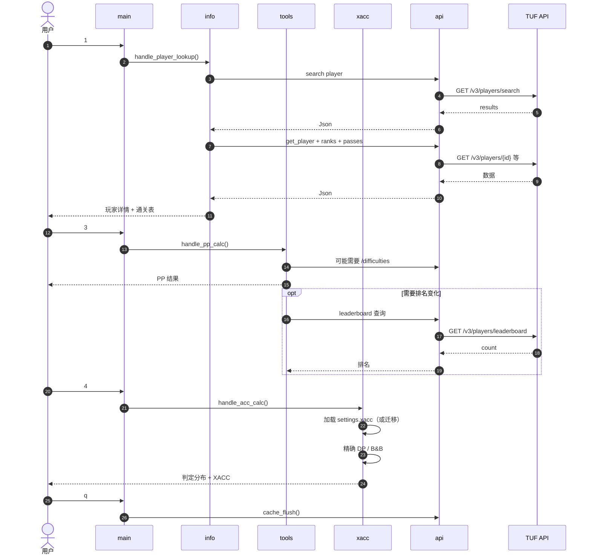

---

## 附录 B：数据文件快速参考

| 文件 | 生成者 | 消费者 | 关键点 |
| --- | --- | --- | --- |
| `settings.json` | `settings_write`（难度库、XACC、预设、legacy 迁移） | `settings_read` | 顶层对象；section 独立；非原子写 |
| `cache.json` | `api.cpp` | `api.cpp` | URL → 响应体；无 TTL；可清空 |
| `*.v1.bak` | `apppaths.cpp::retire_legacy_file` | 人工 | 旧数据备份，不再读取 |
| `build/generated/version.hpp` | CMake | `main.cpp` | 版本/构建时间宏 |
| `build/tuftools[.exe]` | CMake/build 脚本 | 用户 | 最终产物 |

---

*文档结束。若代码行为与本文档不一致，以 commit `969546d` 之后的实际源码为准；建议在修改关键模块（尤其是 `xacc_model` / `xacc_solver` / `apppaths`）时同步更新本文档。*
