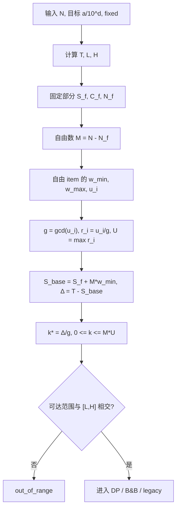
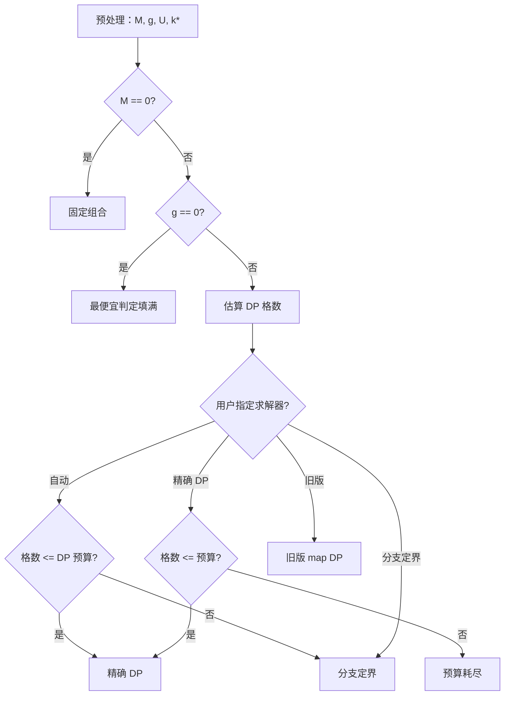
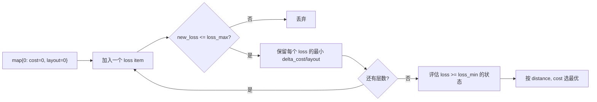
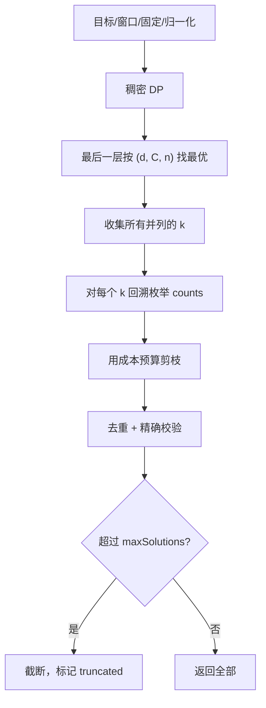

# XACC 反推判定：算法与实现思路

> **主题**：给定目标 XACC，反推出满足目标的判定数量分布。
>
> **重点**：数学模型、目标窗口、整数化、精确 DP、分支定界、旧版 map DP、等效组合枚举、复杂度与正确性。**不讨论**菜单、配置界面、项目结构和调用链。
>
> **约定**：本文用 $N$ 表示物量（判定总数），$\mathcal K$ 表示当前模式的判定键集合，$x_i$ 表示第 $i$ 个判定的数量。公式使用 LaTeX 渲染，算法流程使用 Mermaid。

## 目录

1. [问题陈述](#1-问题陈述)
2. [XACC 的数学模型](#2-xacc-的数学模型)
3. [目标精度与接受窗口](#3-目标精度与接受窗口)
4. [优化目标：如何定义“最优判定分布”](#4-优化目标如何定义最优判定分布)
5. [预处理：把问题化为整数损失](#5-预处理把问题化为整数损失)
6. [算法总览](#6-算法总览)
7. [精确 DP](#7-精确-dp)
8. [分支定界](#8-分支定界)
9. [旧版 map DP](#9-旧版-map-dp)
10. [等效组合枚举](#10-等效组合枚举)
11. [边界条件与正确性](#11-边界条件与正确性)
12. [复杂度与参数敏感性](#12-复杂度与参数敏感性)
13. [实现思路：从输入到判定分布](#13-实现思路从输入到判定分布)
14. [算例集](#14-算例集)
15. [总结与速查](#15-总结与速查)

---

## 1. 问题陈述

### 1.1 输入

| 符号 | 含义 |
| --- | --- |
| $N$ | 物量（所有判定数量之和） |
| $\mathcal K$ | 判定键集合：普通模式 7 键，XPerfect 模式 9 键 |
| $W_i$ | 第 $i$ 个判定的权重（整数单位） |
| $C_i$ | 第 $i$ 个判定的难度系数（整数单位） |
| $s$ | 权重精度 `score_scale`，默认 1000 |
| $c_s$ | 成本精度 `cost_scale`，默认 1000 |
| $A=a/10^d$ | 目标 XACC（百分数），例如 $99.28=9928/10^2$ |
| $f_i$ | 固定的判定数量；未固定的键不参与 fixed 集合 |

要求：

$$
\sum_{i\in\mathcal K} x_i = N,\qquad
x_i=f_i \quad (i \text{ 被固定}),\qquad
x_i\ge 0.
$$

### 1.2 输出

一组整数计数 $x_i$，使得 XACC 尽可能接近目标，并在并列时按第 4 节的优先级选出唯一候选。

### 1.3 为什么反推不唯一

XACC 是一个标量：

$$
\text{XACC}(x)=\frac{100}{Ns}\sum_{i\in\mathcal K}x_iW_i.
$$

但 $x$ 是高维整数向量。即使 XACC 完全相同，也可能有大量组合；因此“反推”本质上是：

> 在一个带约束的整数格点上，先做**最近点搜索**，再做**多级 tie-break**。

---

## 2. XACC 的数学模型

### 2.1 判定权重

普通模式：

| 判定 $i$ | $W_i$ | 权重 $w_i=W_i/s$ |
| --- | ---: | ---: |
| `failMiss` | 0 | 0.00 |
| `tooEarly` | 200 | 0.20 |
| `early` | 400 | 0.40 |
| `ePerfect` | 750 | 0.75 |
| `perfect` | 1000 | 1.00 |
| `lPerfect` | 750 | 0.75 |
| `late` | 400 | 0.40 |

XPerfect 模式把 `perfect` 拆成三个子判定：

| 判定 | $W_i$ | 权重 | 默认 $C_i$ | 成本系数 |
| --- | ---: | ---: | ---: | ---: |
| `+perfect` | 1000 | 1.00 | 10000 | 10.0 |
| `xperfect` | 1000 | 1.00 | 0 | 0.0 |
| `-perfect` | 1000 | 1.00 | 10000 | 10.0 |

XPerfect 模式仍保留 `failMiss/tooEarly/early/ePerfect/lPerfect/late`。

**权重是固定规则，不是可调参数。** 成本只是反推时的偏好，不参与 XACC 计算。

### 2.2 分数单位

定义分数单位和：

$$
S(x)=\sum_{i\in\mathcal K}x_iW_i.
$$

则：

$$
\text{XACC}(x)=\frac{100S(x)}{Ns}\quad(\%).
$$

例如 $N=100$，$x_{\text{perfect}}=99$，$x_{\text{failMiss}}=1$：

$$
S=99\cdot1000+1\cdot0=99000,
\qquad
\text{XACC}=\frac{100\cdot99000}{100\cdot1000}=99.00\%.
$$

### 2.3 成本

定义成本总和：

$$
C(x)=\sum_{i\in\mathcal K}x_iC_i.
$$

成本**不影响** $S$ 或 XACC，只在“分数同样接近目标”的候选之间做选择。

### 2.4 固定与自由

设 fixed 集合为 $\mathcal F$：

$$
N_f=\sum_{i\in\mathcal F}f_i,\qquad
S_f=\sum_{i\in\mathcal F}f_iW_i,\qquad
C_f=\sum_{i\in\mathcal F}f_iC_i.
$$

自由判定数：

$$
M=N-N_f.
$$

固定键不参与自由分配；对于 $i\notin\mathcal F$，令 $y_i=x_i$，则：

$$
\sum_{i\notin\mathcal F}y_i=M.
$$

最终：

$$
S=S_f+\sum_{i\notin\mathcal F}y_iW_i,\qquad
C=C_f+\sum_{i\notin\mathcal F}y_iC_i.
$$

### 2.5 为什么要整数化

如果权重用浮点数保存，正算和反推可能采用不同精度：

- 正算用 `double` 权重；
- 反推为了 DP 可能把权重四舍五入到某个网格；
- 同一个判定分布会得到两个略有差异的 XACC。

为此，整个反推统一使用整数单位：

$$
w_i=\frac{W_i}{s},\qquad c_i=\frac{C_i}{c_s}.
$$

目标也保存为有理数 $a/10^d$，不经过 `double`。所有窗口、距离、成本比较都用 64 位整数；只有 B&B 的启发式下界使用 `long double`，且不参与最终比较。

---

## 3. 目标精度与接受窗口

### 3.1 目标的有理数表示

用户输入 $A\%$，解析成：

$$
A=\frac{a}{10^d},\qquad d\le 6.
$$

例如：

| 输入 | $a$ | $d$ |
| --- | ---: | ---: |
| `99.28` | 9928 | 2 |
| `99.28%` | 9928 | 2 |
| `100` | 100 | 0 |
| `0.00` | 0 | 2 |

解析规则：

- 最多一个小数点；
- 小数位最多 6；
- 不允许符号、指数、字母；
- 去掉前导 0；
- 数值范围 $0\le A\le 100$；
- 不经过浮点数。

### 3.2 最近分数单位

目标中心对应的分数单位：

$$
T=\mathrm{round}\!\left(\frac{aNs}{100\cdot10^d}\right).
$$

`round` 对正数按四舍五入（距离相等时远离 0）。

### 3.3 接受窗口的推导

用户输入 $d$ 位小数，意味着任何四舍五入到 $d$ 位小数后等于 $A$ 的 XACC 都算“命中”。即：

$$
\frac{a-0.5}{10^d}
\le
\frac{100S}{Ns}
<
\frac{a+0.5}{10^d}.
$$

乘以 $Ns/100$：

$$
\frac{(2a-1)Ns}{200\cdot10^d}
\le
S
<
\frac{(2a+1)Ns}{200\cdot10^d}.
$$

因为 $S$ 是整数，得到闭区间：

$$
L=\left\lceil\frac{(2a-1)Ns}{200\cdot10^d}\right\rceil,
\qquad
H=\left\lceil\frac{(2a+1)Ns}{200\cdot10^d}\right\rceil-1.
$$

若 $L<0$，取 $L=0$。如果 $H<L$，说明该精度下不存在任何整数分数单位能打印成目标。

### 3.4 三个关键量

| 量 | 定义 | 用途 |
| --- | --- | --- |
| $T$ | 最近分数单位 | 计算 `distance` |
| $[L,H]$ | 接受窗口 | 判断 `exact` |
| $\lvert S-T\rvert$ | 距离 | 第一级优化目标 |

关系：

$$
\text{exact} \iff L\le S\le H.
$$

- $S=T$ 一定 `exact`，因为 $T\in[L,H]$；
- `exact` 不要求 $S=T$：窗口内可能有多个分数单位；
- 求解器优先让 $S$ 靠近 $T$，所以通常先命中 $T$，但不保证 $T$ 可达。

### 3.5 窗口例子

#### 例 A：$N=100$，目标 $99.00\%$

$$
a=9900,\ d=2,\ s=1000.
$$

$$
T=\mathrm{round}\!\left(\frac{9900\cdot100\cdot1000}{100\cdot100}\right)=99000.
$$

$$
L=\left\lceil\frac{19799\cdot100\cdot1000}{20000}\right\rceil=98995,
\qquad
H=\left\lceil\frac{19801\cdot100\cdot1000}{20000}\right\rceil-1=99004.
$$

窗口 $[98995,99004]$，宽 10 个分数单位。

#### 例 B：$N=3$，目标 $33.33\%$

$$
T=\mathrm{round}\!\left(\frac{3333\cdot3\cdot1000}{10000}\right)=1000.
$$

$$
L=H=1000.
$$

该物量下只有分数 1000 能打印成 $33.33\%$。

#### 例 F：$N=1$，目标 $50.00\%$

$$
T=500,\qquad [L,H]=[500,500].
$$

但单音符可达分数只有 $0,200,400,750,1000$，没有 500，所以只能返回最近值。

### 3.6 精确命中与最近值

求解器并不直接解“是否存在 $S\in[L,H]$”的可行性问题，而是：

1. 先最小化 $\lvert S-T\rvert$；
2. 找到最近可达分数 $S^{*}$；
3. 再用 $L\le S^{*}\le H$ 判断是否 `exact`。

这样做的好处：

- 即使窗口内无解，也能返回“最接近”的可用分布；
- 目标函数连续、可用 DP/B&B 优化；
- `exact` 只是结果属性，不影响搜索方向。

---

## 4. 优化目标：如何定义“最优判定分布”

### 4.1 候选的四元组

每个候选 $x$ 定义：

$$
\Bigl(
d(x),\ C(x),\ n(x),\ \mathrm{lex}(x)
\Bigr),
$$

其中：

$$
d(x)=\lvert S(x)-T\rvert,
$$

$$
C(x)=C_f+\sum_{i\notin\mathcal F}x_iC_i,
$$

$$
n(x)=M-x_{b},
$$

$$
b=\arg\min_{i\notin\mathcal F}(u_i,C_i,\text{key order}).
$$

- $d$：离目标最近的分数单位差；
- $C$：总难度系数；
- $n$：非基准判定数量；
- $\mathrm{lex}$：最终确定性字典序。

### 4.2 字典序比较

$$
x\succ x'
\iff
\begin{cases}
d(x)<d(x'), & \text{否则}\\
C(x)<C(x'), & \text{否则}\\
n(x)<n(x'), & \text{否则}\\
\mathrm{lex}(x)>\mathrm{lex}(x').
\end{cases}
$$

等价地，按四元组从小到大取最小：

$$
\min_{\text{lex}}\bigl(d(x),C(x),n(x),-\mathrm{lex}(x)\bigr).
$$

### 4.3 lex 的定义

按判定键顺序 $\mathcal K=(k_1,k_2,\dots)$ 逐项比较：

$$
\mathrm{lex}(x)>\mathrm{lex}(x')
\iff
\exists j:\ 
x_{k_j}>x'_{k_j}
\ \text{且}\
x_{k_i}=x'_{k_i}\ \forall i<j.
$$

即“靠前的判定数量更多者优先”。这是为了在权重、成本、非基准数都完全相同时，仍然返回一个确定的结果。

### 4.4 成本的作用

成本只在 $d$ 相同的候选之间比较。它**不会**让一个距离更远的组合胜出。

例子：

| 候选 | 分数 | 距离 | 成本 | 结果 |
| --- | ---: | ---: | ---: | --- |
| A | 99000 | 0 | 50000 | 胜出（距离更小） |
| B | 99000 | 0 | 1000 | 若 A/B 同距离，B 胜出 |
| C | 99500 | 500 | 0 | 不会因为成本低而胜出 |

### 4.5 基准判定 $b$ 的选择

$$
b=\arg\min_{i\notin\mathcal F}(u_i,\ C_i,\ \text{key index}).
$$

其中 $u_i=W_i-\min_j W_j$。

- 先选权重最低的判定（$u=0$）；
- 同权重选成本更低；
- 再相同选键顺序靠前。

因此默认普通模式下 $b$ 通常是 `failMiss`（权重 0）。`non_base` 实际统计的是“有多少自由音符不在最低权重判定上”，不是“有多少个非 perfect”。

> 这是第三级 tie-break，只有距离和成本都相同才会影响结果。手工把多个成本调成相同值后，它可能改变分布。

---

## 5. 预处理：把问题化为整数损失

### 5.1 目标

把“搜索 7/9 个整数变量”转化为“搜索一个非负整数损失 $k$”，让每个自由音符的贡献变成可加的步长。

### 5.2 最低可达分

令：

$$
w_{\min}=\min_{i\notin\mathcal F}W_i.
$$

所有自由音符都放在最低权重判定上：

$$
S_{\text{base}}=S_f+M w_{\min}.
$$

这是自由部分能达到的最低分。

定义目标损失：

$$
\Delta=T-S_{\text{base}}.
$$

### 5.3 相对权重与 GCD 归一化

对每个自由 item：

$$
u_i=W_i-w_{\min}\ge0,
$$

$$
g=\gcd_{i\notin\mathcal F}u_i,
\qquad
r_i=\frac{u_i}{g}.
$$

如果所有 $u_i=0$，则 $g=0$，说明所有自由判定权重相同，分数固定，不需要搜索。

否则：

$$
S(x)=S_{\text{base}}+g\sum_{i\notin\mathcal F}x_ir_i.
$$

令：

$$
k=\sum_{i\notin\mathcal F}x_ir_i,
$$

则：

$$
S(k)=S_{\text{base}}+gk.
$$

目标损失对应的归一化值：

$$
k^{*}=\frac{\Delta}{g}
$$

（实际按整数距离比较，不要求整除）。

最大步长：

$$
U=\max_{i\notin\mathcal F}r_i.
$$

所以：

$$
0\le k\le MU.
$$

### 5.4 可达范围

自由部分：

$$
S\in[S_f+M w_{\min},\ S_f+M w_{\max}].
$$

若该区间与 $[L,H]$ 无交集：

$$
S_f+M w_{\max}<L
\quad\text{或}\quad
S_f+M w_{\min}>H,
$$

直接判定 `out_of_range`。

注意：这个检查只保证边界相交，不保证区间内每个分数都可达；通过检查后仍可能无解。

### 5.5 预处理流程



### 5.6 例 A 的预处理表

$N=100$，目标 $99.00\%$，无固定，普通模式：

| $i$ | $W_i$ | $C_i$ | $u_i$ | $r_i=u_i/50$ |
| --- | ---: | ---: | ---: | ---: |
| `failMiss` | 0 | 1000 | 0 | 0 |
| `tooEarly` | 200 | 1500 | 200 | 4 |
| `early` | 400 | 50000 | 400 | 8 |
| `ePerfect` | 750 | 50000 | 750 | 15 |
| `perfect` | 1000 | 0 | 1000 | 20 |
| `lPerfect` | 750 | 50000 | 750 | 15 |
| `late` | 400 | 50000 | 400 | 8 |

$$
w_{\min}=0,\quad g=50,\quad U=20,
$$

$$
S_{\text{base}}=0,\quad \Delta=99000,\quad k^{*}=1980.
$$

解：

$$
x_{\text{perfect}}=99,\quad x_{\text{failMiss}}=1
$$

$$
k=99\cdot20+1\cdot0=1980,
$$

$$
S=0+50\cdot1980=99000.
$$

### 5.7 特殊分支

| 条件 | 结论 |
| --- | --- |
| $M=0$ | 分数完全由固定部分决定；只能判断 `exact`，无法调整 |
| $g=0$ | 所有自由判定权重相同；分数固定；选成本最低的自由判定填满 $M$ |
| 固定总数 $>N$ | 无可行解 |
| $M>0$ 但没有自由 item | 无可行解（所有键都被固定但固定数不足 $N$） |
| 可达范围与窗口无交集 | `out_of_range` |

---

## 6. 算法总览

### 6.1 问题结构

预处理后，问题变成：

$$
\text{选择 } y_i\ge0,\ \sum y_i=M,\ 
\text{使 } k=\sum y_ir_i
\text{ 尽量接近 } k^{*},
$$

然后在并列时最小化成本和非基准数。

这是一个**有界整数线性组合的最近点问题**：

- 变量数少（自由 item 最多 9 个，通常 6–7 个）；
- 每个变量的取值 $0..M$；
- 权值 $r_i$ 是小正整数（默认 $U=20$）；
- 目标是一维的 $k$；
- 还有成本/非基准/字典序的多级 tie-break。

### 6.2 三种算法

| 算法 | 核心思想 | 适用 | 最优性 |
| --- | --- | --- | --- |
| 精确 DP | 按“用了几个音符”和“损失 k”做分层 DP | 状态数可控 | 可证明最优 |
| 分支定界 | 搜索每个 item 的数量，用区间/同余/成本下界剪枝 | 物量大、DP 放不下 | 预算内可证明最优 |
| 旧版 map DP | 以最高权重为基准，按 loss 合并状态 | 对比/回退 | 不保证最优 |

### 6.3 选择逻辑



### 6.4 DP 格数估算

第 $t$ 层的状态数为 $tU+1$，所以：

$$
\text{cells}(M,U)=\sum_{t=1}^{M}(tU+1)
=\frac{U M(M+1)}{2}+M.
$$

如果 `cells` 超过 `maxDpCells`，自动模式改用 B&B；强制精确 DP 则报告预算耗尽。

---

## 7. 精确 DP

### 7.1 状态

设自由 item 集合为 $\mathcal F$，$|\mathcal F|=n$，自由判定数为 $M$。对 $t=0,\dots,M$、$k=0,\dots,tU$，定义：

$$
D_t[k]=\min_{\text{lex}}(c,n)
$$

约束为：

$$
\begin{aligned}
\sum_{i\in\mathcal F}y_i&=t, &\sum_{i\in\mathcal F}y_ir_i&=k,\\
c&=\sum_{i\in\mathcal F}y_iC_i, &n&=\sum_{i\in\mathcal F,\ i\ne b}y_i,\\
y_i&\in\mathbb Z_{\ge0} &&(i\in\mathcal F).
\end{aligned}
$$

其中 $\min_{\text{lex}}$ 先比 $c$，再比 $n$。不可达时记为 $+\infty$。

- $t$：已经用了多少个自由音符；
- $k$：归一化损失；
- $c$：自由部分的成本；
- $n$：非基准判定的数量（每个非 $b$ 音符贡献 1）。

### 7.2 转移

边界：

$$
D_0[0]=(0,0),\qquad D_0[k>0]=\infty.
$$

递推：

$$
D_t[k]=\min_{\substack{i\in\mathcal F\\r_i\le k}}
\bigl(D_{t-1}[k-r_i]+(C_i,\mathbf 1_{i\ne b})\bigr).
$$

直白地说：

> 用 $t$ 个音符达到损失 $k$，可以看成“前 $t-1$ 个音符达到 $k-r_i$，最后放一个 item $i$”。

每个 item 可以使用任意多次；每层恰好增加一个音符。

### 7.3 为什么递推是正确的

**引理 1（最优子结构）**  
若 $D_t[k]$ 的最优序列最后一个音符是 $i$，则它的前 $t-1$ 个音符必须达到 $k-r_i$，且其 $(c,n)$ 不能劣于 $D_{t-1}[k-r_i]$。

证明：如果前缀更差，把前缀换成 $D_{t-1}[k-r_i]$ 对应的序列，仍然合法（同样的 $t-1$ 个音符、同样的损失），并且总成本/非基准数更小或相同，矛盾。$\square$

**引理 2（完备性）**  
对任意合法序列 $y$（$\sum y_i=t,\sum y_ir_i=k$），递推都能构造出对应的路径，因此 $D_t[k]$ 不会漏掉更优解。

证明：对 $t$ 归纳。$t=0$ 只有空序列。$t>0$ 时取序列中任意一个 item $i$ 作为“最后一个”，前缀满足 $t-1,k-r_i$，由归纳假设被 $D_{t-1}$ 覆盖，转移会再次生成该序列。$\square$

**定理 1（DP 的正确性）**  
完成所有层后，$D_M[k]$ 是在“恰好 $M$ 个自由音符、损失 $k$”条件下 $(c,n)$ 字典序最小的候选。

由引理 1 和 2，转移覆盖所有合法序列且保留最优前缀；归纳即得。$\square$

### 7.4 最终选择

对最后一层每个可达 $k$：

$$
S(k)=S_{\text{base}}+gk,
$$

$$
d(k)=\lvert S(k)-T\rvert,
$$

$$
C(k)=C_f+D_M[k].c,
\qquad
n(k)=D_M[k].n.
$$

全局最优候选：

$$
k^{*}=\arg\min_{k}\bigl(d(k),C(k),n(k)\bigr).
$$

- $S(k)\in[L,H]$ 时 `exact=true`；
- 否则 `exact=false`，但 $S(k)$ 仍是最近可达值。

### 7.5 回溯

DP 转移时记录 `choice[t][k]`：到达 $D_t[k]$ 的最后一个 item。回溯：

```text
counts[*] = 0
k = k*
for t = M down to 1:
    i = choice[t][k]
    counts[i] += 1
    k -= r_i
assert k == 0
```

回溯出的 counts 是 DP 保留的那条路径。若多个路径到达同一个 $(t,k)$ 且 $(c,n)$ 相同，DP 只保留其中一个；最终字典序可能需要额外处理（见 7.7）。

### 7.6 状态布局与复杂度

第 $t$ 层宽度为 $tU+1$，所以总状态数：

$$
\text{cells}(M,U)=\sum_{t=1}^{M}(tU+1)
=\frac{UM(M+1)}{2}+M.
$$

转移：

$$
O\left(|\mathcal F|\cdot \sum_{t=1}^{M}(tU+1)\right)
=
O\left(|\mathcal F|\cdot UM^2\right).
$$

空间：

$$
O(UM^2)
$$

个状态，加上 `choice`（与状态同大小）和少量层偏移。

例子：

| $M$ | $U$ | cells |
| ---: | ---: | ---: |
| 3 | 20 | 123 |
| 100 | 20 | 101,100 |
| 1000 | 20 | 10,011,000 |
| 100000 | 20 | $10^{11}$ 量级 |

### 7.7 并列与字典序

最终可能有多个 $k$ 具有完全相同的 $(d,C,n)$。实现会：

1. 扫描最后一层，收集并列的 $k$，最多 `kMaxLexTies = 64` 个；
2. 对每个 $k$ 回溯一条 counts；
3. 用完整四元组（距离、成本、非基准、lex）比较这些 counts，选一个。

两个限制：

- 如果并列的 $k$ 超过 64 个，后面的不会被回溯；
- 每个 $(t,k)$ 只保留一条 $(c,n)$ 最优路径，因此同一个 cell 内因 lex 不同而更优的路径不会被保留。

结论：**DP 对 $(d,C,n)$ 是最优的；对最终 lex 只是有限近似。** 需要严格 lex 的场合，B&B 直接对 counts 调用比较函数，通常更可靠。

### 7.8 伪代码

```text
function solve_dp(M, items, k_target, maxCells):
    cells = sum_{t=1..M} (t*U + 1)
    if cells > maxCells: return BUDGET_EXHAUSTED

    D_prev = array(1) with D_prev[0] = (0, 0)
    choice = array(cells)

    for t in 1..M:
        width = t*U + 1
        D_cur = array(width) init INF
        for i in items:
            step = r_i
            for k in 0..len(D_prev)-1:
                if D_prev[k] is INF: continue
                if k + step >= width: continue
                cand = D_prev[k] + (C_i, i != b)
                if lex_less(cand, D_cur[k+step]):
                    D_cur[k+step] = cand
                    choice[offset[t] + k+step] = i
        D_prev = D_cur

    best = None
    for k in 0..(M*U):
        if D_prev[k] is INF: continue
        score = S_base + g*k
        cand = (abs(score - T), C_f + D_prev[k].c, D_prev[k].n)
        if best is None or lex_less(cand, best):
            best = cand; best_k = k

    counts = backtrack(choice, best_k)
    return candidate(best, counts)
```

### 7.9 例 A 的 DP 解

$M=100,U=20$，总格数 101100。目标：

$$
k^{*}=\frac{99000}{50}=1980.
$$

一个合法解：

$$
y_{\text{perfect}}=99,\quad y_{\text{failMiss}}=1,
$$

$$
k=99\cdot20+1\cdot0=1980,
$$

$$
S=0+50\cdot1980=99000,
$$

$$
d=0,\quad C=1000,\quad n=100-1=99.
$$

### 7.10 例 B 的小规模 DP

$N=3$，目标 $33.33\%$：

$$
T=1000,\ [L,H]=[1000,1000],\quad
M=3,\ g=50,\ U=20,\ k^{*}=20.
$$

目标 $k=20$ 可以由：

$$
y_{\text{perfect}}=1,\quad y_{\text{failMiss}}=2,
$$

得到：

$$
k=1\cdot20+2\cdot0=20,
\qquad
S=50\cdot20=1000,
\qquad
C=1\cdot0+2\cdot1000=2000.
$$

该物量下 $D_3[20]$ 的最小成本就是 2000。

---

## 8. 分支定界

### 8.1 搜索树

对自由 item 排序后，依次决定每个 item 的数量。第 $p$ 层选择 $z_p$，满足：

$$
0\le z_p\le R,
$$

其中 $R$ 是剩余音符数。到最后一个 item 时，$z_{\text{last}}=R$，形成一个完整解。

DFS 状态：

$$
(p,\ R,\ a,\ c,\ n),
$$

其中：

- $p$：当前 item 下标（排序后）；
- $R$：还剩多少个音符没分配；
- $a=\sum_{q<p}z_qr_q$：累计归一化损失；
- $c=\sum_{q<p}z_qC_q+C_f$：累计成本；
- $n$：累计非基准数。

叶子：

$$
k=a+z_{\text{last}}r_{\text{last}},
$$

$$
S=S_{\text{base}}+gk,
$$

$$
d=\lvert S-T\rvert.
$$

用四元组更新 incumbent。

### 8.2 分支顺序

item 按以下顺序排序：

1. $r_i$ 降序；
2. $C_i$ 升序；
3. 键顺序。

目的：

- 大步长优先，快速接近目标；
- 同一步长下成本低的优先，尽早得到低成本 incumbent；
- 让搜索树尽早出现好解，增强后续剪枝。

### 8.3 初始上界：单类型与双类型

在 DFS 前先构造一个可行 incumbent：

#### 单类型

对每个 item $i$，尝试：

$$
z_i=M,
$$

即全部自由音符给同一个 item。

#### 双类型闭式解

对每一对 item $(i,j)$，假设只使用这两种，且：

$$
z_i+z_j=M.
$$

希望：

$$
z_ir_i+z_jr_j\approx k^{*}.
$$

代入 $z_j=M-z_i$：

$$
z_ir_i+(M-z_i)r_j=k^{*}
$$

$$
z_i=\frac{k^{*}-Mr_j}{r_i-r_j}.
$$

取最近整数以及 $\pm2$ 的邻域，生成候选。若 $r_i=r_j$，可以用 $M/2$ 作为启发。

这些候选不保证最优，但能提供一个不错的上界，让 B&B 的剪枝从第一个节点就有效。

### 8.4 下界 1：区间 + 同余

设当前在位置 $p$，剩余 item 集合为 $\mathcal S_p$。剩余 $R$ 个音符能产生的归一化损失增量集合：

$$
\mathcal R_p=\{\sum_{i\in\mathcal S_p}z_ir_i\mid\sum z_i=R,\ z_i\ge0\}.
$$

它一定满足：

$$
R\,r_{\min}\le \sum z_ir_i\le R\,r_{\max},
$$

其中：

$$
r_{\min}=\min_{i\in\mathcal S_p}r_i,\qquad
r_{\max}=\max_{i\in\mathcal S_p}r_i.
$$

并且：

$$
\sum z_ir_i\equiv 0\pmod{g_p},
\qquad
g_p=\gcd_{i\in\mathcal S_p}r_i.
$$

因此最终的 $k$ 一定落在：

$$
[a+Rr_{\min},\ a+Rr_{\max}]
$$

且：

$$
k\equiv a\pmod{g_p}.
$$

记这个“区间 + 同余”集合为 $\mathcal B_p$。定义：

$$
\delta_p=\min_{k\in\mathcal B_p}\lvert gk-\Delta\rvert.
$$

若：

$$
\delta_p > d_{\text{incumbent}},
$$

则当前子树不可能改进 incumbent，剪枝。

实现上 `branch_distance` 会：

- 找区间内第一个/最后一个满足同余的值；
- 在目标附近检查 `middle-1, middle, middle+1`；
- 找不到合法值时返回一个很大的距离。

### 8.5 下界 2：LP 成本下界

当：

$$
\delta_p=0
\quad\text{且}\quad
d_{\text{incumbent}}=0
$$

时，分数已经无法区分候选，必须比较成本。此时用线性松弛估计剩余音符的最低成本。

#### 单类型

若某个 item 的步长能“整除”剩余目标：

$$
R\,r_i=\text{needed}_r,
$$

则成本：

$$
R\,C_i.
$$

#### 双类型

假设只用 $i,j$，满足：

$$
z_ir_i+z_jr_j=\text{needed}_r,
\qquad
z_i+z_j=R.
$$

解线性方程：

$$
z_i=\frac{\text{needed}_r-Rr_j}{r_i-r_j},
\qquad
z_j=R-z_i.
$$

若 $z_i,z_j\ge0$，成本：

$$
z_iC_i+z_jC_j.
$$

取所有单类型/双类型组合的最小值作为下界。若：

$$
c+\text{bound}>C_{\text{incumbent}},
$$

剪枝。

> 这是**下界**：只用一两种类型做线性松弛，得到的最小成本不会高于真实整数解的成本。找不到可行组合时不剪枝。

### 8.6 下界 3：当前 item 的数量上下界

设当前 item 为 $i$，选 $z$ 个，剩余 $R-z$ 个音符。未来损失范围：

$$
L(z)=a+zr_i+(R-z)r_{\min}^{\text{next}},
$$

$$
H(z)=a+zr_i+(R-z)r_{\max}^{\text{next}}.
$$

为了有机会击败/追平当前最优距离 $D$（单位是分数单位），最终分数必须满足：

$$
\lvert gk-\Delta\rvert\le D.
$$

等价地：

$$
\frac{\Delta-D}{g}\le k\le\frac{\Delta+D}{g}.
$$

因此需要：

$$
gL(z)\le\Delta+D,
$$

$$
gH(z)\ge\Delta-D.
$$

这两个不等式都是 $z$ 的线性不等式，可以解出：

$$
z_{\text{low}}\le z\le z_{\text{high}}.
$$

然后只枚举这个区间内的 $z$。

### 8.7 支配关系

键：

$$
(p,\ R,\ a).
$$

理由：在同一个位置、剩余同样多音符、累计损失相同的情况下，后面的可选 item 和约束完全一样；未来的 $(c,n)$ 增量只取决于这条路径。

若之前以：

$$
c'\le c,\qquad n'\le n
$$

访问过同一个键，则当前路径不可能产生更好的最终候选，剪枝。

实现使用一个哈希/有序表保存每个键见过的最小 `(cost, non_base)`；表有容量上限，满了以后只做已有键的剪枝。

### 8.8 分支枚举顺序

在当前 item 的可行区间 $[z_{\text{low}},z_{\text{high}}]$ 内，优先尝试闭式中心：

$$
z_0=\mathrm{round}\left(\frac{k^{*}-a}{r_i}\right),
$$

再向两侧扩展：

$$
z_0,\ z_0-1,\ z_0+1,\ z_0-2,\ z_0+2,\dots
$$

这样更早得到好 incumbent，使区间/LP 剪枝更有效。

### 8.9 预算与终止

- 节点预算：访问节点数超过 `maxNodes` → 标记预算耗尽；
- 时间预算：每 1024 个节点检查一次，超过 `maxSeconds` → 标记预算耗尽；
- 预算耗尽后：
  - 若已有 incumbent，返回它，并标记 `optimal=false`；
  - 若没有 incumbent，返回 `budget_exhausted`。

### 8.10 正确性

**命题 1（支配剪枝安全）**  
若同一键 $(p,R,a)$ 之前以 $c'\le c,n'\le n$ 访问过，则当前路径被支配。

证明：两条路径的剩余子问题完全相同；任何从当前路径能到达的最终解，都可以把前缀换成更便宜/非基准更少的前缀，得到不劣的最终候选。$\square$

**命题 2（区间/同余剪枝安全）**  
若 $\delta_p>d_{\text{incumbent}}$，则当前子树不可能改进 incumbent。

证明：子树的最终 $k$ 必在 $\mathcal B_p$ 中；由 $\delta_p$ 的定义，$\mathcal B_p$ 中任何 $k$ 的加权距离 $\lvert gk-\Delta\rvert$ 都大于 incumbent，子树任何叶子的距离都更大。$\square$

**命题 3（数量边界安全）**  
若 $z$ 不满足 $gL(z)\le \Delta+D$ 或 $gH(z)\ge \Delta-D$，则该分支不可能产生距离不超过 $D$ 的叶子。

证明：未来损失被 $[L(z),H(z)]$ 包含；若整个区间都在目标半径之外，叶子距离必然大于 $D$。$\square$

**定理 2（B&B 最优性）**  
若搜索在未耗尽预算的情况下穷尽，则返回的 incumbent 是全局最优；若预算耗尽，返回的 incumbent 是已找到的最好解，但不保证最优。

由命题 1–3，所有被剪掉的子树都不含更优解；未剪掉的子树被完整枚举；因此穷尽时 incumbent 必为全局最优。预算耗尽时只保证 incumbent 可行。$\square$

### 8.11 复杂度

- 最坏情况：指数级，节点数上界接近“把 $M$ 个相同球放入 $n$ 个盒子”的组合数；
- 实际由目标窗口、item 顺序、初始上界和剪枝决定；
- 支配表最多保存有限项，内存可控但可能削弱剪枝；
- 时间预算是软约束（每 1024 节点检查一次）。

### 8.12 例 A 的 B&B 轨迹

$N=100$，目标 $99.00\%$，普通模式。实测统计：

```text
分支顺序:
  perfect(r=20,cost=0)
  ePerfect(r=15,cost=50000)
  lPerfect(r=15,cost=50000)
  early(r=8,cost=50000)
  late(r=8,cost=50000)
  tooEarly(r=4,cost=1500)
  failMiss(r=0,cost=1000)

初始上界: distance=0, cost=1000
搜索空间穷尽: nodes=22, pruned=10, incumbent_updates=6
最终: failMiss=1, perfect=99
```

为什么节点这么少？

- 双类型闭式解已经给出距离 0、成本 1000 的 incumbent；
- 目标窗口很窄，区间/同余下界很快排除大量分支；
- 成本下界在距离 0 时进一步排除更贵的同距离解。

---

## 9. 旧版 map DP

### 9.1 与精确 DP 的定位差异

旧版 map DP 是保留的近似算法：

- 以**最高权重**判定为 base（精确 DP 以最低权重为 base）；
- 按原始 loss 合并状态；
- 每个 loss 只保留成本最低的一种 layout；
- 只比较 distance 和 cost，不使用 non_base/lex；
- 窗口额外放宽；
- 不保证全局最优。

### 9.2 构造

选择：

$$
b=\arg\max_{i\notin\mathcal F}W_i
$$

同权重取 $C_i$ 更低者。

对每个其他 item：

$$
\ell_i=W_b-W_i>0,
\qquad
\delta_i=C_i-C_b.
$$

同一个 $\ell$ 只保留 $\delta$ 最小的 item，得到 `loss_items`。

基准总分：

$$
S_0=S_f+M W_b.
$$

理想损失：

$$
I=S_0-T.
$$

### 9.3 放宽的损失窗口

定义：

$$
h_{\text{exact}}=\left\lceil\frac{Ns}{200\cdot10^d}\right\rceil,
$$

$$
\text{slack}=0.4s,
\qquad
\text{cap}=\frac{4096s}{20},
$$

$$
h=\min\bigl(\max(h_{\text{exact}},\text{slack}),\text{cap}\bigr).
$$

损失窗口：

$$
\ell_{\min}=\max(0,\ S_0-(T+h)),
$$

$$
\ell_{\max}=S_0-(T-h).
$$

若 $\ell_{\max}<0$，判定不可达。

默认 $s=1000$ 时，`slack=400`，`cap=204800`。注意 `slack` 是**固定分数单位**，不是固定百分点；折合百分点为：

$$
\Delta\%=\frac{100\cdot\text{slack}}{Ns}.
$$

例如 $N=100$ 时约 $0.4$ 个百分点；$N=3$ 时约 $13.3$ 个百分点。

### 9.4 逐层 DP

状态：

$$
\text{map}[\ell]=(\delta_{\text{cost}},\ \text{layout}),
$$

表示用若干次替换达到损失 $\ell$ 时，相对 base 的最小成本增量和对应替换次数。

初始化：

$$
\text{map}[0]=(0,\vec0).
$$

每层选择一个 loss item 加进去：

$$
\ell'=\ell+\ell_i,
$$

$$
\delta'=\delta+\delta_i.
$$

只保留 $\ell'\le\ell_{\max}$ 的状态；同一个 $\ell'$ 只保留 $\delta'$ 最小的 layout。

对每层中 $\ell\ge\ell_{\min}$ 的状态评估候选：

$$
C=C_f+M C_b+\delta,
$$

$$
d=\lvert \ell-I\rvert,
$$

$$
\text{counts}=\text{layout}+(M-\text{used})\cdot\mathbf e_b.
$$

按 `(distance, cost)` 选最优（没有 non_base/lex）。



### 9.5 为什么不是全局最优

1. 每个 loss 只保留一个最低成本 layout，丢弃了 non_base 不同但成本相同的路径；
2. 不比较 non_base，也不做最终 lex；
3. 窗口比精确窗口宽，可能接受更远的点；
4. 状态数上限会截断搜索。

### 9.6 例 A 的 legacy 轨迹

$N=100$，目标 $99.00\%$：

```text
base = perfect（最高权重 1000，成本 0）
loss_items:
  ePerfect: loss=250, delta=50000
  early:    loss=600, delta=50000
  tooEarly: loss=800, delta=1500
  failMiss: loss=1000, delta=1000
（同一 loss 的 lPerfect/late 被合并）

half:
  half_exact = 5
  slack = 400
  cap = 204800
  half = 400

loss 窗口: [600, 1400]
对应分数: [98600, 99400]
对应 XACC: [98.6%, 99.4%]

最终: failMiss=1, perfect=99
distance=0, cost=1000, states=1
```

这个输入下它恰好找到了与精确 DP 相同的解；但这是巧合，不是保证。

---

## 10. 等效组合枚举

### 10.1 什么是“等效”

两个判定分布 $x,x'$ 称为**并列最优**，如果：

$$
d(x)=d(x'),\qquad C(x)=C(x'),\qquad n(x)=n(x').
$$

它们有相同的分数距离、相同的总成本、相同的非基准数；在输出层面通常可互换。

反推只返回其中一个（再用 lex 决胜）。等效组合枚举返回所有并列候选。

### 10.2 算法

1. 用与精确 DP 相同的窗口/目标单位/归一化方式；
2. 用稠密 DP 计算最后一层每个 $k$ 的最小 $(c,n)$；
3. 扫描最后一层，找出所有在 $(d,C,n)$ 上与全局最优并列的 $k$，记为 $K_{\text{tie}}$；
4. 对每个 $k\in K_{\text{tie}}$，回溯枚举所有能到达 $k$ 的计数向量；
5. 对每个计数向量重新计算完整 $(d,C,n)$，只保留与最优完全一致的；
6. 去重，最多输出 `maxSolutions` 个。



### 10.3 回溯枚举

精确 DP 的 `choice` 只保存一条路径；等效枚举需要枚举多条路径，因此使用单独的递归：

```text
collect(layer, k, spent, current):
    if output >= cap: return
    if spent > best_cost: return
    if k < 0 or k > layer * U: return
    if layer == 0:
        if k == 0 and spent == best_cost:
            output.push(current)
        return
    for item i in order (cost asc, key asc):
        if k < r_i: continue
        current[i] += 1
        collect(layer-1, k-r_i, spent+C_i, current)
        current[i] -= 1
```

- 从最后一层往前推；
- 每层选一个 item；
- 用 `best_cost` 作为总成本上界；
- 用 `k > layer*U` 做可行性剪枝；
- 回溯出的计数向量可能重复（不同顺序），最后用集合去重。

### 10.4 固定数量的语义差异（算法层面）

`xacc_equivalents` 在构造 item 时**包含所有判定键**，而普通反推会排除固定键。这意味着：

- 固定键的固定数量进入 $S_f,C_f$，但自由音符仍可被分配到固定键上；
- 结果中某个“固定”判定的数量可能超过用户输入值；
- 从算法上说，它把固定数量当成了**下界**，而不是硬约束。

实际例子（$N=100$，目标 $100.00\%$，固定 `perfect=99`，普通模式）：

反推：

```text
固定 perfect=99 → 自由 1 个音符
自由部分最高只能到 ePerfect/lPerfect = 0.75
可达范围 = 99.00% ~ 99.75%
目标窗口 100.00% 无交集 → out_of_range
```

等效枚举：

```text
items 包含 perfect（虽然它被固定了）
自由 1 个音符可以继续给 perfect
→ perfect=100, XACC=100.00%, distance=0
```

所以两者对“固定”的解释不同。使用时必须明确：**等效组合的固定值是下界，不是锁定值。**

### 10.5 并列 k 与输出分数

实现把 `out.score_units` 设为 `K_tie` 中第一个 $k$ 对应的分数。如果两个并列 $k$ 分别位于目标两侧：

$$
S_1=T-\delta,\qquad S_2=T+\delta,
$$

它们距离相同，但实际 XACC 不同。此时 solutions 中可能包含不同 XACC 的组合；输出的“共同 XACC”只对应第一个 $k$。

### 10.6 复杂度

- 主 DP 与精确 DP 相同：$O(|\mathcal K|UM^2)$ 时间、$O(UM^2)$ 空间；
- 回溯最坏情况是指数级的组合枚举，但被以下条件限制：
  - 只枚举最后并列的 $k$；
  - 成本不超过 `best_cost`；
  - 最多 `maxSolutions` 个输出；
- 只使用 DP 预算，没有 B&B 回退；物量大时可能直接 `budget_exhausted`。

---

## 11. 边界条件与正确性

### 11.1 输入边界

| 条件 | 结果 |
| --- | --- |
| $N<0$ | 无意义；输入无效 |
| 固定数量为负 | 输入无效 |
| 固定键不属于当前模式 | 输入无效 |
| 固定总数 $>N$ | 无可行解 |
| $M>0$ 但没有自由 item | 无可行解 |
| $M=0$ | 固定组合；只判断 `exact` |
| $g=0$ | 分数固定；选成本最低的自由判定 |
| 可达范围与 $[L,H]$ 无交集 | `out_of_range` |
| 可达范围相交但无组合命中 | `unreachable` |
| 目标窗口 $H<L$ | 该精度下不存在可打印的分数单位 |

### 11.2 目标边界

- $A=0$：$T=0$，$L$ 截到 0；窗口通常在 0 附近。
- $A=100$：$T=Ns$，窗口上界可能被 $Ns$ 限制；注意 $d=0$ 时窗口很宽（例如 $N=100$ 时 $99.5\%$ 也算“100%”）。
- $d$ 越大，窗口越窄，越容易出现 `exact=false`；但状态数与 $d$ 无关。
- $d>6$ 被拒绝。
- 目标解析不接受符号，因此负目标在输入阶段就被拒绝。

### 11.3 精确性、近似性与预算

三个独立属性：

| 属性 | 含义 | 谁决定 |
| --- | --- | --- |
| `exact` | $S\in[L,H]$ | 目标精度、物量、模型 |
| `optimal` | 搜索是否在预算内完成 | 求解器、预算 |
| `distance` | $\lvert S-T\rvert$ | 搜索目标 |

可能出现：

- 精确但未证明最优（预算截断，恰好命中）；
- 已证明最优但不精确（该物量下无解）；
- 两者都否（预算截断 + 最近值）。

### 11.4 算法正确性总结

| 算法 | 保证 |
| --- | --- |
| 精确 DP | 完成时 $(d,C,n)$ 全局最优；lex 受 64 个并列 cell 和单路径存储限制 |
| 分支定界 | 未耗尽预算时 $(d,C,n,\text{lex})$ 全局最优；耗尽时只保证 incumbent 可行 |
| 旧版 map DP | 不保证全局最优；只按 $(d,C)$ 选解 |
| 等效枚举 | 基于同一 DP 的并列 cell；固定数量语义与反推不同；输出可能截断 |

### 11.5 需要特别注意的实现细节

1. **成本只是 tie-break**：成本再低也不能让距离更大的解胜出。
2. **`non_base` 的基准是最低权重判定**：默认模型下是 `failMiss`，不是 `perfect`；它只在距离和成本都相同时起作用。
3. **固定 0 是锁定 0**：空输入才表示“不固定”。
4. **XPerfect 模式的 `xperfect` 默认成本为 0**：同为 perfect 权重时，搜索会倾向于它；改成本可以改变分布，但不改变 XACC。
5. **legacy 窗口比精确窗口宽**：它可能接受目标附近更远的解，最终 `exact` 仍按精确窗口判断。
6. **DP 的 lex 是近似的**：每个 cell 只保留一条 $(c,n)$ 最优路径；最终只回溯最多 64 个并列 $k$。
7. **B&B 的支配表有容量上限**：满了以后剪枝变弱，但不会破坏正确性。
8. **B&B 的节点/时间预算可能略微超出**：节点检查在入口，时间每 1024 节点检查一次。
9. **有符号溢出**：目标窗口、DP 成本、B&B 的某些乘法/减法需要 checked 算术；B&B 叶子的 `remaining * r_last` 在实现中没有 checked，极端输入需注意。
10. **`score_scale` 必须能精确表示固定权重**：默认 1000 能表示 0.2/0.4/0.75/1.0；改成别的值要保证所有 $W_i$ 仍是整数且语义一致。
11. **GCD 实现**：不要依赖 GCC 扩展 `std::__gcd`；应使用标准 `std::gcd` 或自行实现的 `gcd_i64`，否则 MSVC/libc++ 构建可能不可用。

---

## 12. 复杂度与参数敏感性

### 12.1 精确 DP

$$
\text{time}=O\left(|\mathcal F|\cdot UM^2\right),
\qquad
\text{space}=O(UM^2).
$$

- $M$ 的影响是平方级；
- $U=\max_i (W_i-w_{\min})/g$ 影响线性；
- $g$ 越大，$U$ 越小，状态越少；
- 固定更多判定会减小 $M$，通常能显著缩小 DP，但可能让目标不可达。

例子：

| $M$ | $U$ | cells | 备注 |
| ---: | ---: | ---: | --- |
| 3 | 20 | 123 | 极小 |
| 100 | 20 | 101,100 | 默认 8M 预算内 |
| 1000 | 20 | 10,011,000 | 超过默认 8M |
| 100000 | 20 | $10^{11}$ 量级 | 必须 B&B 或不可行 |

### 12.2 分支定界

- 最坏情况指数级；
- 实际节点数受目标窗口、分支顺序、初始上界、区间/同余剪枝、LP 成本剪枝影响；
- 支配表容量有限，内存可控；
- 时间预算每 1024 节点检查一次；
- 适合 $M$ 大、DP 放不下的情况，但可能需要调大预算。

### 12.3 旧版 map DP

- 每层状态数受 loss 窗口和 `loss_items` 数量影响；
- 每个状态保存一个 layout vector，内存开销大；
- 状态上限固定，约 2,000,000；
- 不适合作为大规模默认算法。

### 12.4 参数如何影响难度

| 参数 | 增大的影响 |
| --- | --- |
| $N$ | DP 状态平方增长；B&B 组合数增长 |
| $U$ | DP 状态线性增长 |
| 自由 item 数 | 每层转移数线性增长 |
| 目标小数位 $d$ | 窗口变窄，`exact` 更严格；状态数不变 |
| 固定判定数 | $M$ 减小，状态减少；但可能不可达 |
| 成本差异 | 影响 tie-break 与 B&B 成本剪枝，不影响距离 |

### 12.5 算法选择建议

| 场景 | 建议 |
| --- | --- |
| 小物量，要求可证明最优 | 精确 DP |
| 大物量，接受“预算内最优” | 分支定界 |
| 只想快速得到可行近似 | 旧版 map DP（注意不保证最优） |
| 需要所有并列组合 | 等效枚举（只用 DP，物量大可能超预算） |
| 固定很多判定 | 先看 $M$ 是否足够小，再选 DP/B&B |

---

## 13. 实现思路：从输入到判定分布

这一节讨论**算法的实现顺序与整数细节**，不涉及 UI/配置。

### 13.1 总体流水线

```text
1. 解析目标 A = a / 10^d（有理数，不经过 double）
2. 计算 T, L, H
3. 拆分 fixed/free，得到 S_f, C_f, M
4. 计算自由 item 的 w_min, w_max, u_i, g, r_i, U
5. 计算 S_base, Δ, k*
6. 检查可达范围是否与 [L,H] 相交
7. 选择算法：DP / B&B / legacy
8. 搜索最优 k / counts
9. 回溯 counts，计算 S, d, C, n
10. 判定 exact，返回结果
```

### 13.2 整数实现

- 权重、成本、目标、窗口、距离、成本比较全部用 `int64`；
- 目标用 `numerator / 10^decimals`，解析时做 checked 乘加；
- 窗口公式使用 checked 乘法，溢出时返回输入无效；
- DP 的 `cost` 累加、`k` 乘法、分数加法使用 checked；
- B&B 大部分边界使用 checked，但叶子乘法等位置仍有未检查的运算（见 11.5）。

### 13.3 数据结构

| 结构 | 用途 |
| --- | --- |
| `offsets[t]` | 第 t 层在扁平数组中的起点 |
| `D_prev`, `D_cur` | 仅保留上一层/当前层，滚动数组 |
| `choice` | 记录每个 cell 的最后 item，用于回溯 |
| suffix min/max/gcd | B&B 的区间/同余下界 |
| 支配表 | `(position, remaining, accumulated_r)` → `(cost, non_base)` |
| `std::map<loss, State>` | legacy 的按 loss 合并 |
| set/vector | 等效枚举去重 |

### 13.4 确定性

为了让同一输入在不同运行/不同算法下尽量给出相同结果：

- 四元组比较严格定义；
- DP 的 `entry_less` 先 cost 后 non_base；
- 最终用 lex 对判定键顺序做确定性决胜；
- B&B 的分支顺序固定（r 降序、cost 升序、键序）；
- 等效枚举按 cost/key 顺序回溯并去重。

---

## 14. 算例集

> 以下均为普通模式、默认权重/成本、无特殊设置。算法输出可能因成本配置不同而变化；这里用默认值。

### 14.1 例 A：$N=100$，目标 $99.00\%$

**窗口**：

$$
T=99000,\qquad [L,H]=[98995,99004].
$$

**归一化**：

$$
w_{\min}=0,\quad g=50,\quad U=20,\quad S_{\text{base}}=0,\quad \Delta=99000,\quad k^{*}=1980.
$$

**DP 规模**：

$$
\sum_{t=1}^{100}(20t+1)=101100.
$$

**最优解**：

$$
x_{\text{perfect}}=99,\quad x_{\text{failMiss}}=1.
$$

$$
S=99000,\quad d=0,\quad C=1000,\quad n=99,\quad \text{exact}=true.
$$

**B&B 轨迹**：

```text
initial incumbent: distance=0, cost=1000
branch order: perfect(20,0), ePerfect(15,50000), lPerfect(15,50000),
              early(8,50000), late(8,50000), tooEarly(4,1500), failMiss(0,1000)
nodes=22, pruned=10, incumbent_updates=6
```

**legacy**：

```text
base=perfect, loss window=[600,1400] → scores [98600,99400]
result: failMiss=1, perfect=99, distance=0, cost=1000
```

### 14.2 例 B：$N=3$，目标 $33.33\%$

$$
T=1000,\quad [L,H]=[1000,1000],\quad k^{*}=20.
$$

**最优解**：

$$
x_{\text{perfect}}=1,\quad x_{\text{failMiss}}=2.
$$

$$
S=1000,\quad d=0,\quad C=2000,\quad \text{exact}=true.
$$

实际 XACC 为 $33.333333...\%$，比输入精度更精确；窗口判断仍然精确命中。

### 14.3 例 F：$N=1$，目标 $50.00\%$

$$
T=500,\quad [L,H]=[500,500].
$$

单音符候选：

| 判定 | $S$ | 距离 | 成本 |
| --- | ---: | ---: | ---: |
| `failMiss` | 0 | 500 | 1000 |
| `tooEarly` | 200 | 300 | 1500 |
| `early` | 400 | 100 | 50000 |
| `late` | 400 | 100 | 50000 |
| `ePerfect` | 750 | 250 | 50000 |
| `lPerfect` | 750 | 250 | 50000 |
| `perfect` | 1000 | 500 | 0 |

最近距离是 100，`early` 和 `late` 并列；两者成本、non_base 也相同，最终 lex 选择键序更靠前的 `early`。

$$
\text{exact}=false,\qquad d=100,\qquad C=50000.
$$

### 14.4 固定 `perfect=99`，目标 $100.00\%$，$N=100$

固定部分：

$$
S_f=99000,\qquad C_f=0,\qquad M=1.
$$

自由 item 排除 `perfect`，最高权重是 `ePerfect/lPerfect=750`：

$$
S\in[99000,99750]
\quad\Longrightarrow\quad
\text{XACC}\in[99.00\%,99.75\%].
$$

目标窗口：

$$
T=100000,\qquad [L,H]=[99995,100004].
$$

无交集 → `out_of_range`。

这体现了固定数量的硬约束：反推不会把自由音符加到已被固定的 `perfect` 上。

### 14.5 同一输入的等效枚举

等效枚举把 `perfect` 也放进 item 集合，自由 1 个音符可以继续给 `perfect`：

$$
x_{\text{perfect}}=100,\qquad S=100000,\qquad d=0.
$$

所以它返回 `perfect=100`，与反推的 `out_of_range` 不同。原因见 10.4。

### 14.6 例 A 下的不同算法

| 算法 | 结果 counts | $d$ | 成本 | 备注 |
| --- | --- | ---: | ---: | --- |
| 精确 DP | `perfect=99, failMiss=1` | 0 | 1000 | cells=101100 |
| B&B | 同上 | 0 | 1000 | nodes=22, pruned=10 |
| legacy | 同上 | 0 | 1000 | 窗口更宽，不保证最优 |

---

## 15. 总结与速查

### 15.1 核心公式

$$
\text{XACC}=\frac{100}{Ns}\sum_i x_iW_i.
$$

$$
T=\mathrm{round}\left(\frac{aNs}{100\cdot10^d}\right).
$$

$$
L=\left\lceil\frac{(2a-1)Ns}{200\cdot10^d}\right\rceil,
\qquad
H=\left\lceil\frac{(2a+1)Ns}{200\cdot10^d}\right\rceil-1.
$$

$$
u_i=W_i-w_{\min},\quad
g=\gcd u_i,\quad
r_i=u_i/g,\quad
S=S_{\text{base}}+gk.
$$

$$
\text{objective}=\min_{\text{lex}}\bigl(|S-T|,\ C_f+\sum y_iC_i,\ M-y_b,\ -\mathrm{lex}(y)\bigr).
$$

### 15.2 算法对照

| 问题 | 答案 |
| --- | --- |
| 为什么不能直接反解？ | XACC 是标量，判定分布是多维，解不唯一 |
| 最近点是什么？ | $T$，由目标、物量、精度决定 |
| `exact` 是什么？ | $S\in[L,H]$，不要求 $S=T$ |
| 成本影响什么？ | 只在距离相同时影响选择 |
| 精确 DP 的状态？ | $D_t[k]$：t 个音符达到归一化损失 k 的最小 $(c,n)$ |
| DP 复杂度？ | $O(n_{\text{items}}UM^2)$ 时间，$O(UM^2)$ 空间 |
| B&B 的剪枝？ | 区间/同余、LP 成本、数量边界、支配表、预算 |
| legacy 为什么不准？ | 每 loss 只留最低成本 layout；只比 distance/cost；窗口更宽 |
| 等效组合有什么坑？ | 固定数量被当成下界；并列 k 可能对应不同 XACC；输出可能截断 |
| 固定 0 是什么意思？ | 锁定为 0；空输入才是不固定 |
| 什么时候用 B&B？ | DP 格数超过预算，或物量大 |
| 什么时候会不最优？ | 预算耗尽（B&B）、legacy、DP 的 lex 限制 |

### 15.3 一句话总结

> XACC 反推 = 把目标精度转成整数窗口，用 GCD 归一化成损失格点，再做最近点搜索；DP 保证 $(d,C,n)$ 最优，B&B 在大规模下用下界剪枝，legacy 只作近似对比；最后用成本、非基准数和字典序把多解收束成一个。

---

*本文聚焦 XACC 反推的算法与实现思路；项目整体结构、菜单、配置与网络层见 [doc.md](doc.md)。*


